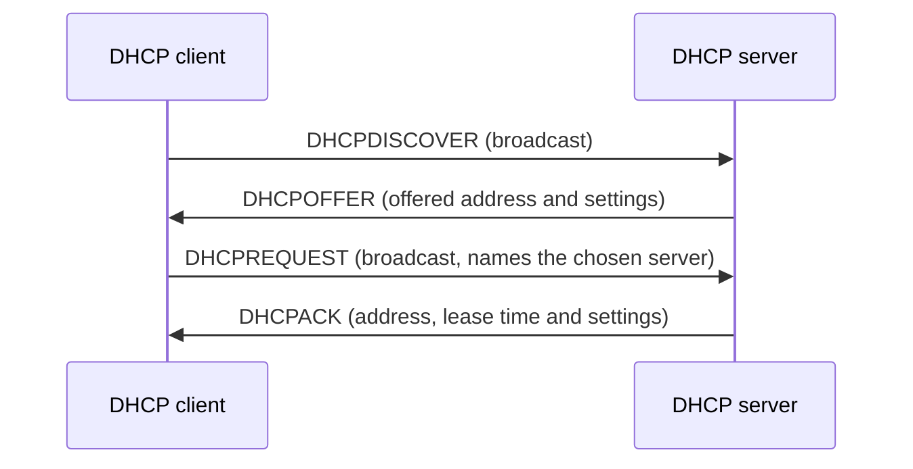

Dynamic Host Configuration Protocol（DHCP）会自动为主机分配 IP 地址和其他网络设置，因此无需手动配置。DHCP 服务器管理一个地址范围，并在有限时间内将它们连同子网掩码、默认网关和 DNS 服务器等设置一起租给客户端。

RouterOS 按照 RFC 2131 实现 IPv4 的 DHCP，按照 RFC 8415 实现 DHCPv6，并为两者分别提供客户端、服务器和中继。

## RouterOS 组件 {#routeros-components}

| 组件 | 菜单 | 用途 |
| :-- | :-- | :-- |
| [DHCP 客户端](./client.md) | `/ip/dhcp-client` | 为接口获取 IPv4 地址和网络设置，例如从 ISP 获取。 |
| [DHCP 服务器](./server.md) | `/ip/dhcp-server` | 为本地网络中的主机分配 IPv4 地址和网络设置。 |
| [DHCP 中继](./relay.md) | `/ip/dhcp-relay`、`/ipv6/dhcp-relay` | 将客户端请求转发到另一个网络中的 DHCP 或 DHCPv6 服务器。 |
| [DHCPv6 客户端](./dhcpv6-client.md) | `/ipv6/dhcp-client` | 获取 IPv6 地址或委派的 IPv6 前缀，例如从 ISP 获取。 |
| [DHCPv6 服务器](./dhcpv6-server.md) | `/ipv6/dhcp-server` | 向客户端委派 IPv6 前缀或分配 IPv6 地址。 |

## 客户端如何获取地址 {#how-a-client-gets-an-address}

没有 IP 地址的主机无法发送或接收普通的单播 IP 流量，因此最初的 DHCP 消息都是广播。客户端从 UDP 端口 68 发送到服务器监听的端口 67。获取地址需要四条消息（RFC 2131 第 3.1 节）：

1. 客户端广播一条 DHCPDISCOVER 消息，以查找网络中的服务器。
2. 每个能够为该客户端提供服务的服务器都会回复一条 DHCPOFFER 消息，其中包含建议的 IP 地址和设置。
3. 客户端选择一个提议，并广播一条 DHCPREQUEST 消息，指明所选的服务器。其他服务器看到自己的提议未被接受，便将所提供的地址归还到各自的地址池中。
4. 被选中的服务器用 DHCPACK 消息进行确认，客户端随即配置该地址。如果该地址已不可用，服务器则改为回复 DHCPNAK，客户端重新开始。

在客户端配置好其地址之前，服务器要么广播自己的回复，要么将其作为单播发送到客户端的 MAC 地址和建议的 IP 地址。无法接收此类单播回复的客户端会在其消息中设置广播标志，随后服务器便会广播其回复（RFC 2131 第 4.1 节）。在 RouterOS 中，DHCP 客户端的 `use-broadcast` 属性控制此标志，而 DHCP 服务器的 `always-broadcast` 属性会使服务器无论该标志如何都广播其回复。

### 地址冲突检查 {#address-conflict-checks}

双方都会在地址被使用之前检查它是否空闲（RFC 2131 第 2.2 节）：

- 服务器在提供某个地址之前，应探测该地址，例如发送 ICMP echo 请求。当启用 `conflict-detection`（默认启用）时，RouterOS DHCP 服务器会在提供地址之前，针对该地址发送 ARP 请求和 ICMP echo 请求。如果有另一台主机应答，服务器会记录一条警告，在租期内将该地址保留为状态为 `conflict` 的租约，并从地址池中提供另一个空闲地址。当另一台主机不再应答时，`check-status` 租约命令会释放该地址。静态租约的地址不会被探测，即使另一台主机正在使用它们也会被分配出去。
- 客户端在配置所收到的地址之前，应检查该地址，例如使用 ARP。如果另一台主机已在使用该地址，客户端会发送 DHCPDECLINE 消息并重新开始。RouterOS DHCP 服务器会以 `declined` 状态显示客户端拒绝的租约；这在正常操作中不会发生。

## 租约与续租 {#leases-and-renewal}

地址是租用的，而非永久分配的。服务器会告知客户端租约持续多长时间，客户端必须在租约到期前续租才能保留该地址。RFC 2131（第 4.4.5 节）为此定义了两个定时器，服务器也可以显式设置它们：

- **T1**，默认为租期的 50%：客户端以单播方式向发放该租约的服务器发送 DHCPREQUEST 消息（续租）。当服务器确认后，租约即被延长。
- **T2**，默认为租期的 87.5%：如果服务器没有应答，客户端会广播 DHCPREQUEST 消息，这样任何服务器都可以延长租约（重新绑定）。
- 当租约到期而未被延长时，客户端会停止使用该地址，并以 DHCPDISCOVER 消息重新开始。

例如，在 RouterOS DHCP 服务器默认租期 30 分钟的情况下，使用默认定时器的客户端会在 15 分钟后续租，并在 26 分 15 秒后开始重新绑定。RouterOS DHCP 客户端的 `status` 属性会显示客户端正处于这些阶段中的哪一个。

不再需要其地址的客户端可以通过 DHCPRELEASE 消息提前归还地址。RouterOS DHCP 客户端的 `release` 命令可完成此操作。

## 客户端标识 {#client-identification}

当客户端续租，或在重启后请求地址时，服务器需要再次识别该客户端。如果客户端发送了客户端标识符选项（选项 61），则以该选项标识客户端；否则以硬件（MAC）地址标识（RFC 2131 第 4.2 节）。

默认情况下，RouterOS DHCP 服务器使用这两者来识别客户端（`dynamic-lease-identifiers`），静态租约可以绑定到 MAC 地址或客户端标识符。默认情况下，RouterOS DHCP 客户端会发送基于其 MAC 地址的客户端标识符。它也可以改为发送基于路由器 DHCP 唯一标识符（DUID）的标识符，如 RFC 4361 所述，这与 DHCPv6 客户端使用的标识符相同。

## 选项 {#options}

除 IP 地址本身之外，所有设置都承载在选项中，每个选项由一个编号标识（RFC 2132）。常用选项：

| 代码 | 选项 |
| --: | :-- |
| 1 | 子网掩码 |
| 3 | 路由器（默认网关） |
| 6 | DNS 服务器 |
| 12 | 主机名 |
| 15 | 域名 |
| 42 | NTP 服务器 |
| 43 | 厂商特定信息 |
| 51 | 租约时间 |
| 54 | 服务器标识符 |
| 55 | 参数请求列表 |
| 60 | 厂商类别标识符 |
| 61 | 客户端标识符 |
| 82 | 中继代理信息 |
| 121 | 无类静态路由 |

客户端会在参数请求列表（选项 55）中列出它想要的选项，服务器则用这些选项的值进行回复。当服务器发送无类静态路由（选项 121）时，客户端会忽略路由器选项（选项 3），因此默认路由也必须包含在选项 121 中（RFC 3442）。RouterOS DHCP 客户端默认遵循此规则；使用 `add-default-route=special-classless` 时，它会同时安装无类路由和来自选项 3 的默认路由。

RouterOS DHCP 服务器会发送匹配网络（`/ip/dhcp-server/network`）的设置，你还可以定义额外的自定义选项，参见 [DHCP 选项](./server.md#dhcp-options)。

## DHCP 中继 {#dhcp-relay}

DHCP 广播不会跨越路由器，因此 DHCP 服务器只能听到与其直接相连的网络中的客户端。要为其他网络提供服务，需要在客户端所在网络的路由器上运行 DHCP 中继。中继接收客户端的广播，并将其作为单播消息转发给一个或多个 DHCP 服务器（RFC 2131 第 4.1 节）。

中继会将其在客户端网络上的地址写入每条转发消息的网关地址字段（`giaddr`），服务器则把回复发送回该地址。中继还可以添加中继代理信息选项（选项 82，RFC 3046），以告知服务器该请求来自哪个端口或线路。

在 RouterOS 中，中继会将其 `local-address` 写入 `giaddr`；当未设置 `local-address` 时，则写入其某个接口的地址。当其 `relay` 属性与该地址匹配，或被设置为 `255.255.255.255` 以接受任何中继时，DHCP 服务器会应答中继的请求，并从自己的地址池中分配地址。完整示例请参见 [DHCP 中继](./relay.md)。

## DHCPv6 {#dhcpv6}

DHCPv6（RFC 8415）为 IPv6 提供相同的用途，但在几个方面工作方式不同：

- 客户端从其链路本地地址向 All_DHCP_Relay_Agents_and_Servers 组播地址 `ff02::1:2` 发送消息。客户端使用 UDP 端口 546，服务器使用端口 547。
- 客户端通过 Solicit、Advertise、Request 和 Reply 消息获取配置。使用 Rapid Commit 时，Solicit 和 Reply 就足够了。
- 每台设备都有一个 DHCP 唯一标识符（DUID），客户端的每个身份关联都有一个身份关联标识符（IAID）。服务器通过 DUID 和 IAID 来识别客户端绑定，而不是通过 MAC 地址。
- 客户端可以请求地址（IA_NA）和委派前缀（IA_PD）。通过前缀委派，路由器会收到一个完整的前缀，例如来自 ISP 的 /56 或 /60，并用其为自己的网络编号。
- DHCPv6 不提供默认网关。主机通过路由器通告（RFC 4861）获知默认路由器。路由器通告中的受管（M）和其他配置（O）标志告诉主机是使用 DHCPv6 获取地址，还是仅用于其他设置。在 RouterOS 中，这些标志是 [`/ipv6/nd`](../../cli-reference/ipv6/nd/index.md) 的 `managed-address-configuration` 和 `other-configuration` 属性。RouterOS DHCPv6 客户端可以选择使用 `add-default-route` 添加一条指向服务器的默认路由。

关于不使用 DHCPv6 的地址自动配置，请参见 [IPv6 邻居发现](../../getting-started/networking-fundamentals/ipv6-neighbor-discovery.md)。关于通过 PPPoE 进行前缀委派，请参见 [PPP 上的 IPv6 PD](../../virtual-private-networks/pppoe/ipv6-pd-over-ppp.md)。
