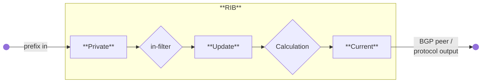

路由是在网络之间选择路径，将数据包从一台主机移动到另一台主机的过程。路径选择也称为路由决策，它依赖于路由信息表。该表包含路由条目，每个条目指定一个目标以及到达该目标所使用的下一跳。当数据包从一个网段传递到另一个网段时，就发生了一次*跳*。


通常，路由信息分为两部分，RouterOS 也不例外：

* **FIB** – 转发信息库（Forwarding Information Base），用于做出数据包转发决策。它包含转发所需的路由信息子集。
* **RIB** – 路由信息库（Routing Information Base），包含从路由来源（如直连网络、静态路由、BGP、RIP 和 OSPF）学习到的所有前缀。


## 路由信息库 {#routing-information-base}

RIB 包含完整的路由信息，包括静态路由、直连网络，以及从动态协议和 MPLS 标签绑定协议（如 OSPF、BGP 和 LDP）学习到的路由。  
RIB 不仅仅是存储路由：它还会过滤路由信息以计算每个目标前缀的最佳路由，构建并更新 FIB，并在路由协议之间分发路由。

默认情况下，所有路由都组织在一个 **main** 路由表中。

### 直连网络 {#connected-networks}

直连路由表示主机可以直接到达的网络（直接连接到二层广播域）。对于每个在 `/ip/address` 或 `/ipv6/address` 下配置了至少一个已启用接口的 IP 网络，RouterOS 会自动创建一条直连路由。RIB 会跟踪直连路由的状态，但不会修改这些路由。每条直连路由都有一个对应的 IP 地址项，使得：

* 直连路由 `dst-address` 中的 **address** 部分等于 IP 地址项的网络。
* 直连路由 `dst-address` 中的 **netmask** 部分等于 IP 地址项地址的 netmask 部分。
* 直连路由的 **gateway** 等于 IP 地址项的 [`actual-interface`](../../cli-reference/ip/address.md#actual-interface)（与接口相同，但桥接接口端口除外），表示可以到达该特定三层网络中直连主机的接口。

直连网络示例：

```text
[admin@TempTest] /ip/route> print where connect 
Flags: D - DYNAMIC; A - ACTIVE; c - CONNECT
Columns: DST-ADDRESS, GATEWAY, ROUTING-TABLE, DISTANCE
    DST-ADDRESS      GATEWAY  ROUTING-TABLE  DISTANCE
DAc 10.155.125.0/24  ether1   main                  0
DAc 192.168.1.0/24   vlan2    main                  0
```

### 默认路由 {#default-route}

当表中没有其他路由与目标匹配时，会使用默认路由。在 RouterOS 中，默认路由的 `dst-address` 对于 IPv4 为 **0.0.0.0/0**，对于 IPv6 为 **::/0**。如果路由表中存在一条活动的默认路由，那么在该表中的查找总是会成功。

通常，家庭路由器的路由表只包含直连网络和一条默认路由，用于将所有出站流量转发到 ISP 的网关：

```text
[admin@TempTest] /ip/route> add gateway=10.155.125.1  
[admin@TempTest] /ip/route> print where dst-address=/0  
Flags: A - ACTIVE; s - STATIC
Columns: DST-ADDRESS, GATEWAY, ROUTING-TABLE, DISTANCE
#    DST-ADDRESS  GATEWAY       ROUTING-TABLE  DISTANCE
4 As 0.0.0.0/0    10.155.125.1  main                  1
```

### 硬件卸载路由 {#hardware-offloaded-route}

支持[三层硬件卸载](../../bridging-and-switching/l3-hardware-offloading.md)（L3HW，也称为 IP 交换或硬件路由）的设备可以将数据包转发卸载到交换芯片。启用 L3HW 后，符合条件的路由会显示 **H** 标志：

```text
[admin@MikroTik] > /ip/route print where static
Flags: A - ACTIVE; s - STATIC, y - COPY; H - HW-OFFLOADED
Columns: DST-ADDRESS, GATEWAY, DISTANCE
#     DST-ADDRESS       GATEWAY         D
0 AsH 0.0.0.0/0         172.16.2.1      1
1 AsH 10.0.0.0/8        10.155.121.254  1
2 AsH 192.168.3.0/24    172.16.2.1      1
```

默认情况下，所有路由都是硬件卸载的候选对象。你可以通过在单条 IPv4 或 IPv6 静态路由上启用或禁用 [`suppress-hw-offload`](../../cli-reference/ip/route/index.md#suppress-hw-offload) 选项来微调卸载。
例如，如果大部分流量都发往某个服务器网络，则只为该目标启用卸载：

```ros
/ip route set [find where static && dst-address!="192.168.3.0/24"] suppress-hw-offload=yes
```

现在只有通往 **192.168.3.0/24** 的路由带有 H 标志，表明它是唯一有资格被选中进行硬件卸载的路由：

```text
[admin@MikroTik] > /ip/route print where static
Flags: A - ACTIVE; s - STATIC, y - COPY; H - HW-OFFLOADED
Columns: DST-ADDRESS, GATEWAY, DISTANCE
#     DST-ADDRESS       GATEWAY         D
0 As  0.0.0.0/0         172.16.2.1      1
1 As  10.0.0.0/8        10.155.121.254  1
2 AsH 192.168.3.0/24    172.16.2.1      1
```

:::warning
H 标志并不表示该路由实际上已被硬件卸载，它只表示该路由可以被选中进行硬件卸载。
:::

### 多路径（ECMP）路由 {#multipath-ecmp-routes}

某些设置（例如负载均衡）需要到达给定目标的多条路径。


ECMP（等代价多路径）路由具有多个网关（下一跳）值。所有可达的下一跳都会被复制到 [**FIB**](#forwarding-information-base) 中用于数据包转发。

你可以手动创建这些路由，也可以由 OSPF、BGP 或 RIP 等协议动态学习。通往同一目标的多条同等优选路由会获得 **+** 标志，并由 RouterOS 自动分组（见下方示例）。

```text
[admin@TempTest] /ip/route> print 
Flags: D - DYNAMIC; I - INACTIVE, A - ACTIVE; C - CONNECT, S - STATIC, m - MODEM; + - ECMP
Columns: DST-ADDRESS, GATEWAY, DISTANCE
#       DST-ADDRESS      GATEWAY       D
0   AS+ 192.168.2.0/24   10.155.125.1  1
1   AS+ 192.168.2.0/24   172.16.1.2    1
```

默认情况下，ECMP 使用 **Layer3** 哈希策略，该策略对源和目标 IP 地址（IPv4）或源/目标 IP、流标签和 IP 协议（IPv6）进行哈希。  
你可以在 `/ip/settings` 和 `/ipv6/settings` 中将哈希策略更改为 **Layer4** 或 **inner Layer3** 哈希。  
支持的哈希方法包括：

|          | IPv4                  | IPv6                                      |
|:--|:--|:--|
| L3       | srcIPv4, dstIPv4      | srcIPv6, dstIPv6, 流标签, IP proto    |
| L4       | srcIPv4, dstIPv4, srcPort, dstPort, IP proto | srcIPv6, dstIPv6, srcPort, dstPort, IP Proto |
| L3-Inner | <ul><li>srcIPv4, dstIPv4(如果内层为 IPv4)</li><li>srcIPv6, dstIPv6, 流标签, IP proto(如果内层为 IPv6)</li><li>如果不存在内层,则与 L3 相同。</li></ul> | <ul><li>srcIPv4, dstIPv4(如果内层为 IPv4)</li><li>srcIPv6, dstIPv6, 流标签, IP proto(如果内层为 IPv6)</li><li>如果不存在内层,则与 L3 相同。</li></ul> |

当 ECMP 由 [L3 硬件卸载](../../bridging-and-switching/l3-hardware-offloading.md)卸载时，交换芯片使用自己的哈希掩码，其中包含 TCP/UDP 的 L4 端口；对于硬件转发的 ECMP，配置的哈希策略会被忽略。[FastPath](../../firewall-and-quality-of-service/packet-flow-in-routeros.md#fast-path) 按目标地址缓存路由，因此 **Layer4** 和 **inner Layer3** 策略不会为 FastPath 缓存的流量提供按流分发。

### 路由选择 {#route-selection}

可以从不同协议或静态配置中学习到具有相同目标的多条路由，但只有一条最佳路由用于转发。RIB 运行路由选择算法，为每个目标在候选路由中选择最佳路由。

只有满足以下条件的路由才参与路由选择：

* 路由未被禁用。
* 如果路由类型为*单播*，则它必须至少有一个可达的下一跳。（如果网关来自直连网络，并且存在一条活动的直连路由，则该网关被视为可达）
* 路由不应是*合成*的。

距离最低的候选路由成为活动路由。如果多个候选路由具有相同的距离，则任意选择一条作为活动路由。

例如，

```text
[admin@RB5009_108] /ip/route> print where dst-address=203.0.113.1
Flags: D - DYNAMIC; A - ACTIVE; s - STATIC, o - OSPF
Columns: DST-ADDRESS, GATEWAY, ROUTING-TABLE, DISTANCE
#     DST-ADDRESS     GATEWAY                  ROUTING-TABLE  DISTANCE
  D o 203.0.113.1/32  111.13.0.2%sfp-sfpplus1  main                110
2  As 203.0.113.1/32  111.13.0.2               main                  1
```

在该示例中，一条静态路由和一条 OSPF 路由指向同一目标。OSPF 安装其路由时使用的默认距离（110）高于静态路由（1）。距离较低的路由被选为最佳路由。

### 下一跳查找 {#nexthop-lookup}

下一跳查找是路由选择过程的一部分。其主要目的是找到一个可直接到达的网关地址（下一跳）。只有在选择了有效的下一跳之后，路由器才知道使用哪个接口进行数据包转发。

如果路由的网关地址距离此路由器有数跳（例如 iBGP、多跳 eBGP），下一跳查找会变得更加复杂。此类路由会在下一跳选择算法确定直接可达/立即网关的地址（由 `immediate-gw` 参数显示）之后安装到 FIB 中。

有必要限制可用于查找立即下一跳的路由集合。例如，RIP 或 OSPF 路由的下一跳值应当是直接可达的，并且只应使用直连路由进行查找。这通过 scope 和 target-scope 属性来实现。

`scope` 大于最大接受值的路由不用于下一跳查找。每条路由在其 `target-scope` 属性中指定其下一跳可接受的最大 scope 值。该属性的默认值只允许通过直连路由进行下一跳查找，但 iBGP 路由除外，其默认值更大，还可以通过 IGP 和静态路由查找下一跳。
<Columns>
<Column>
<center>
| Scope | 路由类型      | Target scope |
|:--|:--      |:--|
| 0     |                 |              |
| 10    | 直连       | 5            |
| 20    | IGP (OSPF, RIP) | 10           |
| 30    | 静态          | 10           |
| 40    | eBGP            | 10           |
| 40    | iBGP            | 30           |
</center>
</Column>
<Column>
矩阵显示了基于默认 scope 和 target-scope 值，哪种路由类型（行）可以解析哪些路由类型（列）的网关。
<center>
|             | IGP | 静态 | eBGP | iBGP |
|:--|:--|:--|:--|:--|
| **直连** |  +  |   +    |  +   |  +   |
| **IGP**       |     |        |      |  +   |
| **静态**    |     |        |      |  +   |
| **eBGP**      |     |        |      |      |
| **iBGP**      |     |        |      |      |
</center>
</Column>
</Columns>

可以通过调整 `target-scope` 值来改变默认行为。例如，如果存在多跳 eBGP 设置，通过 IGP 协议路由或静态路由来解析这些路由的下一跳可能是个好主意。为此，我们可以设置输入路由过滤器，将 `target-scope` 更改为大于 IGP 或静态 `scope` 的值。甚至可以通过调整 `scope` 和 `target-scope` 值，通过 iBGP 路由来解析 eBGP 路由。

scope 调整的灵活性甚至允许创建一些疯狂的设置，比如通过 eBGP 解析 OSPF。

路由按 scope 顺序处理，对较大 scope 路由的更新不会影响较小 scope 路由的下一跳查找状态。

RIB 为每个地址保留多个下一跳对象，每个 scope 和网关检查的组合对应一个。

当你更改路由的 `target-scope` 或网关检查时，它***不会影响其他路由***，因为这些属性附加到下一跳对象而不是路由上。

无效的 scope 值会被自动修正：

* 如果下一跳 scope 设置为 255 - RouterOS 会在内部通过将其 scope 设置为 254 来修正此错误。
* 如果路由的 scope 不大于网关查找的最大接受 scope，RouterOS 会通过将下一跳 scope 设置为 `target-scope + 1` 来修正错误

你可以在 `/routing/nexthop` 菜单中查看实际的 `scope` 和 `target-scope` 值。

你可以通过设置 `check-gateway` 参数来扩展网关检查。路由器通过 ARP 探测、ICMP 消息或活动的 BFD 会话来验证网关可达性。默认情况下，它每 10 秒发送一次 ICMP 回显请求（*ping*）或 ARP 请求（*arp*）。如果网关在 1 秒内没有响应，请求就会超时；两次超时后，网关被标记为不可达。收到回复会使网关再次可达，并重置超时计数器。可在 `/routing/settings` 菜单中调整这些间隔。

```
[admin@CCR2004_2XS_111] /routing/settings> print 
               single-process: no 
  check-gateway-ping-interval: 10s
   check-gateway-ping-timeout: 1s 
     check-gateway-ping-count: 2  
```

:::danger
将 `gateway` 设置为非点对点接口时，不能用于转发目标在数跳之外的数据包。
:::

你不能在此类网关上使用 `check-gateway` 参数，因为目标 IP 未知。

### 路由存储 {#route-storage}

路由信息的存储方式旨在在常见情况下尽量减少内存使用。这些优化可能会带来不明显的极端情况，并影响性能。

所有路由和网关都按前缀/地址保存在一个层级结构中。

```
    Dst [4]/0 1/0+4                             18  <-- number of prefixes
         ^  ^ ^ ^ ^
         |  | | | |
         |  | | | \- bytes taken by Route distinguisher or Interface Id
         |  | | \--- vrf/routing table
         |  | \----- AFI
         |  \------- netmask length of prefix
         \---------- bytes taken by prefix value

         [subject to change without notice]
    
```

每个 'Dst' 条目对应一个唯一的 'dst-address'（对于路由）或网关地址。每个 'Dst' 条目需要一个或多个 'T2Node' 对象。

所有具有相同 'dst-address' 的路由都保存在 Dst 中，并按路由优先级排序。  
:::info
**最坏情况**：拥有许多具有相同 'dst-address' 的路由会非常慢，即使它们处于非活动状态。更新包含数万个元素的排序列表会降低性能。
:::
路由顺序仅在路由属性变化时才会改变。如果路由变为活动/非活动状态，顺序不会改变。

每条路由都有三份路由属性副本：

* **private** -- 从对等体接收到的内容，在通过入过滤器之前。
* **updated** -- 应用入过滤器后的结果。
* **current** -- 路由当前使用的属性。

定期（在需要时），***update*** 属性会从 ***private*** 属性计算得出。这发生在收到路由更新时，或入过滤器更新时。

当重新计算路由表时，***current*** 属性会被设置为 ***updated*** 属性中的值。



这意味着，通常如果没有会改变路由属性的入过滤器，***private***、***updated*** 和 ***current*** 共享相同的值。

路由属性保存在几个组中：

* L1 Data - 所有标志、额外属性列表、as-path；
* L2 Data – 下一跳、RIP 或 OSPF 度量、BGP 度量、路由标签、originator 及类似属性。
* L3 Data – 距离、scope、内核类型和 MPLS 信息。
* 额外属性 - communities、originator、aggregator-id、cluster-list、unknown

例如，拥有许多不同的 `distance` 和 `scope` 路由属性组合会使用更多内存！

使用正则表达式匹配 communities 或 as-path 会缓存结果，以加速过滤。每个 as-path 或 community 值都有一个针对所有正则表达式的缓存，按需填充匹配结果。  
:::info
**最坏情况**：在 `in-filter` 中更改属性会使路由程序使用更多内存！因为 ***private*** 和 ***updated*** 属性将不同！拥有大量不同的正则表达式会使匹配变慢并占用大量内存！因为每个值都会有一个包含数千条目的缓存！
:::

有关路由协议所使用内存的详细信息，可在 `/routing/stats/memory` 菜单中查看

## 转发信息库 {#forwarding-information-base}

FIB（转发信息库）包含数据包转发所必需的信息副本：

* vrf 表
* 活动路由
* 策略路由规则
* 其他路由决策规则

每条路由都有一个 **dst-address** 属性，指定此路由可用于的所有目标地址。如果有多条路由适用于某个特定 IP 地址，则使用最具体的一条（netmask 最大）。如果路由表中包含多条具有相同 **dst-address** 和 netmask 的路由，则所有同等最佳路由会合并为一条 [ECMP](#multipath-ecmp-routes) 路由，安装到 FIB 中并标记为“活动”。

只有一条最佳路由可用于数据包转发。  
查找与给定地址匹配的最具体路由称为**路由表查找**。

当转发决策使用额外信息（例如数据包的源地址）时，称为**策略路由**。策略路由实现为一个策略路由规则列表，这些规则根据数据包的目标地址、源地址、源接口和路由标记（可由防火墙 mangle 规则更改）选择不同的路由表。

### 路由表查找 {#routing-table-lookup}

FIB 使用数据包中的以下信息来确定其目标：

* 源地址
* 目标地址
* 源接口
* 路由标记

可能的路由决策有：

* 本地接收数据包
* 丢弃数据包（静默丢弃或向数据包发送方发送 ICMP 消息）
* 将数据包发送到特定接口上的特定 IP 地址

路由决策动作由 [/routing/settings](../../cli-reference/routing/settings.md) 中通过 `policy-rules` 参数定义的策略规则决定。  
默认情况下：

```ros
[admin@CCR2004_2S+_107] /routing/settings> print 
               single-process: no         
  check-gateway-ping-interval: 10s        
   check-gateway-ping-timeout: 1s         
     check-gateway-ping-count: 2          
                 policy-rules: mangle     
                               vrf-lookup 
                               vrf-unreach
                               local      
                               user       
                               main  
 ```

* 在由 mangle 规则标记的路由表中查找目标。
* 如果接口属于某个 VRF 或数据包被引导到某个 VRF，则尝试在该 VRF 表中查找。
* 如果 VRF 查找失败，则拒绝该数据包。
* 检查数据包是否必须本地交付（目标地址是路由器的地址）。
* 处理用户定义的[路由规则](../../cli-reference/routing/rule.md)（来自 "user" 链）
* 在 `main` 路由表中查找目标。

根据所需任务的复杂程度，你可以更改默认规则的顺序，或通过添加自定义规则来微调设置。

例如，如果目标 1.2.3.4 必须只在 `other_table` 中解析，并且你还打算使用 mangle，则添加你的路由规则并将 mangle 动作移到自定义规则之下：

```ros
[admin@r1] /routing/settings> set policy-rules=vrf-lookup,vrf-unreach,local,user,mangle,main
[admin@r1] /routing/rule> add dst-address=1.2.3.4 action=lookup-only-in-table table=other_table
[admin@r1] /routing/rule> print 
Flags: X - disabled, I - inactive; * - default 
 0    dst-address=1.2.3.4 action=lookup-only-in-table table=other_table 
 ```

如果规则的动作是：

* `drop` 或 `unreachable`，则将其作为路由决策过程的结果返回。
* `lookup`，则在规则指定的路由表中查找数据包的目标地址。如果查找失败（没有路由与数据包的目标地址匹配），则 FIB 继续处理下一条规则。
* `lookup-only-in-table` 与 `lookup` 类似，不同之处在于如果表中没有任何路由与数据包匹配，则查找失败。

否则：

* 如果路由类型为 blackhole，则将此动作作为路由决策结果返回。
* 如果这是一条直连路由或网关值为接口的路由，则将此接口和数据包的目标地址作为路由决策结果返回。
* 如果此路由的网关值为 IP 地址，则将此地址及关联接口作为路由决策结果返回。
* 如果此路由有多个下一跳值，则根据配置的[哈希策略](#multipath-ecmp-routes)以轮询方式选择其中一个。

请记住，通常将接口设置为静态路由的网关并不是个好主意。接口网关仅在两种场景下有用：

* 在点对点类型的接口上；
* 在目标地址为直连的接口上。

如果路由决策在广播网络上返回一个接口和数据包的目标地址作为结果，路由器将尝试通过发送 ARP 探测在该接口上解析数据包的目标地址。如果同一广播域中没有任何主机拥有该 IP 地址，转发将失败，因此此类网关不能用于路由目标在数跳之外的数据包。
