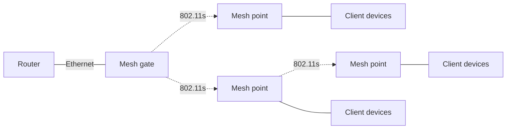

**软件包：** `wifi-qcom-be`、`wifi-mediatek`

:::warning

- MeshPoint 适用于 `wifi-qcom-be` 和 `wifi-mediatek`。不适用于 `wifi-qcom` 或 `wifi-qcom-ac`。
- MeshPoint 在 CLI 中配置。不提供 GUI 支持。
- Mesh 对等链路使用 WPA3-PSK（SAE）。802.11s 不支持 WPA2-PSK。
:::

MeshPoint 是 RouterOS 对 IEEE 802.11s 二层 Mesh 的实现。使用它无需以太网布线即可连接接入点，并通过多跳无线链路扩展二层网络。

Mesh 节点通过 Wi-Fi 根据 Mesh ID 相互发现，并建立 WPA3-PSK（SAE）对等链路。Mesh 链路不支持 WPA2-PSK。MeshPoint 支持自愈：选择最低开销路径，并在链路故障时重新路由流量。

Mesh 中的每台设备都是 Mesh 节点。Mesh 网关是具有到 LAN 的有线上行链路的节点；它通过 Wi-Fi 通告通往有线网络的路径，使其他节点能够访问 LAN 和互联网。没有有线上行链路的节点彼此建立无线对等链路，并通过一跳或多跳无线链路将客户端流量转发到 Mesh 网关。一个 Mesh 网络可以有多个网关。每个节点还可以为本地客户端运行一个普通 AP 接口；客户端连接到该 AP，而不是 Mesh 链路。Mesh、AP 和以太网接口桥接在一起，因此客户端看到的是同一个二层网络。

Mesh 链路是节点之间的回传。AP 接口是面向客户端的前传。

简而言之：

- Mesh 节点的所有端口均桥接。每个节点使用相同的 Mesh ID（`configuration.ssid`）和 WPA3-PSK 密码短语。
- 用于 Mesh 链路的 Wi-Fi 接口（例如 `wifi1`）以 MeshPoint 模式运行。
- 第二个 Wi-Fi 接口（例如 `wifi2`）以 AP 模式运行，因此客户端设备可通过 Mesh 网络访问 LAN。
- 客户端流量从一个节点转发到下一个节点，直到到达具有有线上行链路的节点。
- 链路故障时，Mesh 会自动重新路由流量。

## Topology

MeshPoint 网络包含以下角色：

- Mesh 网关 - 具有到 LAN 的以太网上行链路的 Mesh 节点。它通过 HWMP 根通告（RANN）通告通往有线网络的路径。
- Mesh 点 - 通过 Mesh ID 加入 Mesh 并通过其对等链路转发流量的节点。它可以使用 AP 接口为本地客户端提供服务。

所有节点使用相同的 Mesh ID、WPA3-PSK 密码短语和国家/地区设置。各射频必须支持相同的频段和信道。Mesh 在二层转发以太网帧，因此所有节点位于同一个二层网络中，客户端 MAC 地址在跨跳后保持不变。



Mesh 点与范围内的每个邻居建立对等关系。HWMP 通过比较每条路径的空口时间链路度量来选择通往 Mesh 网关的活动路径：数据速率、帧错误率和信道开销。使用总度量最低的路径。可以存在多个 Mesh 网关，每个节点选择通往某个网关的最佳路径。如果链路故障，HWMP 会重新路由流量。

:::warning

路径选择无法消除干扰，每增加一跳都会降低吞吐量并增加延迟。

在单射频 Mesh 中，所有节点共享一个信道及其空口时间。例如，在 A-B-C-D 的 3 跳链中，从 D 发往 A 的帧会在同一信道上传输三次：D→C、C→B、B→A。同一时间只能有一个节点发送，因此每一跳都会再次消耗相同的空口时间。吞吐量大约每跳减半。隐藏节点冲突和同信道附近的 AP 会进一步恶化长链性能。

对于长链，Mesh 回传请使用 5 GHz、减少跳数或使用有线上行链路。
:::

## Configuration

:::warning
更改 Wi-Fi 和网桥配置可能会中断管理连接。请通过以太网端口连接，或使用 [Winbox](/docs/management-tools/winbox) 的 Neighbors 选项卡按 MAC 地址连接。
:::

Mesh 网关可以是运行 DHCP 服务器的路由器，也可以是将 Mesh 桥接到 LAN 的二层接入点。Mesh 节点是接入点，通过其 MeshPoint Wi-Fi 接口将客户端流量桥接进 Mesh。

如果 Mesh 网关是运行 DHCP 服务器的路由器，请确保所需的 LAN 以太网端口、MeshPoint Wi-Fi 接口和 AP Wi-Fi 接口位于同一个网桥中。

如果 Mesh 网关是纯二层 AP，请确保所有端口（以太网、Wi-Fi MeshPoint 和 AP）都已桥接在一起，并且网桥已配置 IP 地址——手动指定或通过 DHCP 获取。

Mesh 网关与 Mesh 节点之间没有其他配置差异。在 Mesh 网关和 Mesh 节点上以相同方式配置 MeshPoint Wi-Fi 接口（只需确保 Wi-Fi 接口加入正确的网桥）。

### MeshPoint 接口

将其中一个 radio 设置为 MeshPoint 模式：

```ros
/interface/wifi
set [find default-name=wifi1] configuration.country=Latvia .mode=meshpoint .ssid=mesh-mesh datapath.bridge=bridge disabled=no security.authentication-types=wpa3-psk .passphrase=mesh-password
```

- `configuration.mode=meshpoint` - 选择 IEEE 802.11s MeshPoint 模式。
- `configuration.ssid=mesh-mesh` - 设置 Mesh ID。该值不是客户端 SSID。
- `configuration.country=Latvia` - 设置监管域。请使用你所在的国家/地区。
- `security.authentication-types=wpa3-psk` - 使用 SAE 对 Mesh 对端进行认证。
- `security.passphrase=mesh-password` - 设置 Mesh 密码。每个节点使用相同的密码。
- `datapath.bridge=bridge` - 将 Mesh 接口添加到网桥。

在每个 Mesh 网关和 Mesh 节点上应用相同的 MeshPoint Wi-Fi 接口配置，使网络中的每台设备都有一个接口配置为 MeshPoint。

### 可选 AP 接口

将第二个 Wi-Fi 接口配置为 AP：

```ros
set [find default-name=wifi2] configuration.country=Latvia .mode=ap .ssid=SSID-for-clients datapath.bridge=bridge disabled=no security.authentication-types=wpa2-psk .passphrase=client-password
```

- `configuration.mode=ap` - AP 模式。
- `configuration.ssid=SSID-for-clients` - 客户端 SSID。
- `security.authentication-types=wpa2-psk` 和 `security.passphrase=client-password` - 客户端安全。
- `datapath.bridge=bridge` - 将 AP 接口添加到网桥。

如果没有其他可用接口，请在 MeshPoint 接口之上创建虚拟 AP：

```ros
/interface/wifi
add name=wifi3 master-interface=wifi1 configuration.mode=ap .ssid=SSID-for-clients datapath.bridge=bridge disabled=no security.authentication-types=wpa2-psk .passphrase=client-password
```

虚拟 AP 使用与 MeshPoint 接口相同的信道。它与 Mesh 链路共享空口时间，因此吞吐量低于使用专用射频的情况。

### 可选信道控制

启动时，MeshPoint 会扫描匹配的 Mesh ID，并选择有对端的信道。如果 Mesh 在多个信道上可见，节点会收敛到 MAC 地址最低的对端所在信道（即最小地址值，用作确定性的决胜条件）。初始扫描后，Mesh 射频会定期运行后台扫描，默认每 2–3 小时一次。

使用 `channel.reselect-interval` 或 `channel.reselect-time` 控制后台扫描：

```ros
/interface/wifi
set [find default-name=wifi1] channel.reselect-interval=02:00..03:00
# 或改用时钟时间窗口：
set [find default-name=wifi1] channel.reselect-time=03:00..04:00
```

这两个设置都会安排相同的后台扫描。重新选择可能触发信道切换，并短暂中断 Mesh。

要将 Mesh 射频保持在固定信道，请仅设置一个 `channel.frequency`：

```ros
/interface/wifi
set [find default-name=wifi1] channel.frequency=5180
```

## Verification

注册表会显示 mesh 对端：

```ros
[admin@hAP] > /interface/wifi/registration-table/print
Flags: A - AUTHORIZED
Columns: INTERFACE, SSID, MAC-ADDRESS, DHCP-ADDRESS, DHCP-HOSTNAME, UPTIME, LAST-ACTIVITY, SIGNAL, AUTH-TYPE, BAND
#   INTERFACE  SSID        MAC-ADDRESS        DHCP-ADDRESS    DHCP-HOSTNAME  UPTIME  LAST-ACTIVITY  SIGNAL  AUTH-TYPE  BAND
0 A wifi1      mesh-mesh   XX:XX:XX:XX:XX:02                                 49m14s  0ms            -14                2ghz-ax
```

使用 `/interface/wifi/meshpoint-paths` 显示 MeshPoint 接口的 HWMP 路径表：

```ros
/interface/wifi/meshpoint-paths wifi1

Flags: V - SN-VALID
Columns: DESTINATION, NEXT-HOP, HOPS, METRIC, PACKETS-QUEUED, SN, EXPIRATION, DISCOVERY-TIMEOUT, DISCOVERY-RETRIES, PATH-CHANGES
  DESTINATION        NEXT-HOP           HOPS  METRIC  PACKETS-QUEUED   SN  EXPIRATION  DISCOVERY-TIMEOUT  DISCOVERY-RETRIES  PATH-CHANGES
  XX:XX:XX:XX:XX:01  00:00:00:00:00:00     0       0               0    0           0               1600                  0             0
V XX:XX:XX:XX:XX:02  XX:XX:XX:XX:XX:02     1    8257               0  120           0                100                  0             1
```

## Troubleshooting

- 如果对端未出现在注册表中，请检查两个节点是否使用相同的 Mesh ID（`ssid`）、WPA3-PSK 密码短语、国家/地区和频段。在每个节点上运行 `/interface/wifi/scan`，确认 Mesh ID 可见。
- 如果客户端无法获取 IP 地址，请检查 MeshPoint 接口和 AP 接口是否都使用 `datapath.bridge=bridge`、网桥是否配置了 DHCP 客户端，以及网络中是否只有一个 DHCP 服务器。
- 如果拔掉节点的以太网线后该节点失去管理访问，请等待对端链路建立，然后检查注册表和网桥端口。
- 如果吞吐量较低，请为 mesh 回传使用独立的射频。共享射频会在 mesh 流量和客户端流量之间分时复用信道，且每增加一跳都会降低吞吐量。

## Notes

:::note

- MeshPoint 可在 `wifi-qcom-be` 和 `wifi-mediatek` 上运行，不支持 `wifi-qcom` 和 `wifi-qcom-ac`。
- 所有 mesh 节点必须使用相同的 Mesh ID、WPA3-PSK 密码短语和国家/地区。
- 802.11s 对端链路不支持 WPA2-PSK。
- MeshPoint 在 CLI 中配置，不支持 GUI。
- 允许使用多个 mesh 网关。每个节点会选择到网关的最佳路径。
- mesh 点会与范围内的每个邻居建立对端关系，由 HWMP 选择活动路径。
:::
