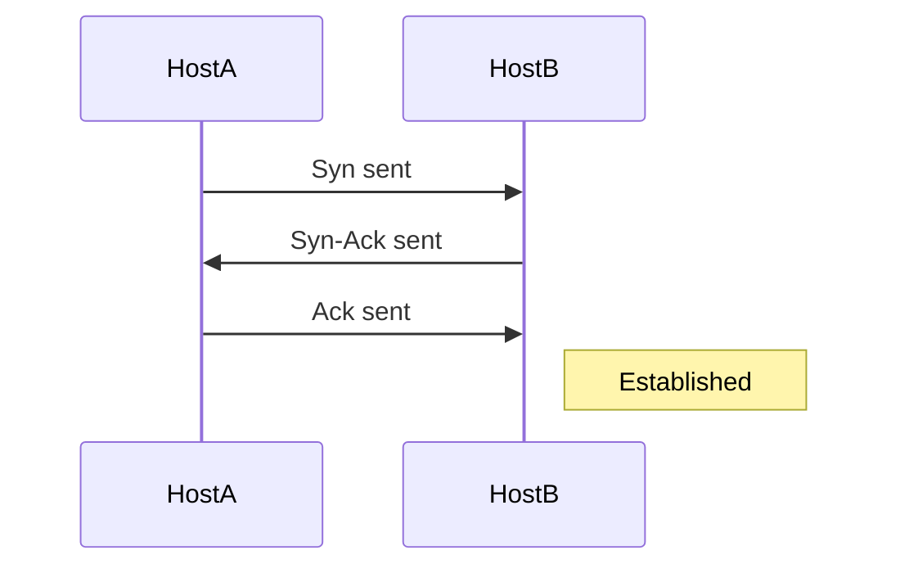
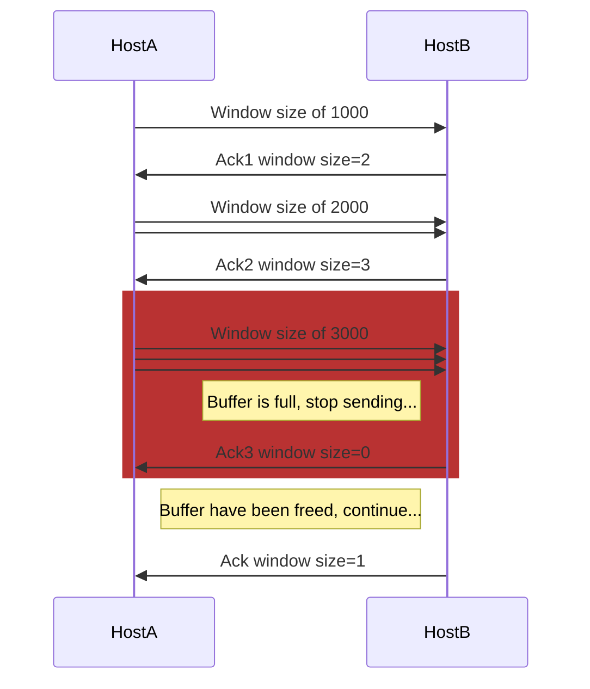
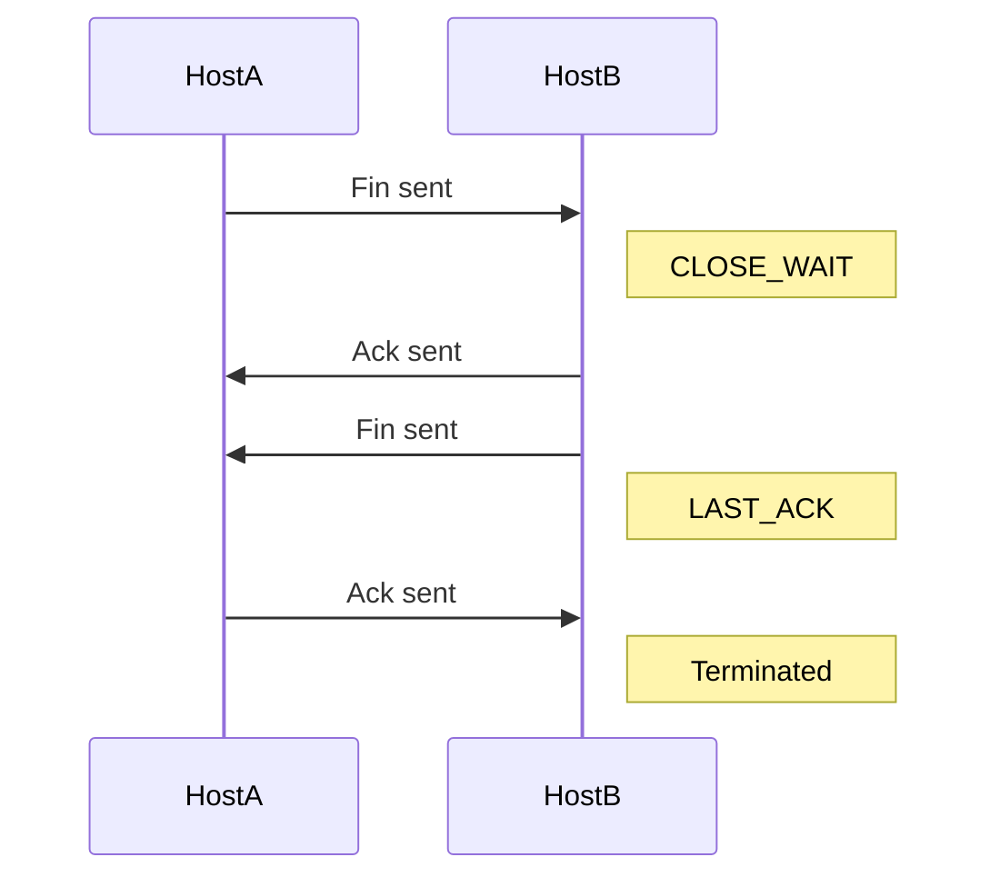

计算机网络由许多不同的组件和协议协同工作组成。要理解节点到节点通信的概念，请先熟悉 **OSI 模型** 和 **TCP/IP 模型**。这两种模型都有助于直观展示节点之间如何进行通信。

### OSI 模型 {#osi-model}

开放系统互连（OSI）模型是一个 7 层模型，如今主要用作教学工具。OSI 模型最初被设想为构建网络系统的标准架构，但现实世界中的网络定义远没有 OSI 模型所暗示的那样清晰。

- **第 7 层（应用层）** - 定义服务器和客户端之间通信的协议，例如 HTTP 协议。如果 Web 浏览器要下载图像，该协议会组织并执行请求；
- **第 6 层（表示层）** - 确保数据以可用格式接收。加密在此完成（但实际情况可能并非如此，例如 IPSec）；
- **第 5 层（会话层）** - 负责在客户端和服务器之间建立、管理和关闭会话；
- **第 4 层（传输层）** - 传输层的主要职责是组装和重组，将数据流划分为块（段），分配序列号，并封装到协议头部中（TCP、UDP 等）；
- **第 3 层（网络层）** - 负责逻辑设备寻址，数据封装在 IP 头部中，此时称为“数据包”；
- **第 2 层（数据链路层）** - 数据封装在自定义头部中，可以是 802.3（以太网）或 802.11（无线），此时称为“帧”，并处理流控；
- **第 1 层（物理层）** - 发送和接收比特的通信介质、电信号和硬件接口；

### TCP/IP 模型 {#tcpip-model}

该模型与 OSI 模型的目的相同，但更适合现代网络故障排查。与 OSI 模型相比，TCP/IP 是一个 4 层模型：

- **应用层（4）** - 包括 OSI 模型的应用层、表示层和会话层，显著简化了网络故障排查；
- **传输层（3）** - 与 OSI 模型中的传输层相同（TCP、UDP 协议）；
- **网际层（2）** - 与 OSI 模型中的网络层作用相同（包括 ARP、IP 协议）；
- **链路层（1）** - 也称为 Network Access 层。包括 OSI 模型的第 1 层和第 2 层，因此其主要关注网络节点之间的物理数据交换；

| TCP/IP | OSI 模型 | 协议 |
|:--|:--|:--|
| 应用层 | 应用层 | DNS、DHCP、HTTP、SSH 等 |
|  | 表示层 | JPEG、MPEG、PICT 等 |
|  | 会话层 | PAP、SCP、ZIP 等 |
| 传输层 | 传输层 | TCP、UDP |
| 网际层 | 网络层 | ICMP、IGMP、IPv4、IPv6、IPSec |
| 链路层 | 数据链路层 | ARP、CDP、MPLS、PPP 等 |
|  | 物理层 | Bluetooth、Ethernet、Wi-Fi 等 |

## Ethernet

计算机网络中常用的链路层协议（OSI 第 2 层）是以太网协议。为了进行通信，每个节点都有一个唯一分配的地址，称为 **MAC**（媒体访问控制地址），有时也称为以太网地址。

该地址为 48 位长，通常由制造商固定（无法更改），但如今 MAC 地址自定义已被广泛使用，RouterOS 也允许设置自定义 MAC 地址。

最常用的 MAC 格式是由冒号分隔的 6 个十六进制数（`D4:CA:6D:01:22:96`）

RouterOS 会在所有类似以太网的接口（Wireless、60G、VPLS 等）的配置中显示 MAC 地址。

```ros
[admin@rack1_b32_CCR1036] /interface ethernet> print 
Flags: X - disabled, R - running, S - slave 
 #    NAME                  MTU MAC-ADDRESS       ARP             SWITCH               
 0 R  ether1               1500 D4:CA:6D:01:22:96 enabled        
 1 R  ether2               1500 D4:CA:6D:01:22:97 enabled        
 2 R  ether3               1500 D4:CA:6D:01:22:98 enabled        
 3    ether4               1500 D4:CA:6D:01:22:99 enabled        
 4    ether5               1500 D4:CA:6D:01:22:9A enabled        
 5    ether6               1500 D4:CA:6D:01:22:9B enabled        
 6    ether7               1500 D4:CA:6D:01:22:9C enabled        
 7 R  ether8               1500 D4:CA:6D:01:22:9D enabled        
 8    sfp-sfpplus1         1500 D4:CA:6D:01:22:94 enabled        
 9    sfp-sfpplus2         1500 D4:CA:6D:01:22:95 enabled 
```

以太网网络中转发帧有三种类型：

- **Unicast** - 具有单播地址的帧会发送到冲突域内的所有节点，通常是两个节点之间的以太网线缆；在无线情况下，则是所有能够检测到无线信号的接收器。只有 MAC 地址匹配的远端节点会接受该帧（除非启用了混杂模式）
- **Broadcast** - 特殊地址之一（`FF:FF:FF:FF:FF:FF`），广播帧会被第 2 层网络中的所有节点接受并转发。
- **Multicast** - 具有组播地址的帧会被所有配置为监听该地址的节点接收。

## IP 网络 {#ip-networking}

以太网协议足以在以太网网络中的两个节点之间传输数据，但不足以在跨越多个以太网段、相距多跳的节点之间传输数据。对于互联网/网络层（OSI 第 3 层），使用 IP（互联网协议）通过唯一的逻辑地址标识主机。

当前大多数网络使用 **IPv4**，它是以点分十进制表示法编写的 32 位地址（`192.168.88.1`），但 **IPv6**（128 位地址）的使用正在扩大。

可以向一个接口添加多个 IP 地址，也可以让接口不分配任何地址。在网桥或 PPPoE 连接的情况下，物理接口可能没有分配任何地址，但仍可正常使用。为加入网桥的物理接口配置 IP 地址，实际上意味着在网桥接口本身上进行设置。

### Netmasks

可能存在多个逻辑网络，为了识别 IP 地址属于哪个网络，需要使用 **netmask**。**netmask** 通常以用于标识逻辑网络的位数指定。格式也可以是十进制表示法，例如，24 位 netmask 可以写为 `255.255.255.0`

### IPv4 地址 {#ipv4-addresses}

IPv4 使用 4 字节地址，这些地址被分成四个 8 位字段，称为八位字节。每个八位字节都会转换为十进制格式，并用点分隔。例如：

```
11000000 10101000 00000011 00011000 => 192.168.3.24
```

下面详细查看 192.168.3.24/24，以及如何通过 netmask 确定有效范围：

```
11000000 10101000 00000011 00011000 => 192.168.3.24
11111111 11111111 11111111 00000000 => /24 or 255.255.255.0
```

在本示例中，高 24 位被屏蔽，剩下的范围为 0-255。  
该范围由三种地址类型组成：

- **网络地址** - 范围中的第一个地址用于标识网络（在本示例中，网络地址为 192.168.3.0）

- **广播地址** - 范围中的最后一个/最高地址（在我们的示例中为 192.168.3.255）。广播地址用于将数据发送到所有可能的目的地（**所有主机广播**），使发送方只需发送数据一次，所有接收方都会收到一份副本。在 IPv4 协议中，地址 255.255.255.255 用于**本地广播**。此外，可以向网络广播地址发起定向（受限）广播。
- **单播地址** - 范围中的所有其他地址都可用于标识网络中的特定主机（在我们的示例中，主机标识范围为 1 到 254）。

与 Ethernet 协议一样，也存在用于**组播**的特殊地址范围。组播地址用于与一组感兴趣的接收方关联。在 IPv4 中，地址 `224.0.0.0` 至 `239.255.255.255` 被指定为组播地址。发送方从其单播地址向组播组地址发送单个数据报，中间路由器负责复制并将其发送给已加入相应组播组的所有接收方；

逻辑 IP 网络、单播、广播和组播的可视化：


还有一些地址范围保留用于特殊用途：

- [私有地址范围（RFC 1918）](https://tools.ietf.org/html/rfc1918)，仅应在本地网络中使用，转发到互联网时通常会被丢弃：
  - 10.0.0.0/8 - 起始：10.0.0.0；结束：10.255.255.255
  - 172.16.0.0/12 - 起始：172.16.0.0；结束：172.31.255.255
  - 192.168.0.0/16 - 起始：192.168.0.0；结束：192.168.255.255

- 198.18.0.0/15 - 基准测试
- 192.88.99.0/24 - 6to4 中继任播地址范围
- 192.0.2.0/24、198.51.100.0/24、203.0.113.0/24 - 文档
- 169.254.0.0/16 - 自动配置地址范围

#### 点对点寻址 {#point-to-point-addressing}

顾名思义，点对点寻址可用于设置仅由两个节点组成的第 3 层网络。可通过两种方式设置此类寻址：

- 使用 /31 地址范围
- 使用 /32 地址，其中网络地址设置为远程节点的 IP 地址。  
  例如：

  ```mermaid
  flowchart LR
    H1 --- H2

    H1["**Host 1**<br />____________________<br /> **Address**: 192.168.0.1/32<br />**Network**: 192.168.0.2"]
    H2["**Host 2**<br />____________________<br /> **Address**: 192.168.0.2/32<br />**Network**: 192.168.0.1"]

    style H1 text-align:left
    style H2 text-align:left
  ```

#### 地址配置 {#address-configuration}

假设有两台路由器通过线缆直接相连，并且不希望浪费地址空间：

Router 1:

```ros
/ip address
add address=10.1.1.1/32 interface=ether1 network=172.16.1.1
```

Router 2:

```ros
/ip address
add address=172.16.1.1/32 interface=ether1 network=10.1.1.1
```

## ARP 及综合应用 {#arp-and-tying-it-all-together}

即使 IP 数据包使用 IP 地址寻址，实际将数据从一台主机传输到另一台主机时仍必须使用硬件地址。

这引出了 **地址解析协议（Address Resolution Protocol，ARP）**，它用于将主机的 **IPv4** 地址映射到硬件地址（MAC）。**ARP** 协议在 [RFC 826](https://tools.ietf.org/html/rfc826) 中定义。它属于过去的技术，IPv6 通过组播消除了对它的需求，但只要 IPv4 仍在使用，它就会继续存在。

每个网络设备都有一个当前使用的 ARP 条目表。通常该表是动态构建的，但为了提高网络安全性，可以通过添加静态条目来部分或完全静态构建该表。

当局域网上的主机要向该网络中的另一台主机发送 IP 数据包时，它必须在其 ARP 缓存中查找目标主机的以太网 MAC 地址。如果目标主机的 MAC 地址不在 ARP 表中，则会发送 ARP 请求，以查找具有对应 IP 地址的设备。ARP 会向 LAN 上的所有设备发送广播请求消息，要求具有指定 IP 地址的设备回复其 MAC 地址。识别出该 IP 地址属于自己的设备会返回 ARP 响应，并附带自己的 MAC 地址：


下面进行一个简单配置，并详细查看 **Host A** 尝试 ping **Host C** 时的过程。

首先，在 **Host A** 上添加 IP 地址：

```ros
/ip address add address=10.155.101.225/24 interface=ether1
```

**Host B**:

```ros
/ip address add address=10.155.101.221/24 interface=ether1
```

**Host C**:

```ros
/ip address add address=10.155.101.217/24 interface=ether1
```

运行数据包嗅探器，将数据包转储保存到文件中，并在 **Host A** 上运行 ping 命令：

```ros
/tool sniffer
  set file-name=arp.pcap filter-interface=ether1
  start 
/ping 10.155.101.217 count=1
/tool sniffer stop
```

现在可以从路由器下载 arp.pcap 文件，并在 Wireshark 中打开进行分析：


- **Host A** 发送 **ARP** 消息，询问谁拥有“10.155.101.217”
- **Host C** 响应，10.155.101.217 可通过 MAC 地址 08:00:27:3C:79:3A 到达
- **Host A** 和 **Host C** 现在都已更新其 **ARP** 表，可以发送 ICMP（ping）数据包

如果运行 `/ip/arp/print` 查看两台主机的 ARP 表，应能看到相关条目：

```routeros
[admin@host_a] /ip arp> print 
Flags: D - DYNAMIC; C - COMPLETE
Columns: ADDRESS, MAC-ADDRESS, INTERFACE, VRF, STATUS
 #    ADDRESS         MAC-ADDRESS       INTERFACE     VRF   STATUS
 0 DC 10.155.101.217  08:00:27:3C:79:3A ether1        main  reachable

 [admin@host_b] /ip arp> print 
Flags: D - DYNAMIC; C - COMPLETE
Columns: ADDRESS, MAC-ADDRESS, INTERFACE, VRF, STATUS
 #    ADDRESS         MAC-ADDRESS       INTERFACE     VRF   STATUS
 0 DC 10.155.101.225  08:00:27:85:69:B5 ether1        main  reachable
```

在某些情况下，可能需要不同的行为。RouterOS 允许为支持 **ARP** 的接口配置不同模式：

- **Enabled** - 将自动发现 ARP，并向 ARP 表添加新的动态条目。这是接口的默认模式。
- **Disabled** - 如果接口上的 ARP 功能关闭，则路由器不会响应客户端的 ARP 请求。因此，也应在客户端添加静态 ARP 条目。例如，
  Host A：

  ```ros
  /interface/set ether1 arp=disabled
  /ip arp add mac-address=08:00:27:3C:79:3A address=10.155.101.217 interface=ether1
  ```

  Host B:

  ```ros
  /ip arp add mac-address=08:00:27:85:69:B5 address=10.155.101.225 interface=ether1
  ```

- **Reply Only** - 如果接口上的 ARP 属性设置为 `reply-only`，则路由器仅回复 ARP 请求。邻居 MAC 地址将通过 `/ip/arp` 静态解析，但无需像禁用 ARP 的情况那样，将路由器的 MAC 地址添加到其他主机的 ARP 表中。

- **Proxy ARP** - 正确配置代理 ARP 功能的路由器可在直接连接的网络之间充当透明代理。例如，如果希望为拨入（PPP、PPTP、PPPoE）客户端分配与所连接 LAN 相同地址空间中的 IP 地址，该行为很有用。

- **Local Proxy ARP** - 如果接口上的 arp 属性设置为 `local-proxy-arp`，则路由器仅对该接口执行代理 ARP，即针对从同一接口进入并从同一接口发出的流量。在普通 LAN 中，默认行为是两台网络主机直接相互通信，而不经过路由器。
  路由器将使用路由器自身接口的 MAC 地址而不是另一台主机的 MAC 地址，回复所有客户端主机。

  例如，如果主机 A（192.168.88.2/24）查询主机 B（192.168.88.3/24）的 MAC 地址，路由器将使用自身 MAC 地址回复。换句话说，如果启用 local-proxy-arp，路由器将承担在主机 A 192.168.88.2 和主机 B 192.168.88.3 之间转发流量的责任。主机 A 和主机 B 上的所有 ARP 缓存条目都将引用路由器的 MAC 地址。在这种情况下，路由器正在为整个子网 192.168.88.0/24 执行 local-proxy-arp。

  RouterOS local-proxy-arp 的一个示例是包含 DHCP 服务器和隔离网桥端口的网桥配置，其中来自同一子网的主机只能通过网桥 IP 在第 3 层相互访问。

  ```ros
  /interface bridge
  add arp=local-proxy-arp name=bridge1
  /interface bridge port
  add bridge=bridge1 horizon=1 interface=ether2
  add bridge=bridge1 horizon=1 interface=ether3
  add bridge=bridge1 horizon=1 interface=ether4
  ```

  该技术的名称各不相同：
  - 在 RFC 3069 中称为 VLAN Aggregation；
  - Cisco 和 Allied Telesis 称其为 Private VLAN；
  - Hewlett-Packard 称其为 Source-Port filtering 或 port-isolation；
  - Ericsson 称其为 MAC-Forced Forwarding（RFC Draft）。

#### Proxy ARP 示例 {#proxy-arp-example}

请看示例图。  


**Host A**（172.16.1.2）位于 Subnet A，希望向 Subnet B 中的 **Host D**（172.16.2.3）发送数据包。**Host A** 使用 /16 子网掩码，因此它认为自身与整个 172.16.0.0/16 网络直接相连（同一 LAN）。它在 Subnet A 中广播，以确认 **Host D** 的 MAC 地址。

来自数据包分析软件的信息：

```text
 No.     Time   Source             Destination       Protocol  Info

 12   5.133205  00:1b:38:24:fc:13  ff:ff:ff:ff:ff:ff  ARP      Who has 173.16.2.3?  Tell 173.16.1.2

Packet details:

Ethernet II, Src: (00:1b:38:24:fc:13), Dst: (ff:ff:ff:ff:ff:ff)
    Destination: Broadcast (ff:ff:ff:ff:ff:ff)
    Source: (00:1b:38:24:fc:13)
    Type: ARP (0x0806)
Address Resolution Protocol (request)
    Hardware type: Ethernet (0x0001)
    Protocol type: IP (0x0800)
    Hardware size: 6
    Protocol size: 4
    Opcode: request (0x0001)
    [Is gratuitous: False]
    Sender MAC address: 00:1b:38:24:fc:13
    Sender IP address: 173.16.1.2
    Target MAC address: 00:00:00:00:00:00
    Target IP address: 173.16.2.3
```

通过该 ARP 请求，**Host A**（172.16.1.2）请求 **Host D**（172.16.2.3）发送其 MAC 地址。二层广播意味着该帧将发送到同一二层广播域中的所有主机，其中包括路由器的 **ether0** 接口，但不会到达 **Host D**，因为路由器默认不会转发二层广播。

要解决此问题，需要在 ether0 上启用 `proxy-arp`：

```ros
/interface/ethernet set ether0 arp=proxy-arp
```

现在，路由器知道目标地址（172.16.2.3）位于另一个子网且可达，因此它向 **Host A** 发送单播回复，并在回复中使用自身的 **MAC** 地址。基本上，它是在说“将这些数据包发送给我，我会把它们送到需要到达的位置。”

```text
No.     Time   Source            Destination         Protocol   Info

13   5.133378  00:0c:42:52:2e:cf  00:1b:38:24:fc:13   ARP        172.16.2.3 is at 00:0c:42:52:2e:cf

Packet details:

Ethernet II, Src: 00:0c:42:52:2e:cf, Dst: 00:1b:38:24:fc:13
   Destination: 00:1b:38:24:fc:13
   Source: 00:0c:42:52:2e:cf
   Type: ARP (0x0806)
Address Resolution Protocol (reply)
   Hardware type: Ethernet (0x0001)
   Protocol type: IP (0x0800)
   Hardware size: 6
   Protocol size: 4
   Opcode: reply (0x0002)
   [Is gratuitous: False]
   Sender MAC address: 00:0c:42:52:2e:cf
   Sender IP address: 172.16.1.254
   Target MAC address: 00:1b:38:24:fc:13
   Target IP address: 172.16.1.2
```

当 Host A 收到 ARP 响应时，它会更新其 ARP 表，如下所示：

```text
C:\Users\And>arp -a
Interface: 173.16.2.1 --- 0x8
  Internet Address      Physical Address      Type
  173.16.1.254          00-0c-42-52-2e-cf    dynamic
  173.16.2.3            00-0c-42-52-2e-cf    dynamic
  173.16.2.2            00-0c-42-52-2e-cf    dynamic
```

MAC 表更新后，**Host A** 会将所有发往 **Host D**（172.16.2.3）的数据包直接转发到路由器接口 ether0（00:0c:42:52:2e:cf），路由器再将数据包转发给 **Host D**。Subnet A 中主机上的 ARP 缓存会为 Subnet B 中的所有主机填充路由器的 MAC 地址。因此，所有发往 Subnet B 的数据包都会发送到路由器。路由器再将这些数据包转发给 Subnet B 中的主机。

使用代理 ARP 时，主机的多个 IP 地址会映射到单个 MAC 地址。

## 传输层 {#transport-layer}

该层中的协议为应用程序提供端到端通信服务。这些协议应通过交换数据接收确认并重传丢失的数据包，确保数据包按序且无误地到达。

最知名且使用最广泛的是 **Transmission Control Protocol (TCP)**，它用于面向连接的传输，并包含可靠数据传输机制。

无连接的 **User Datagram Protocol (UDP)** 是另一种用于简单数据传输的常见协议。

### TCP 协议操作 {#tcp-protocol-operation}

面向连接的协议在建立适当连接之前不会发送任何数据。当发送设备尝试与远程节点建立连接时，**TCP** 使用多步握手过程。因此，会创建端到端的虚拟（逻辑）电路，并在其中使用流控和确认来实现可靠交付。TCP 在连接建立和终止过程中使用多种消息类型。

**三次握手**过程：

1. 需要初始化连接的 **HostA** 向目标 **HostB** 发送带有建议初始序列号的 **SYN**（Synchronize）数据包。
2. 当 **HostB** 收到 **SYN** 消息时，它回复一个在 TCP 标头中同时设置 **SYN** 和 **ACK** 标志的数据包（SYN-ACK）。
3. 当 **HostA** 收到 SYN-ACK 时，它回复 **ACK**（Acknowledgment）数据包。**HostB** 收到 **ACK** 后，此时连接进入 **ESTABLISHED;** 状态；



既然已了解 **TCP** 连接如何建立，接下来需要理解数据传输如何管理和维护。

面向连接的协议服务通常会在成功送达后发送确认（ACK）。携带数据的包发送后，发送方等待接收方的确认。如果超时且发送方未收到 **ACK**，则会重传该包。

考虑一下数据报发送速度快于接收设备处理速度时会发生什么。接收方会将数据报存储在称为缓冲区的内存中。但缓冲区空间并非无限，当容量超出时，接收方开始丢弃帧。所有丢弃的帧都必须重新传输，这是传输性能低下的原因。

为解决此问题，TCP 使用流控协议。窗口机制用于控制数据流。建立连接时，接收方在每个 TCP 帧中指定 window 字段。窗口大小表示接收方愿意在缓冲区中存储的已接收数据量。窗口大小（以字节为单位）会随确认一起发送给发送方。因此，窗口大小控制着在收到确认之前，可以从一台主机向另一台主机传输多少信息。发送方只发送窗口大小指定的字节数，然后等待带有更新后窗口大小的确认。

如果接收应用处理数据的速度与数据从发送方到达的速度一样快，则接收方会在每次确认中发送正向窗口通告（增大窗口大小）。该过程会持续到发送方速度快于接收方，传入数据最终填满接收方缓冲区，导致接收方通告窗口大小为 0 的确认。收到零窗口通告的发送方必须停止传输，直到收到正向窗口。下面来看图示的窗口过程：

1. **HostA** 以 1000 的窗口大小开始传输，发送一个 1000 字节的帧。
2. 接收方 **HostB** 返回 **ACK**，并将窗口大小增大到 2000。
3. **HostA** 收到 **ACK**，并发送两个帧（每个 1000 字节）。
4. 之后，接收方通告初始窗口大小为 3000。现在发送方发送三个帧并等待确认。
5. 前三个分段填满接收方缓冲区的速度快于接收应用处理数据的速度，因此通告的窗口大小降为零，表示必须等待后才能继续传输。
6. 窗口大小以及如何增大或减小窗口大小，由各种 TCP 拥塞避免算法决定，例如 Reno、Vegas、Tahoe 等。



数据传输完成且主机希望终止连接时，会启动终止过程。与使用 **三次握手** 的 **TCP** 连接建立不同，连接终止使用 **四次** 握手。当双方都通过发送 **FIN**（完成）并接收 **ACK**（确认）完成关闭过程后，连接即被终止。

**四次** 终止过程：

1. 需要终止连接的 **HostA** 发送带有 **FIN** 标志的特殊消息，表示其已完成数据发送。
2. 收到 **FIN** 报文段的 **HostB** 不会终止连接，而是进入“passive close”（CLOSE\_WAIT）状态，并向 **HostA** 发送该 **FIN** 的 **ACK**。如果 **HostB** 没有数据要发送给 **HostA**，它也会发送 **FIN** 消息。此时 **HostB** 进入 LAST\_ACK 状态。此时它将不再接收来自 **HostA** 的数据，但可以继续发送数据。
3. 当 **HostA** 收到来自 **HostB** 的最后一个 **FIN** 时，它进入（TIME\_WAIT）状态，并向 **HostB** 发送 **ACK**。
4. **HostB** 收到来自 **HostA** 的 **ACK**，连接终止。



## 更多信息 {#see-more}

- [RFC 6890](https://tools.ietf.org/html/rfc6890) - 所有保留的 IPv4 和 IPv6 地址范围列表
- [RFC 3069](https://tools.ietf.org/html/rfc3069)
