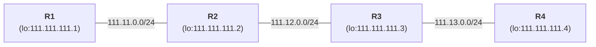

MikroTik RouterOS 为 IPv4 和 IPv6 地址族实现了 Label Distribution Protocol（RFC 3036、RFC 5036 和 RFC 7552）。LDP 是一种协议，它执行一组过程和消息交换，Label Switched Routers（LSR）通过这些过程和消息，将网络层路由信息直接映射到数据链路层交换路径，从而在网络中建立 Label Switched Paths（LSP）。

## MPLS 的前提条件 {#prerequisites-for-mpls}

### “Loopback” IP 地址 {#loopback-ip-address}

虽然这不是严格要求，但建议为参与 MPLS 网络的路由器配置“loopback”IP 地址（不附加到任何实际网络接口），供 LDP 建立会话使用。

这有两个用途：

- 由于任意 2 台路由器之间只有 1 个 LDP 会话，无论它们之间有多少条链路，loopback IP 地址都可确保 LDP 会话不受接口状态或地址变化的影响。
- 使用 loopback 地址作为 LDP 传输地址，可确保在 VPLS 等场景中，当数据包附加多个标签时，倒数第二跳弹出行为正常。

在 RouterOS 中，可以通过创建一个不带任何端口的 dummy 网桥接口，并向其添加地址来配置“loopback”IP 地址。例如：

```ros
/interface/bridge/add name=lo
/ip/address/add address=10.255.255.1/32 interface=lo
```

### IP 连通性 {#ip-connectivity}

由于 LDP 会为活动路由分发标签，因此基本要求是正确配置 IP 路由。LDP 默认为活动 IGP 路由分发标签，即直连路由、静态路由和通过路由协议学习到的路由，BGP 除外。

有关如何正确设置 IGP 的说明，请参阅相应的文档章节：

- [OSPF](/docs/user-guides/routing-and-networking-protocols/unicast/ospf)
- [Static Routing](/docs/user-guides/routing-and-networking-protocols/routing-decision)
- 等

LDP 支持 ECMP 路由。

在继续配置 LDP 之前，应确保能够从网络中的任意位置访问任意 loopback 地址。可以使用 ping 工具从 loopback 地址到 loopback 地址验证连通性。

## 示例设置 {#example-setup}

假设已有四台路由器完成设置，并且 IP 连通性正常。



### IP 可达性 {#ip-reachability}

此处不深入介绍路由设置，以下是 IP 和 OSPF 配置的快速导出：

```ros
#R1
/interface/bridge
add name=loopback
/ip/address
add address=111.11.0.1/24 interface=ether2
add address=111.111.111.1 interface=loopback

/routing/ospf/instance
add name=default_ip4 router-id=111.111.111.1
/routing/ospf/area
add instance=default_ip4 name=backbone_ip4
/routing/ospf/interface-template
add area=backbone_ip4 dead-interval=10s hello-interval=1s networks=111.111.111.1 
add area=backbone_ip4 dead-interval=10s hello-interval=1s networks=111.11.0.0/24 

#R2
/interface/bridge
add name=loopback
/ip/address
add address=111.11.0.2/24 interface=ether2
add address=111.12.0.1/24 interface=ether3
add address=111.111.111.2 interface=loopback

/routing/ospf/instance
add name=default_ip4 router-id=111.111.111.2
/routing/ospf/area
add instance=default_ip4 name=backbone_ip4
/routing/ospf/interface-template
add area=backbone_ip4 dead-interval=10s hello-interval=1s networks=111.111.111.2
add area=backbone_ip4 dead-interval=10s hello-interval=1s networks=111.11.0.0/24
add area=backbone_ip4 dead-interval=10s hello-interval=1s networks=111.12.0.0/24

#R3
/interface/bridge
add name=loopback

/ip/address
add address=111.12.0.2/24 interface=ether2
add address=111.13.0.1/24 interface=ether3
add address=111.111.111.3 interface=loopback

/routing/ospf/instance
add name=default_ip4 router-id=111.111.111.3
/routing/ospf/area
add instance=default_ip4 name=backbone_ip4
/routing/ospf/interface-template
add area=backbone_ip4 dead-interval=10s hello-interval=1s networks=111.111.111.3
add area=backbone_ip4 dead-interval=10s hello-interval=1s networks=111.12.0.0/24
add area=backbone_ip4 dead-interval=10s hello-interval=1s networks=111.13.0.0/24

#R4
/interface/bridge
add name=loopback
/ip/address
add address=111.13.0.2/24 interface=ether2
add address=111.111.111.4 interface=loopback

/routing/ospf/instance
add name=default_ip4 router-id=111.111.111.4
/routing/ospf/area
add instance=default_ip4 name=backbone_ip4
/routing/ospf/interface-template
add area=backbone_ip4 dead-interval=10s hello-interval=1s networks=111.111.111.4
add area=backbone_ip4 dead-interval=10s hello-interval=1s networks=111.13.0.0/24

```

验证 IP 连通性和路由是否正常工作

```text
[admin@R4] /ip/address> /tool/traceroute 111.111.111.1 src-address=111.111.111.4
Columns: ADDRESS, LOSS, SENT, LAST, AVG, BEST, WORST, STD-DEV
#  ADDRESS        LOSS  SENT  LAST   AVG  BEST  WORST  STD-DEV
1  111.13.0.1     0%       4  0.6ms  0.6  0.6   0.6    0      
2  111.12.0.1     0%       4  0.5ms  0.6  0.5   0.6    0.1    
3  111.111.111.1  0%       4  0.6ms  0.6  0.6   0.6    0      

```

### LDP 设置 {#ldp-setup}

要开始分发标签，需要在连接其他 LDP 路由器的接口上启用 LDP，而不要在连接客户网络的接口上启用 LDP。

在 R1 上，配置如下：

```ros
/mpls/ldp
add afi=ip lsr-id=111.111.111.1 transport-addresses=111.111.111.1
/mpls/ldp/interface
add interface=ether2    

```

:::info
请注意，transport address 设置为 111.111.111.1。这会使路由器使用该地址发起 LDP 会话连接，并将该地址作为 transport address 通告给 LDP 邻居。
:::

其他路由器的设置类似。

R2:

```ros
/mpls/ldp
add afi=ip lsr-id=111.111.111.2 transport-addresses=111.111.111.2
/mpls/ldp/interface
add interface=ether2   
add interface=ether3   

```

On R3:

```ros
/mpls/ldp
add afi=ip lsr-id=111.111.111.3 transport-addresses=111.111.111.3
/mpls/ldp/interface
add interface=ether2   
add interface=ether3   

```

On R4:

```ros
/mpls/ldp
add afi=ip lsr-id=111.111.111.4 transport-addresses=111.111.111.4
/mpls/ldp/interface
add interface=ether2   

```

建立 LDP 会话后，R2 应有两个 LDP 邻居：

```text
[admin@R2] /mpls/ldp/neighbor> print 
Flags: D, I - INACTIVE; O, T - THROTTLED; p - PASSIVE
Columns: TRANSPORT, LOCAL-TRANSPORT, PEER, ADDRESSES
#     TRANSPORT      LOCAL-TRANSPORT  PEER             ADDRESSES    
0 DO  111.111.111.1  111.111.111.2    111.111.111.1:0  111.11.0.1   
                                                       111.111.111.1
1 DOp 111.111.111.3  111.111.111.2    111.111.111.3:0  111.12.0.2   
                                                       111.13.0.1   
                                                       111.111.111.3
```

Local mappings 表显示哪些标签分配给哪些路由，以及路由器已向哪些对等体分发了标签。

```text
[admin@R2] /mpls/ldp/local-mapping> print 
Flags: I - INACTIVE; D - DYNAMIC; E - EGRESS; G - GATEWAY; L - LOCAL
Columns: VRF, DST-ADDRESS, LABEL, PEERS
#       VRF   DST-ADDRESS      LABEL      PEERS          
0  D G  main  10.0.0.0/8       16         111.111.111.1:0
                                          111.111.111.3:0
1 IDE L main  10.155.130.0/25  impl-null  111.111.111.1:0
                                          111.111.111.3:0
2 IDE L main  111.11.0.0/24    impl-null  111.111.111.1:0
                                          111.111.111.3:0
3 IDE L main  111.12.0.0/24    impl-null  111.111.111.1:0
                                          111.111.111.3:0
4 IDE L main  111.111.111.2    impl-null  111.111.111.1:0
                                          111.111.111.3:0
5  D G  main  111.111.111.1    17         111.111.111.1:0
                                          111.111.111.3:0
6  D G  main  111.111.111.3    18         111.111.111.1:0
                                          111.111.111.3:0
7  D G  main  111.111.111.4    19         111.111.111.1:0
                                          111.111.111.3:0
8  D G  main  111.13.0.0/24    20         111.111.111.1:0
                                          111.111.111.3:0

```

另一方面，Remote mappings 表显示由相邻 LDP 路由器为路由分配并通告给本路由器的标签：

```text
[admin@R2] /mpls/ldp/remote-mapping> print 
Flags: I - INACTIVE; D - DYNAMIC
Columns: VRF, DST-ADDRESS, NEXTHOP, LABEL, PEER
 #    VRF   DST-ADDRESS      NEXTHOP     LABEL      PEER           
 0 ID main  10.0.0.0/8                   16         111.111.111.1:0
 1 ID main  10.155.130.0/25              impl-null  111.111.111.1:0
 2 ID main  111.11.0.0/24                impl-null  111.111.111.1:0
 3 ID main  111.12.0.0/24                17         111.111.111.1:0
 4  D main  111.111.111.1    111.11.0.1  impl-null  111.111.111.1:0
 5 ID main  111.111.111.2                19         111.111.111.1:0
 6 ID main  111.111.111.3                20         111.111.111.1:0
 7 ID main  111.111.111.4                21         111.111.111.1:0
 8 ID main  111.13.0.0/24                18         111.111.111.1:0
 9 ID main  0.0.0.0/0                    impl-null  111.111.111.3:0
10 ID main  111.111.111.2                16         111.111.111.3:0
11 ID main  111.111.111.1                18         111.111.111.3:0
12  D main  111.111.111.3    111.12.0.2  impl-null  111.111.111.3:0
13  D main  111.111.111.4    111.12.0.2  19         111.111.111.3:0
14 ID main  10.155.130.0/25              impl-null  111.111.111.3:0
15 ID main  111.11.0.0/24                17         111.111.111.3:0
16 ID main  111.12.0.0/24                impl-null  111.111.111.3:0
17  D main  111.13.0.0/24    111.12.0.2  impl-null  111.111.111.3:0

```

可以看到，该路由器已从两个邻居 R1 和 R3 收到所有路由的标签绑定。

Remote mapping 表仅对具有直接下一跳的目的地保留活动映射。例如，仔细查看 111.111.111.4 的映射。路由表表明网络 111.111.111.4 可通过 111.12.0.2（R3）到达：

```text
[admin@R2] /ip/route> print where dst-address=111.111.111.4
Flags: D - DYNAMIC; A - ACTIVE; o, y - COPY
Columns: DST-ADDRESS, GATEWAY, DISTANCE
    DST-ADDRESS       GATEWAY            DISTANCE
DAo 111.111.111.4/32  111.12.0.2%ether3       110
```

再次查看 Remote mapping 表，唯一的活动映射是从 R3 收到的、分配标签为 19 的映射。这意味着 R2 将流量路由到该网络时，将压入标签 19。

```text
17  D main  111.111.111.4    111.12.0.2  19         111.111.111.3:0
```

可以在转发表中查看标签交换规则：

```text
[admin@R2] /mpls/forwarding-table> print 
Flags: L, V - VPLS
Columns: LABEL, VRF, PREFIX, NEXTHOPS
#   LABEL  VRF   PREFIX         NEXTHOPS                                            
0 L    16  main  10.0.0.0/8     { nh=10.155.130.1; interface=ether1 }               
1 L    18  main  111.111.111.3  { label=impl-null; nh=111.12.0.2; interface=ether3 }
2 L    19  main  111.111.111.4  { label=19; nh=111.12.0.2; interface=ether3 }       
3 L    20  main  111.13.0.0/24  { label=impl-null; nh=111.12.0.2; interface=ether3 }
4 L    17  main  111.111.111.1  { label=impl-null; nh=111.11.0.1; interface=ether2 }
```

查看规则编号 2，该规则表示当 R2 收到带标签 19 的数据包时，会将标签更改为新标签 19（由 R3 分配）。

从该示例可以看出，路径上的标签不必唯一。

现在查看 R3 的转发表：

```text
[admin@R3] /mpls/forwarding-table> print 
Flags: L, V - VPLS
Columns: LABEL, VRF, PREFIX, NEXTHOPS
#   LA  VRF   PREFIX         NEXTHOPS                                            
0 L 19  main  111.111.111.4  { label=impl-null; nh=111.13.0.2; interface=ether3 }
1 L 17  main  111.11.0.0/24  { label=impl-null; nh=111.12.0.1; interface=ether2 }
2 L 16  main  111.111.111.2  { label=impl-null; nh=111.12.0.1; interface=ether2 }
3 L 18  main  111.111.111.1  { label=17; nh=111.12.0.1; interface=ether2 } 
```

规则编号 0 显示 out label 为“**impl-null**”。原因是 R3 是到达 111.111.111.4 前的最后一跳，无需交换为任何真实标签。已知 R4 是 111.111.111.4 网络的 egress point（对于直连网络，路由器就是 egress point，因为流量的下一跳不是 MPLS 路由器），因此它会为该路由通告“implicit null”标签。这会告诉 R3 将发往目的地址 111.111.111.4/32 的流量不带标签地转发给 R4，这正是 R3 转发表条目所表示的内容。

:::warning
当标签未交换为任何真实标签时，该操作称为 **Penultimate hop popping**。它可以确保路由器在预先知道需要对数据包进行路由时，不必执行不必要的标签查找。
:::

## 在 MPLS 网络中使用 traceroute {#using-traceroute-in-mpls-networks}

RFC4950 为 MPLS 引入了 ICMP 协议扩展。基本思路是，某些 ICMP 消息可能携带 MPLS“label stack object”（当数据包引发特定 ICMP 消息时，数据包上携带的标签列表）。MPLS 关注的 ICMP 消息是 Time Exceeded 和 Fragmentation Needed。

MPLS 标签不仅携带标签值，还携带 TTL 字段。为 IP 数据包压入标签时，MPLS TTL 会设置为 IP 报头中的值。从 IP 数据包中移除最后一个标签时，IP TTL 会设置为 MPLS TTL 中的值。因此，可以使用支持 MPLS 扩展的 traceroute 工具诊断 MPLS 交换网络。

例如，从 R1 到 R4 的 traceroute 如下所示：

```text
[admin@R1] /mpls/ldp/neighbor> /tool/traceroute 111.111.111.4 src-address=111.111.111.1
Columns: ADDRESS, LOSS, SENT, LAST, AVG, BEST, WORST, STD-DEV, STATUS
#  ADDRESS        LOSS  SENT  LAST   AVG  BEST  WORST  STD-DEV  STATUS         
1  111.11.0.2     0%       2  0.7ms  0.7  0.7   0.7          0  <MPLS:L=19,E=0>
2  111.12.0.2     0%       2  0.4ms  0.4  0.4   0.4          0  <MPLS:L=19,E=0>
3  111.111.111.4  0%       2  0.5ms  0.5  0.5   0.5          0 
```

traceroute 结果显示数据包产生 ICMP Time Exceeded 时携带的 MPLS 标签。上述结果表示，当 R3 收到 MPLS TTL 为 1 的数据包时，该数据包带有标签 19。这与 R3 为 111.111.111.4 通告的标签一致。同样，在下一次 traceroute 迭代中，R2 观察到数据包带有标签 19——如上所述，R2 将标签 19 交换为标签 19。R4 收到的数据包不带标签——如上所述，R3 执行了 penultimate hop popping。

### 在 MPLS 网络中使用 traceroute 的缺点 {#drawbacks-of-using-traceroute-in-mpls-network}

#### 标签交换 ICMP 错误 {#label-switching-icmp-errors}

在 MPLS 网络中使用 traceroute 的缺点之一是 MPLS 处理生成的 ICMP 错误的方式。在 IP 网络中，ICMP 错误会直接路由回导致错误的数据包源。在 MPLS 网络中，生成错误消息的路由器可能甚至没有到 IP 数据包源的路由（例如，在非对称标签交换路径或某种 MPLS 隧道的情况下，例如用于传输 MPLS VPN 流量）。

因此，生成的 ICMP 错误不会路由回导致错误的数据包源，而是沿标签交换路径继续交换，假设当标签交换路径端点收到 ICMP 错误时，它会知道如何正确地将其路由回源。

这会导致 MPLS 网络中的 traceroute 无法像在 IP 网络中那样用于确定网络中的故障点。如果标签交换路径在中间任意位置中断，则不会有 ICMP 回复返回，因为它们无法到达标签交换路径的远端端点。

#### 倒数第二跳弹出和 traceroute 源地址 {#penultimate-hop-popping-and-traceroute-source-address}

要理解并避免倒数第二跳弹出给 traceroute 带来的问题，必须透彻理解倒数第二跳行为和路由。

在示例配置中，从 R5 到 R1 的常规 traceroute 将产生以下结果：

```
[admin@R5] > /tool/traceroute 9.9.9.1
     ADDRESS                                    STATUS
   1         0.0.0.0 timeout timeout timeout
   2         2.2.2.2 37ms 4ms 4ms
                      mpls-label=17
   3         9.9.9.1 4ms 2ms 11ms

```

与以下内容相比：

```
[admin@R5] > /tool/traceroute 9.9.9.1 src-address=9.9.9.5
     ADDRESS                                    STATUS
   1         4.4.4.3 15ms 5ms 5ms
                      mpls-label=17
   2         2.2.2.2 5ms 3ms 6ms
                      mpls-label=17
   3         9.9.9.1 6ms 3ms 3ms

```

第一次 `traceroute` 未收到来自 R3 的响应，原因是默认情况下，R5 上的 `traceroute` 使用源地址 `4.4.4.5` 发送探测包，因为它是到达 `9.9.9.1/32` 下一跳所经路由的首选源地址：

```
[admin@R5] > /ip/route/print
Flags: X - disabled, A - active, D - dynamic,
C - connect, S - static, r - rip, b - bgp, o - ospf, m - mme,
B - blackhole, U - unreachable, P - prohibit
 #      DST-ADDRESS        PREF-SRC        G GATEWAY         DISTANCE             INTERFACE
 ...
 3 ADC  4.4.4.0/24         4.4.4.5                           0                    ether1
 ...
 5 ADo  9.9.9.1/32                         r 4.4.4.3         110                  ether1
 ...

```

当第一个 `traceroute` 探测包发出时（源：`4.4.4.5`，目的：`9.9.9.1`），R3 会丢弃它并生成一条 ICMP 错误消息（源：`4.4.4.3`，目的：`4.4.4.5`），该消息一路交换到 R1。随后 R1 发回一条 ICMP 错误消息，它沿标签交换路径被交换到 `4.4.4.5`。

对于网络 `4.4.4.0/24`，R2 是倒数第二跳弹出路由器，因为 `4.4.4.0/24` 直接连接到 R3。因此，R2 移除最后一个标签，并向 R3 发送不带标签的 ICMP 错误消息：

```
[admin@R2] > /mpls/forwarding-table/print
 # IN-LABEL             OUT-LABELS           DESTINATION        INTERFACE            NEXTHOP
 ...
 3 19                                        4.4.4.0/24         ether2               2.2.2.3
 ...

```

R3 丢弃收到的 IP 数据包，因为它收到的数据包以自身地址作为源地址。后续探测包产生的 ICMP 错误消息能够正确返回，因为 R3 收到的是不带标签的数据包，其源地址为 `2.2.2.2` 和 `9.9.9.1`，这些地址对路由器来说是可接受的。

Command:

```
[admin@R5] > /tool/traceroute 9.9.9.1 src-address=9.9.9.5
 ...

```

会产生预期结果，因为 `traceroute` 探测包的源地址是 `9.9.9.5`。当 ICMP 错误消息从 R1 返回 R5 时，`9.9.9.5/32` 网络的倒数第二跳弹出发生在 R3，因此它永远不会路由以自身地址作为源地址的数据包。

## 优化标签分发 {#optimizing-label-distribution}

### 标签绑定过滤 {#label-binding-filtering}

在实施上述示例配置时，可以明确并非所有标签绑定都是必需的。例如，无需在 R1 和 R3 或 R2 和 R4 之间交换 IP 路由标签绑定，因为这些绑定不会被使用。此外，如果给定的网络核心仅为上述客户以太网网段提供连接，那么为路由器之间互连的网络分发标签也没有实际意义。真正重要的路由只有到端点的 /32 路由或直连的客户网络。

标签绑定过滤可用于仅分发指定的标签集合，以降低资源占用和网络负载。

标签绑定过滤有 2 种类型：

- 应向 LDP 邻居通告哪些标签绑定，在 `/mpls/ldp/advertise-filter` 菜单中配置。
- 应接受来自 LDP 邻居的哪些标签绑定，在 `/mpls/ldp/accept-filter` 菜单中配置。

过滤器按有序列表组织，指定必须包含待过滤前缀的前缀以及邻居（或通配符）。

在上述示例配置中，可以将所有路由器配置为仅通告用于到达隧道端点的路由的标签。为此，需要在所有路由器上配置 2 个 advertise 过滤器：

```ros
/mpls/ldp/advertise-filter/add prefix=111.111.111.0/24 advertise=yes
/mpls/ldp/advertise-filter/add prefix=0.0.0.0/0 advertise=no
```

该过滤器使路由器仅通告包含在 111.111.111.0/24 前缀内的路由的绑定，该前缀覆盖 loopback（111.111.111.1/32、111.111.111.2/32 等）。第二条规则是必需的，因为当没有规则匹配时，默认过滤结果是允许相关操作。

在上述配置中无需设置 accept 过滤器，因为按照上述 2 条规则引入的约定，任何 LDP 路由器都不会分发不必要的绑定。

请注意，过滤器更改不会影响现有映射，因此要使过滤器生效，需要重置邻居之间的连接，方法是从 LDP 邻居表中删除邻居，或重启 LDP 实例。

因此，例如在 R2 上，我们得到：

```text
[admin@R2] /mpls/ldp/remote-mapping> print 
Flags: I - INACTIVE; D - DYNAMIC
Columns: VRF, DST-ADDRESS, NEXTHOP, LABEL, PEER
#    VRF   DST-ADDRESS    NEXTHOP     LABEL      PEER           
0 ID main  111.111.111.2              17         111.111.111.3:0
1 ID main  111.111.111.1              16         111.111.111.3:0
2  D main  111.111.111.3  111.12.0.2  impl-null  111.111.111.3:0
3  D main  111.111.111.4  111.12.0.2  18         111.111.111.3:0
4 ID main  111.111.111.2              16         111.111.111.1:0
5  D main  111.111.111.1  111.11.0.1  impl-null  111.111.111.1:0
6 ID main  111.111.111.3              17         111.111.111.1:0
7 ID main  111.111.111.4              18         111.111.111.1:0
```

## IPv6 和双栈链路上的 LDP {#ldp-on-ipv6-and-dual-stack-links}

RouterOS 实现 RFC 7552，以支持双栈链路上的 LDP。

支持的 AFI 可以通过 LDP 实例选择，也可以在 LDP 接口上显式配置。

```ros
/mpls/ldp
add afi=ip,ipv6 lsr-id=111.111.111.1 preferred-afi=ipv6
/mpls/ldp/interface
add interface=ether2 afi=ip
add interface=ether3 afi=ipv6
```

上面的示例使 LDP 实例使用 IPv4 和 IPv6 地址族，并通过 `preferred-afi` 参数将优先级设置为 IPv6。另一方面，LDP 接口配置显式设置 **ether2** 仅支持 IPv4，**ether3** 仅支持 IPv6。

主要问题是，当混合使用不同 AFI 时如何选择 AFI，以及当某个受支持的 AFI 发生抖动时会怎样。

发送 hello 的逻辑如下：

- 如果接口只有一个 AFI：
  - 不发送 dual-stack 元素。
  - 仅当接口上存在来自对应 AFI 的 IP 地址时才发送 hello。
- 如果接口同时具有两个 AFI：
  - 始终发送 dual-stack 元素，并包含来自 preferred-afi 的值。
  - 如果接口上存在对应地址，则在每个 AFI 上发送 hello。

根据所有收到的 hello，对端确定用于连接的 AFI，以及要为哪些 AFI 绑定并发送标签。要使 LDP 能够使用特定 AFI，必须收到该特定 AFI 的 hello。Hello 数据包包含 LDP 正常运行所需的传输地址。通过比较收到的 AFI 地址，确定主动/被动角色。

接收和处理 hello 的逻辑如下：

- 如果 LDP 实例只有一个 AFI（这意味着所有接口只能运行该特定 AFI）：
  - 丢弃来自不受支持 AFI 的 hello。
  - 忽略 hello 数据包中的 dual-stack 元素。
  - 仅针对该特定 AFI 确定角色。
  - 仅为该特定 AFI 发送标签。
- 如果 LDP 实例同时具有两个 AFI（接口可以具有不同受支持 AFI 组合）：
  - 丢弃来自接口上未配置为受支持 AFI 的 hello。
  - 如果接口只有一个受支持的 AFI，则忽略 hello 数据包中的 dual-stack 元素（不考虑首选项）。
  - 如果 dual-stack 元素中收到的首选项与配置的 `preferred-afi` 不匹配，则丢弃该 hello。

如果 hello 数据包发生变化，仅当标签使用的地址族发生变化时才终止现有会话，否则保留会话。

仅当接口被确定为兼容 dual-stack 时，才会在 hello 数据包中设置 dual-stack 元素：

- 通常，此类接口应能接收来自两个 AFI 的 hello：
  - 在继续 LDP 处理之前，应等待来自 preferred AFI 的 hello。
  - 如果仅收到来自一个 AFI 的 hello：
    - 如果未收到来自 preferred AFI 的 hello，则视为错误。
    - 否则，等待缺失的 hello x 秒（x = 3 \* hello-interval）：
      - 如果缺失的 hello 在该时间间隔内出现，则认为对端为 dual-stack。
      - 如果缺失的 hello 未出现，则认为对端为 single-stack。
      - 如果缺失的 hello 在该时间间隔之后出现，则重启会话。
- dual-stack 元素表示 LDP 希望为两个 AFI 分发标签。

总之，在假设 preferred-afi=ipv6 的情况下，AFI 和 dual-stack 元素（ds6）可能存在以下组合：

1. ipv4 - 等待 X 秒，如果没有变化，则使用 IPv4 LDP 会话并分发 IPv4 标签。
2. ipv4+ds6 - 等待 IPv6 hello，双栈元素表示应存在 IPv6。
3. ipv6 - 等待 X 秒，如果没有变化，则使用 IPv6 LDP 会话并分发 IPv6 标签。
4. ipv6+ds6 - 使用 IPv6 LDP 会话并分发 IPv6 标签。
5. ipv4,ipv6 - 使用 IPv6 LDP 会话并分发 IPv4 和 IPv6 标签。
6. ipv4,ipv6+ds6 - 使用 IPv6 LDP 会话并分发 IPv4 和 IPv6 标签。
