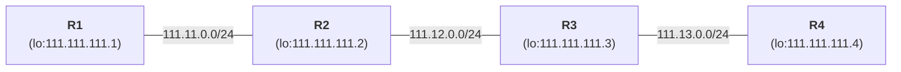

MikroTik RouterOS 为 IPv4 和 IPv6 地址族实现了 Label Distribution Protocol（RFC 3036、RFC 5036 和 RFC 7552）。LDP 是一种协议，它执行一组过程和消息交换，标签交换路由器（LSR）通过这些过程和消息，将网络层路由信息直接映射到数据链路层交换路径，从而在网络中建立标签交换路径（LSP）。

## MPLS 前提条件 {#prerequisites-for-mpls}

### “Loopback” IP 地址 {#loopback-ip-address}

尽管不是严格要求，但建议为参与 MPLS 网络的路由器配置“loopback”IP 地址（不附加到任何真实网络接口），供 LDP 用于建立会话。

这有两个目的：

- 由于任意 2 台路由器之间只有一个 LDP 会话，无论它们之间有多少条链路连接，loopback IP 地址都能确保 LDP 会话不受接口状态或地址变化的影响。
- 使用 loopback 地址作为 LDP 传输地址，可确保在数据包上附加多个标签时（如 VPLS 的情况）具有正确的倒数第二跳弹出行为。

在 RouterOS 中，可以通过创建一个没有任何端口的虚拟 bridge 接口并向其添加地址来配置“loopback”IP 地址。例如：

```ros
/interface/bridge/add name=lo
/ip/address/add address=10.255.255.1/32 interface=lo
```

### IP 连通性 {#ip-connectivity}

由于 LDP 为活动路由分发标签，基本要求是正确配置 IP 路由。默认情况下，LDP 为活动的 IGP 路由（即直连路由、静态路由以及路由协议学习到的路由，BGP 除外）分发标签。

有关如何正确设置 IGP 的说明，请参阅相应的文档章节：

- [OSPF](../unicast/ospf/index.md)
- [静态路由](../routing-decision.md)
- 等

LDP 支持 ECMP 路由。

在继续 LDP 配置之前，应该能够从网络的任何位置访问任何 loopback 地址。可以使用 ping 工具从 loopback 地址到 loopback 地址验证连通性。

## 示例设置 {#example-setup}

假设我们已经设置好四台现有路由器，并且 IP 连通性正常工作。



### IP 可达性 {#ip-reachability}

这里不深入介绍路由设置，以下是 IP 和 OSPF 配置的快速导出：

```ros
#R1
/interface/bridge
add name=loopback
/ip/address
add address=111.11.0.1/24 interface=ether2
add address=111.111.111.1 interface=loopback

/routing/ospf/instance
add name=default_ip4 router-id=111.111.111.1
/routing/ospf/area
add instance=default_ip4 name=backbone_ip4
/routing/ospf/interface-template
add area=backbone_ip4 dead-interval=10s hello-interval=1s networks=111.111.111.1 
add area=backbone_ip4 dead-interval=10s hello-interval=1s networks=111.11.0.0/24 

#R2
/interface/bridge
add name=loopback
/ip/address
add address=111.11.0.2/24 interface=ether2
add address=111.12.0.1/24 interface=ether3
add address=111.111.111.2 interface=loopback

/routing/ospf/instance
add name=default_ip4 router-id=111.111.111.2
/routing/ospf/area
add instance=default_ip4 name=backbone_ip4
/routing/ospf/interface-template
add area=backbone_ip4 dead-interval=10s hello-interval=1s networks=111.111.111.2
add area=backbone_ip4 dead-interval=10s hello-interval=1s networks=111.11.0.0/24
add area=backbone_ip4 dead-interval=10s hello-interval=1s networks=111.12.0.0/24

#R3
/interface/bridge
add name=loopback

/ip/address
add address=111.12.0.2/24 interface=ether2
add address=111.13.0.1/24 interface=ether3
add address=111.111.111.3 interface=loopback

/routing/ospf/instance
add name=default_ip4 router-id=111.111.111.3
/routing/ospf/area
add instance=default_ip4 name=backbone_ip4
/routing/ospf/interface-template
add area=backbone_ip4 dead-interval=10s hello-interval=1s networks=111.111.111.3
add area=backbone_ip4 dead-interval=10s hello-interval=1s networks=111.12.0.0/24
add area=backbone_ip4 dead-interval=10s hello-interval=1s networks=111.13.0.0/24

#R4
/interface/bridge
add name=loopback
/ip/address
add address=111.13.0.2/24 interface=ether2
add address=111.111.111.4 interface=loopback

/routing/ospf/instance
add name=default_ip4 router-id=111.111.111.4
/routing/ospf/area
add instance=default_ip4 name=backbone_ip4
/routing/ospf/interface-template
add area=backbone_ip4 dead-interval=10s hello-interval=1s networks=111.111.111.4
add area=backbone_ip4 dead-interval=10s hello-interval=1s networks=111.13.0.0/24

```

验证 IP 连通性和路由是否正常工作

```text
[admin@R4] /ip/address> /tool/traceroute 111.111.111.1 src-address=111.111.111.4
Columns: ADDRESS, LOSS, SENT, LAST, AVG, BEST, WORST, STD-DEV
#  ADDRESS        LOSS  SENT  LAST   AVG  BEST  WORST  STD-DEV
1  111.13.0.1     0%       4  0.6ms  0.6  0.6   0.6    0      
2  111.12.0.1     0%       4  0.5ms  0.6  0.5   0.6    0.1    
3  111.111.111.1  0%       4  0.6ms  0.6  0.6   0.6    0      

```

### LDP 设置 {#ldp-setup}

为了开始分发标签，在连接其他 LDP 路由器的接口上启用 LDP，而在连接客户网络的接口上不启用 LDP。

在 R1 上，配置如下所示：

```ros
/mpls/ldp
add afi=ip lsr-id=111.111.111.1 transport-addresses=111.111.111.1
/mpls/ldp/interface
add interface=ether2    

```

:::info
请注意，传输地址被设置为 111.111.111.1。这使路由器使用此地址发起 LDP 会话连接，并将此地址作为传输地址通告给 LDP 邻居。
:::

其他路由器的设置类似。

R2：

```ros
/mpls/ldp
add afi=ip lsr-id=111.111.111.2 transport-addresses=111.111.111.2
/mpls/ldp/interface
add interface=ether2   
add interface=ether3   

```

在 R3 上：

```ros
/mpls/ldp
add afi=ip lsr-id=111.111.111.3 transport-addresses=111.111.111.3
/mpls/ldp/interface
add interface=ether2   
add interface=ether3   

```

在 R4 上：

```ros
/mpls/ldp
add afi=ip lsr-id=111.111.111.4 transport-addresses=111.111.111.4
/mpls/ldp/interface
add interface=ether2   

```

LDP 会话建立后，R2 应该有两个 LDP 邻居：

```text
[admin@R2] /mpls/ldp/neighbor> print 
Flags: D, I - INACTIVE; O, T - THROTTLED; p - PASSIVE
Columns: TRANSPORT, LOCAL-TRANSPORT, PEER, ADDRESSES
#     TRANSPORT      LOCAL-TRANSPORT  PEER             ADDRESSES    
0 DO  111.111.111.1  111.111.111.2    111.111.111.1:0  111.11.0.1   
                                                       111.111.111.1
1 DOp 111.111.111.3  111.111.111.2    111.111.111.3:0  111.12.0.2   
                                                       111.13.0.1   
                                                       111.111.111.3
```

本地映射表显示哪个标签被分配给哪条路由，以及路由器已将标签分发给了哪些对等体。

```text
[admin@R2] /mpls/ldp/local-mapping> print 
Flags: I - INACTIVE; D - DYNAMIC; E - EGRESS; G - GATEWAY; L - LOCAL
Columns: VRF, DST-ADDRESS, LABEL, PEERS
#       VRF   DST-ADDRESS      LABEL      PEERS          
0  D G  main  10.0.0.0/8       16         111.111.111.1:0
                                          111.111.111.3:0
1 IDE L main  10.155.130.0/25  impl-null  111.111.111.1:0
                                          111.111.111.3:0
2 IDE L main  111.11.0.0/24    impl-null  111.111.111.1:0
                                          111.111.111.3:0
3 IDE L main  111.12.0.0/24    impl-null  111.111.111.1:0
                                          111.111.111.3:0
4 IDE L main  111.111.111.2    impl-null  111.111.111.1:0
                                          111.111.111.3:0
5  D G  main  111.111.111.1    17         111.111.111.1:0
                                          111.111.111.3:0
6  D G  main  111.111.111.3    18         111.111.111.1:0
                                          111.111.111.3:0
7  D G  main  111.111.111.4    19         111.111.111.1:0
                                          111.111.111.3:0
8  D G  main  111.13.0.0/24    20         111.111.111.1:0
                                          111.111.111.3:0

```

另一方面，远程映射表显示相邻 LDP 路由器为路由分配的标签，以及向此路由器通告的标签：

```text
[admin@R2] /mpls/ldp/remote-mapping> print 
Flags: I - INACTIVE; D - DYNAMIC
Columns: VRF, DST-ADDRESS, NEXTHOP, LABEL, PEER
 #    VRF   DST-ADDRESS      NEXTHOP     LABEL      PEER           
 0 ID main  10.0.0.0/8                   16         111.111.111.1:0
 1 ID main  10.155.130.0/25              impl-null  111.111.111.1:0
 2 ID main  111.11.0.0/24                impl-null  111.111.111.1:0
 3 ID main  111.12.0.0/24                17         111.111.111.1:0
 4  D main  111.111.111.1    111.11.0.1  impl-null  111.111.111.1:0
 5 ID main  111.111.111.2                19         111.111.111.1:0
 6 ID main  111.111.111.3                20         111.111.111.1:0
 7 ID main  111.111.111.4                21         111.111.111.1:0
 8 ID main  111.13.0.0/24                18         111.111.111.1:0
 9 ID main  0.0.0.0/0                    impl-null  111.111.111.3:0
10 ID main  111.111.111.2                16         111.111.111.3:0
11 ID main  111.111.111.1                18         111.111.111.3:0
12  D main  111.111.111.3    111.12.0.2  impl-null  111.111.111.3:0
13  D main  111.111.111.4    111.12.0.2  19         111.111.111.3:0
14 ID main  10.155.130.0/25              impl-null  111.111.111.3:0
15 ID main  111.11.0.0/24                17         111.111.111.3:0
16 ID main  111.12.0.0/24                impl-null  111.111.111.3:0
17  D main  111.13.0.0/24    111.12.0.2  impl-null  111.111.111.3:0

```

我们可以观察到，该路由器已从其两个邻居 R1 和 R3 收到了所有路由的标签绑定。

远程映射表只为具有直接下一跳的目标拥有活动映射，例如，让我们更仔细地查看 111.111.111.4 的映射。路由表表明，网络 111.111.111.4 可通过 111.12.0.2 (R3) 到达：

```text
[admin@R2] /ip/route> print where dst-address=111.111.111.4
Flags: D - DYNAMIC; A - ACTIVE; o, y - COPY
Columns: DST-ADDRESS, GATEWAY, DISTANCE
    DST-ADDRESS       GATEWAY            DISTANCE
DAo 111.111.111.4/32  111.12.0.2%ether3       110
```

如果再次查看远程映射表，唯一的活动映射是从 R3 收到的、分配了标签 19 的映射。这意味着当 R2 将流量路由到该网络时，将压入标签 19。

```text
17  D main  111.111.111.4    111.12.0.2  19         111.111.111.3:0
```

标签交换规则可以在转发表中看到：

```text
[admin@R2] /mpls/forwarding-table> print 
Flags: L, V - VPLS
Columns: LABEL, VRF, PREFIX, NEXTHOPS
#   LABEL  VRF   PREFIX         NEXTHOPS                                            
0 L    16  main  10.0.0.0/8     { nh=10.155.130.1; interface=ether1 }               
1 L    18  main  111.111.111.3  { label=impl-null; nh=111.12.0.2; interface=ether3 }
2 L    19  main  111.111.111.4  { label=19; nh=111.12.0.2; interface=ether3 }       
3 L    20  main  111.13.0.0/24  { label=impl-null; nh=111.12.0.2; interface=ether3 }
4 L    17  main  111.111.111.1  { label=impl-null; nh=111.11.0.1; interface=ether2 }
```

如果查看第 2 条规则，该规则表明当 R2 收到带有标签 19 的数据包时，它会将标签更改为新标签 19（由 R3 分配）。

从这个示例可以看出，路径上的标签不必唯一。

现在，如果我们查看 R3 的转发表：

```text
[admin@R3] /mpls/forwarding-table> print 
Flags: L, V - VPLS
Columns: LABEL, VRF, PREFIX, NEXTHOPS
#   LA  VRF   PREFIX         NEXTHOPS                                            
0 L 19  main  111.111.111.4  { label=impl-null; nh=111.13.0.2; interface=ether3 }
1 L 17  main  111.11.0.0/24  { label=impl-null; nh=111.12.0.1; interface=ether2 }
2 L 16  main  111.111.111.2  { label=impl-null; nh=111.12.0.1; interface=ether2 }
3 L 18  main  111.111.111.1  { label=17; nh=111.12.0.1; interface=ether2 } 
```

第 0 条规则显示出标签为“**impl-null**”。原因是 R3 是到达 111.111.111.4 之前的最后一跳，不需要交换为任何真实标签。已知 R4 是 111.111.111.4 网络的出口点（对于直连网络，该路由器是出口点，因为流量的下一跳不是 MPLS 路由器），因此它为这条路由通告“implicit null”标签。这告诉 R3 将目标 111.111.111.4/32 的流量以不带标签的方式转发给 R4，这正是 R3 转发表条目所表明的。

:::warning
当标签不交换为任何真实标签时的动作称为 **Penultimate hop popping**（倒数第二跳弹出）。它确保在预先知道路由器将必须对数据包进行路由时，路由器不必进行不必要的标签查找。
:::

## 在 MPLS 网络中使用 traceroute {#using-traceroute-in-mpls-networks}

RFC4950 为 MPLS 引入了 ICMP 协议扩展。其基本思想是，某些 ICMP 消息可能携带 MPLS“label stack object”（当数据包引发特定 ICMP 消息时，该数据包上的标签列表）。与 MPLS 相关的 ICMP 消息是 Time Exceeded 和 Fragmentation Needed。

MPLS 标签不仅携带标签值，还携带 TTL 字段。当为 IP 数据包压入标签时，MPLS TTL 被设置为 IP 头中的值。当从 IP 数据包中移除最后一个标签时，IP TTL 被设置为 MPLS TTL 中的值。因此，可以通过支持 MPLS 扩展的 traceroute 工具来诊断 MPLS 交换网络。

例如，从 R1 到 R4 的 traceroute 如下所示：

```text
[admin@R1] /mpls/ldp/neighbor> /tool/traceroute 111.111.111.4 src-address=111.111.111.1
Columns: ADDRESS, LOSS, SENT, LAST, AVG, BEST, WORST, STD-DEV, STATUS
#  ADDRESS        LOSS  SENT  LAST   AVG  BEST  WORST  STD-DEV  STATUS         
1  111.11.0.2     0%       2  0.7ms  0.7  0.7   0.7          0  <MPLS:L=19,E=0>
2  111.12.0.2     0%       2  0.4ms  0.4  0.4   0.4          0  <MPLS:L=19,E=0>
3  111.111.111.4  0%       2  0.5ms  0.5  0.5   0.5          0 
```

Traceroute 结果显示了数据包产生 ICMP Time Exceeded 时其上的 MPLS 标签。以上内容意味着，当 R3 收到 MPLS TTL 为 1 的数据包时，该数据包上带有标签 19。这与 R3 为 111.111.111.4 通告的标签相匹配。以同样的方式，R2 在下一次 traceroute 迭代中观察到数据包上的标签 19——如上所述，R2 将标签 19 交换为标签 19。R4 收到了不带标签的数据包——如上所述，R3 执行了倒数第二跳弹出。

### 在 MPLS 网络中使用 traceroute 的缺点 {#drawbacks-of-using-traceroute-in-mpls-network}

#### 标签交换 ICMP 错误 {#label-switching-icmp-errors}

在 MPLS 网络中使用 traceroute 的缺点之一是 MPLS 处理所产生的 ICMP 错误的方式。在 IP 网络中，ICMP 错误只是被路由回引发该错误的数据包源。在 MPLS 网络中，产生错误消息的路由器甚至可能没有到达该 IP 数据包源的路由（例如，在非对称标签交换路径或某种 MPLS 隧道的情况下，例如传输 MPLS VPN 流量）。

因此，产生的 ICMP 错误不会被路由到引发错误的数据包源，而是沿标签交换路径继续交换，假设当标签交换路径端点收到 ICMP 错误时，它将知道如何正确地将其路由回源。

这导致在 MPLS 网络中无法像在 IP 网络中那样使用 traceroute——用于确定网络中的故障点。如果标签交换路径在中间任何位置断开，将不会有 ICMP 回复返回，因为它们无法到达标签交换路径的远端端点。

#### 倒数第二跳弹出与 traceroute 源地址 {#penultimate-hop-popping-and-traceroute-source-address}

要理解并避免倒数第二跳弹出给 traceroute 带来的问题，需要透彻理解倒数第二跳行为和路由。

在示例设置中，从 R5 到 R1 的常规 traceroute 将产生以下结果：

```
[admin@R5] > /tool/traceroute 9.9.9.1
     ADDRESS                                    STATUS
   1         0.0.0.0 timeout timeout timeout
   2         2.2.2.2 37ms 4ms 4ms
                      mpls-label=17
   3         9.9.9.1 4ms 2ms 11ms

```

与以下结果相比：

```
[admin@R5] > /tool/traceroute 9.9.9.1 src-address=9.9.9.5
     ADDRESS                                    STATUS
   1         4.4.4.3 15ms 5ms 5ms
                      mpls-label=17
   2         2.2.2.2 5ms 3ms 6ms
                      mpls-label=17
   3         9.9.9.1 6ms 3ms 3ms

```

第一次 traceroute 没有从 R3 获得响应的原因是，默认情况下，R5 上的 traceroute 使用源地址 4.4.4.5 进行探测，因为它是可到达 9.9.9.1/32 下一跳的路由的首选源地址：

```
[admin@R5] > /ip/route/print
Flags: X - disabled, A - active, D - dynamic,
C - connect, S - static, r - rip, b - bgp, o - ospf, m - mme,
B - blackhole, U - unreachable, P - prohibit
 #      DST-ADDRESS        PREF-SRC        G GATEWAY         DISTANCE             INTERFACE
 ...
 3 ADC  4.4.4.0/24         4.4.4.5                           0                    ether1
 ...
 5 ADo  9.9.9.1/32                         r 4.4.4.3         110                  ether1
 ...

```

当第一个 traceroute 探测被发送时（源：4.4.4.5，目标 9.9.9.1），R3 会丢弃它并产生一条 ICMP 错误消息（源 4.4.4.3，目标 4.4.4.5），该消息一路交换到 R1。然后 R1 发回一条 ICMP 错误——它沿着标签交换路径交换到 4.4.4.5。

R2 是网络 4.4.4.0/24 的倒数第二跳弹出路由器，因为 4.4.4.0/24 直连到 R3。因此，R2 移除最后一个标签，并将 ICMP 错误以不带标签的方式发送给 R3：

```
[admin@R2] > /mpls/forwarding-table/print
 # IN-LABEL             OUT-LABELS           DESTINATION        INTERFACE            NEXTHOP
 ...
 3 19                                        4.4.4.0/24         ether2               2.2.2.3
 ...

```

R3 丢弃收到的 IP 数据包，因为它收到一个以自身地址作为源地址的数据包。后续探测产生的 ICMP 错误会正确返回，因为 R3 收到源地址为 2.2.2.2 和 9.9.9.1 的不带标签数据包，这些地址对路由器来说是可接受的。

命令：

```
[admin@R5] > /tool/traceroute 9.9.9.1 src-address=9.9.9.5
 ...

```

会产生预期结果，因为 traceroute 探测的源地址是 9.9.9.5。当 ICMP 错误从 R1 返回 R5 时，9.9.9.5/32 网络的倒数第二跳弹出发生在 R3，因此它永远不会路由一个以自身地址作为源地址的数据包。

## 优化标签分发 {#optimizing-label-distribution}

### 标签绑定过滤 {#label-binding-filtering}

在实施给定示例设置的过程中，已经明确并非所有标签绑定都是必要的。例如，R1 和 R3 或 R2 和 R4 之间没有必要交换 IP 路由标签绑定，因为它们没有机会被使用。此外，如果给定的网络核心仅为此前提到的客户以太网网段提供连通性，那么为路由器之间互连的网络分发标签就没有实际用途。唯一重要的路由是到端点或所连接客户网络的 /32 路由。

标签绑定过滤可用于仅分发指定的标签集，以减少资源使用和网络负载。

标签绑定过滤器有 2 种类型：

- 应在 `/mpls/ldp/advertise-filter` 菜单中配置向 LDP 邻居通告哪些标签绑定。
- 应在 `/mpls/ldp/accept-filter` 菜单中配置从 LDP 邻居接受哪些标签绑定。

过滤器按有序列表组织，其中指定必须包含被测试前缀的前缀，以及邻居（或通配符）。

在给定的示例设置中，可以将所有路由器配置为仅对能够到达隧道端点的路由通告标签。为此，需要在所有路由器上配置 2 个通告过滤器：

```ros
/mpls/ldp/advertise-filter/add prefix=111.111.111.0/24 advertise=yes
/mpls/ldp/advertise-filter/add prefix=0.0.0.0/0 advertise=no
```

此过滤器使路由器仅通告被 111.111.111.0/24 前缀包含的路由的绑定，该前缀涵盖 loopback（111.111.111.1/32、111.111.111.2/32 等）。第二条规则是必要的，因为当没有规则匹配时，默认过滤结果是允许相关操作。

在给定设置中，无需设置接受过滤器，因为按照上述 2 条规则引入的约定，没有 LDP 路由器会分发不必要的绑定。

请注意，过滤器更改不会影响现有映射，因此要使过滤器生效，需要重置邻居之间的连接，可以通过从 LDP 邻居表中移除邻居或重新启动 LDP 实例来实现。

因此，例如在 R2 上，我们得到：

```text
[admin@R2] /mpls/ldp/remote-mapping> print 
Flags: I - INACTIVE; D - DYNAMIC
Columns: VRF, DST-ADDRESS, NEXTHOP, LABEL, PEER
#    VRF   DST-ADDRESS    NEXTHOP     LABEL      PEER           
0 ID main  111.111.111.2              17         111.111.111.3:0
1 ID main  111.111.111.1              16         111.111.111.3:0
2  D main  111.111.111.3  111.12.0.2  impl-null  111.111.111.3:0
3  D main  111.111.111.4  111.12.0.2  18         111.111.111.3:0
4 ID main  111.111.111.2              16         111.111.111.1:0
5  D main  111.111.111.1  111.11.0.1  impl-null  111.111.111.1:0
6 ID main  111.111.111.3              17         111.111.111.1:0
7 ID main  111.111.111.4              18         111.111.111.1:0
```

## IPv6 和双栈链路上的 LDP {#ldp-on-ipv6-and-dual-stack-links}

RouterOS 实现 RFC 7552，以支持双栈链路上的 LDP。

支持的 AFI 可以由 LDP 实例选择，也可以按 LDP 接口显式配置。

```ros
/mpls/ldp
add afi=ip,ipv6 lsr-id=111.111.111.1 preferred-afi=ipv6
/mpls/ldp/interface
add interface=ether2 afi=ip
add interface=ether3 afi=ipv6
```

上述示例使 LDP 实例能够使用 IPv4 和 IPv6 地址族，并通过 `preferred-afi` 参数将首选项设置为 IPv6。另一方面，LDP 接口配置显式设置 **ether2** 仅支持 IPv4，**ether3** 仅支持 IPv6。

主要问题是，当混合使用不同 AFI 时如何选择 AFI，以及如果其中一个受支持的 AFI 发生翻转（flap）会怎样。

发送 hello 的逻辑如下：

- 如果接口只有一个 AFI：
  - 不发送双栈元素。
  - 仅当接口上有来自相应 AFI 的 IP 地址时才发送 hello。
- 如果接口同时具有两个 AFI：
  - 始终发送双栈元素，其中包含来自 preferred-afi 的值。
  - 如果接口上存在相应地址，则在每个 AFI 上发送 hello。

对等体从所有收到的 hello 中确定使用哪个 AFI 进行连接，以及为哪些 AFI 绑定和发送标签。为了使 LDP 能够使用特定 AFI，必须收到该特定 AFI 的 hello。Hello 数据包包含正常 LDP 操作所需的传输地址。通过比较收到的 AFI 地址，确定主动/被动角色。

接收和处理 hello 的逻辑如下：

- 如果 LDP 实例只有一个 AFI（这意味着所有接口只能运行该特定 AFI）：
  - 丢弃来自不受支持 AFI 的 hello。
  - 忽略/遗忘 hello 数据包中的双栈元素。
  - 仅针对该特定 AFI 确定角色。
  - 仅针对该特定 AFI 发送标签。
- 如果 LDP 实例同时具有两个 AFI（接口可以具有不同的受支持 AFI 组合）：
  - 丢弃来自未在接口上配置为受支持的 AFI 的 hello。
  - 如果接口只有一个受支持的 AFI，则忽略/遗忘 hello 数据包中的双栈元素（不考虑首选项）。
  - 如果收到的双栈元素中的首选项与配置的 `preferred-afi` 不匹配，则丢弃该 hello。

如果 hello 数据包发生变化，仅当标签使用的地址族发生变化时才终止现有会话，否则保留会话。

仅当确定接口兼容双栈时，才会在 hello 数据包中设置双栈元素：

- 通常，这样的接口应该能够接收来自两个 AFI 的 hello：
  - 在继续之前，LDP 应等待来自首选 AFI 的 hello。
  - 如果仅从其中一个 AFI 收到 hello：
    - 如果未收到来自首选 AFI 的 hello，则视为错误。
    - 否则，等待缺失的 hello x 秒（x = 3 \* hello-interval）：
      - 如果缺失的 hello 在时间间隔内出现，则认为对等体是双栈的。
      - 如果缺失的 hello 未出现，则认为对等体是单栈的。
      - 如果缺失的 hello 在时间间隔之后出现，则重新启动会话。
- 双栈元素表示 LDP 希望为两个 AFI 分发标签。

总之，假设 preferred-afi=ipv6，则以下 AFI 和双栈元素 (ds6) 的组合是可能的：

1. ipv4 - 等待 X 秒，如果无变化，则使用 IPv4 LDP 会话并分发 IPv4 标签。
2. ipv4+ds6 - 等待 IPv6 hello，双栈元素表示应该有 IPv6。
3. ipv6 - 等待 X 秒，如果无变化，则使用 IPv6 LDP 会话并分发 IPv6 标签。
4. ipv6+ds6 - 使用 IPv6 LDP 会话并分发 IPv6 标签。
5. ipv4,ipv6 - 使用 IPv6 LDP 会话并分发 IPv4 和 IPv6 标签。
6. ipv4,ipv6+ds6 - 使用 IPv6 LDP 会话并分发 IPv4 和 IPv6 标签。
