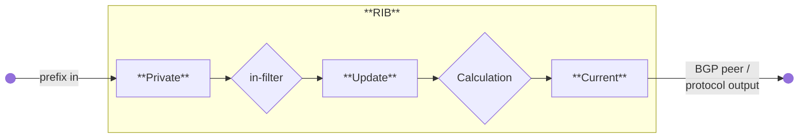

路由是在网络中选择路径，将数据包从一台主机移动到另一台主机的过程。路径选择也称为路由决策，依赖路由信息表。该表包含路由条目，每条路由条目都指定一个目的地址和用于到达该地址的下一跳。当数据包从一个网段传递到另一个网段时，就会发生一次*跳*。


通常，路由信息包含两部分，RouterOS 也不例外：

* **FIB** – 转发信息库，用于做出数据包转发决策。它包含转发所需的路由信息子集。
* **RIB** – 路由信息库，包含从路由来源学习到的所有前缀，例如连接网络、静态路由、BGP、RIP 和 OSPF。


## 路由信息库 {#routing-information-base}

RIB 包含完整的路由信息，包括静态路由、连接网络，以及从动态协议和 MPLS 标签绑定协议（例如 OSPF、BGP 和 LDP）学习到的路由。  
RIB 不仅仅是存储路由：它还会过滤路由信息，为每个目的前缀计算最佳路由，构建并更新 FIB，并在路由协议之间分发路由。

默认情况下，所有路由都组织在一个 **main** 路由表中。

### 已连接的网络 {#connected-networks}

连接路由表示主机可以直接到达的网络（与 Layer 2 广播域的直接连接）。RouterOS 会为 `/ip/address` 或 `/ipv6/address` 下配置的每个具有至少一个已启用接口的 IP 网络自动创建连接路由。RIB 会跟踪连接路由状态，但不会修改这些路由。每条连接路由都有一个对应的 IP 地址项，满足以下条件：

* **address** 是直连路由 `dst-address` 的一部分，等于 IP 地址条目的网络地址。
* **netmask** 是直连路由 `dst-address` 的一部分，等于 IP 地址条目地址部分的 netmask。
* 直连路由的 **gateway** 等于 IP 地址条目的 [`actual-interface`](/docs/cli-reference/ip/address#actual-interface)（与接口相同，但网桥接口端口除外），表示可到达特定 Layer3 网络中直连主机的接口。

直连网络示例：

```text
[admin@TempTest] /ip/route> print where connect 
Flags: D - DYNAMIC; A - ACTIVE; c - CONNECT
Columns: DST-ADDRESS, GATEWAY, ROUTING-TABLE, DISTANCE
    DST-ADDRESS      GATEWAY  ROUTING-TABLE  DISTANCE
DAc 10.155.125.0/24  ether1   main                  0
DAc 192.168.1.0/24   vlan2    main                  0
```

### 默认路由 {#default-route}

当路由表中没有其他路由匹配目标时，将使用默认路由。在 RouterOS 中，IPv4 默认路由的 `dst-address` 为 **0.0.0.0/0**，IPv6 默认路由为 **::/0**。如果路由表包含活动默认路由，则该表中的查找始终成功。

通常，家庭路由器的路由表仅包含直连网络和一条默认路由，用于将所有出站流量转发到 ISP 的网关：

```text
[admin@TempTest] /ip/route> add gateway=10.155.125.1  
[admin@TempTest] /ip/route> print where dst-address=/0  
Flags: A - ACTIVE; s - STATIC
Columns: DST-ADDRESS, GATEWAY, ROUTING-TABLE, DISTANCE
#    DST-ADDRESS  GATEWAY       ROUTING-TABLE  DISTANCE
4 As 0.0.0.0/0    10.155.125.1  main                  1
```

### 硬件卸载路由 {#hardware-offloaded-route}

支持 [Layer 3 Hardware Offloading](/docs/bridging-and-switching/l3-hardware-offloading) 的设备（L3HW，也称为 IP switching 或 HW routing）可以将数据包转发卸载到交换芯片。启用 L3HW 后，符合条件的路由会显示 **H** 标志：

```text
[admin@MikroTik] > /ip/route print where static
Flags: A - ACTIVE; s - STATIC, y - COPY; H - HW-OFFLOADED
Columns: DST-ADDRESS, GATEWAY, DISTANCE
#     DST-ADDRESS       GATEWAY         D
0 AsH 0.0.0.0/0         172.16.2.1      1
1 AsH 10.0.0.0/8        10.155.121.254  1
2 AsH 192.168.3.0/24    172.16.2.1      1
```

默认情况下，所有路由都是硬件卸载的候选路由。可以通过在单条 IPv4 或 IPv6 静态路由上启用或禁用 [`suppress-hw-offload`](/docs/cli-reference/ip/route#suppress-hw-offload) 选项来微调卸载行为。
例如，如果大多数流量发往某个服务器网络，则仅为该目标启用卸载：

```ros
/ip route set [find where static && dst-address!="192.168.3.0/24"] suppress-hw-offload=yes
```

现在，只有到 **192.168.3.0/24** 的路由带有 H 标志，表示它是唯一一条可被选择进行硬件卸载的路由：

```text
[admin@MikroTik] > /ip/route print where static
Flags: A - ACTIVE; s - STATIC, y - COPY; H - HW-OFFLOADED
Columns: DST-ADDRESS, GATEWAY, DISTANCE
#     DST-ADDRESS       GATEWAY         D
0 As  0.0.0.0/0         172.16.2.1      1
1 As  10.0.0.0/8        10.155.121.254  1
2 AsH 192.168.3.0/24    172.16.2.1      1
```

:::warning
H 标志并不表示该路由已实际进行硬件卸载，仅表示该路由可被选择进行硬件卸载。
:::

### 多路径（ECMP）路由 {#multipath-ecmp-routes}

某些场景（例如负载均衡）需要到同一目的地的多条路径。


ECMP（等价多路径）路由具有多个网关（下一跳）值。所有可达的下一跳都会复制到 [**FIB**](#forwarding-information-base) 中，用于数据包转发。

你可以手动创建这些路由，也可以通过 OSPF、BGP 或 RIP 等协议动态学习。到同一目的地的多条同等优先路由会获得 **+** 标志，并由 RouterOS 自动分组（请参阅以下示例）。

```text
[admin@TempTest] /ip/route> print 
Flags: D - DYNAMIC; I - INACTIVE, A - ACTIVE; C - CONNECT, S - STATIC, m - MODEM; + - ECMP
Columns: DST-ADDRESS, GATEWAY, DISTANCE
#       DST-ADDRESS      GATEWAY       D
0   AS+ 192.168.2.0/24   10.155.125.1  1
1   AS+ 192.168.2.0/24   172.16.1.2    1
```

默认情况下，ECMP 使用 **Layer3** 哈希策略，该策略对源 IP 地址和目的 IP 地址（IPv4），或源/目的 IP、流标签和 IP 协议（IPv6）进行哈希。  
你可以在 `/ip/settings` 和 `/ipv6/settings` 中将哈希策略更改为 **Layer4** 或 **inner Layer3** 哈希。  
支持的哈希方法包括：

|          | IPv4                  | IPv6                                      |
|:--|:--|:--|
| L3       | srcIPv4, dstIPv4      | srcIPv6, dstIPv6, flow label, IP proto    |
| L4       | srcIPv4, dstIPv4, srcPort, dstPort, IP proto | srcIPv6, dstIPv6, srcPort, dstPort, IP Proto |
| L3-Inner | <ul><li>srcIPv4, dstIPv4（如果内层为 IPv4）</li><li>srcIPv6, dstIPv6, flow label, IP proto（如果内层为 IPv6）</li><li>如果不存在内层，则与 L3 相同。</li></ul> | <ul><li>srcIPv4, dstIPv4（如果内层为 IPv4）</li><li>srcIPv6, dstIPv6, flow label, IP proto（如果内层为 IPv6）</li><li>如果不存在内层，则与 L3 相同。</li></ul> |

当 ECMP 由 [L3 hardware offloading](/docs/bridging-and-switching/l3-hardware-offloading) 卸载时，交换芯片使用其自身的哈希掩码，其中包含用于 TCP/UDP 的 L4 端口；对于硬件转发的 ECMP，配置的哈希策略会被忽略。[FastPath](/docs/firewall-and-quality-of-service/packet-flow-in-routeros#fast-path) 按目的地址缓存路由，因此 **Layer4** 和 **inner Layer3** 策略不会为 FastPath 缓存的流量提供按流分发。

### 路由选择 {#route-selection}

具有相同目的地址的多条路由可以从不同协议或静态配置中学习到，但只有一条最佳路由用于转发。RIB 运行路由选择算法，为每个目的地址从候选路由中选择最佳路由。

只有满足以下条件的路由才会参与路由选择：

* 路由未禁用。
* 如果路由类型为 *unicast*，则它必须至少有一个可达的下一跳。（如果网关来自直连网络且存在活动的直连路由，则认为该网关可达）
* 路由不应为 *synthetic*。

distance 最低的候选路由会成为活动路由。如果多条候选路由具有相同的 distance，则会任意选择一条作为活动路由。

例如，

```text
[admin@RB5009_108] /ip/route> print where dst-address=203.0.113.1
Flags: D - DYNAMIC; A - ACTIVE; s - STATIC, o - OSPF
Columns: DST-ADDRESS, GATEWAY, ROUTING-TABLE, DISTANCE
#     DST-ADDRESS     GATEWAY                  ROUTING-TABLE  DISTANCE
  D o 203.0.113.1/32  111.13.0.2%sfp-sfpplus1  main                110
2  As 203.0.113.1/32  111.13.0.2               main                  1
```

在该示例中，一条静态路由和一条 OSPF 路由指向同一目的地址。与静态路由（1）相比，OSPF 安装其路由时使用更高的默认 distance（110）。distance 较低的路由被选为最佳路由。

### 下一跳查找 {#nexthop-lookup}

Nexthop lookup 是路由选择过程的一部分。其主要目的是找到直接可达的网关地址（next-hop）。只有选择有效的 next-hop 后，路由器才知道使用哪个接口转发数据包。

如果路由的网关地址距离该路由器有多跳（例如 iBGP、multihop eBGP），Nexthop lookup 会变得更复杂。此类路由会在 next-hop 选择算法确定直接可达/直连网关地址后安装到 FIB 中（由 `immediate-gw` 参数显示）。

必须限制可用于查找 immediate next-hop 的路由集合。例如，RIP 或 OSPF 路由的 Nexthop 值应当是直接可达的，并且应仅使用 connected 路由查找。这通过 scope 和 target-scope 属性实现。

`scope` 大于最大可接受值的路由不会用于 next-hop lookup。每条路由在 `target-scope` 属性中为其 nexthop 指定最大可接受 scope 值。该属性的默认值仅允许通过 connected 路由进行 nexthop lookup，但 iBGP 路由例外，其默认值更大，也可以通过 IGP 和 static 路由查找 nexthop。
<Columns>
<Column>
<center>
| Scope | 路由类型      | Target scope |
|:--|:--      |:--|
| 0     |                 |              |
| 10    | Connected       | 5            |
| 20    | IGP (OSPF, RIP) | 10           |
| 30    | Static          | 10           |
| 40    | eBGP            | 10           |
| 40    | iBGP            | 30           |
</center>
</Column>
<Column>
矩阵显示基于默认 scope 和 target-scope 值，哪种路由类型（行）可以解析路由类型（列）的网关。
<center>
|             | IGP | Static | eBGP | iBGP |
|:--|:--|:--|:--|:--|
| **Connected** |  +  |   +    |  +   |  +   |
| **IGP**       |     |        |      |  +   |
| **Static**    |     |        |      |  +   |
| **eBGP**      |     |        |      |      |
| **iBGP**      |     |        |      |      |
</center>
</Column>
</Columns>

可以通过调整 `target-scope` 值来更改默认行为。例如，在 multihop eBGP 环境中，通过 IGP 协议路由或 static 路由解析这些路由的 nexthop 可能是较好的做法。为此，可以设置输入路由过滤规则，将 `target-scope` 更改为大于 IGP 或 static `scope` 的值。甚至可以通过调整 `scope` 和 `target-scope` 值，经 iBGP 路由解析 eBGP 路由。

scope 调整的灵活性甚至允许创建非常规配置，例如通过 eBGP 解析 OSPF。

路由按 scope 顺序处理，对 scope 较大路由的更新不会影响 scope 较小路由的 nexthop lookup 状态。

RIB 为每个地址保留多个 nexthop 对象，每个对象对应一种 scope 和网关检查的组合。

更改路由的 `target-scope` 或网关检查时，***不会影响其他路由***，因为这些属性附加到 nexthop 对象，而不是路由。

无效的 scope 值会自动修正：

* 如果 nexthop scope 设置为 255，RouterOS 会在内部将其 scope 设置为 254 来修正该错误。
* 如果路由的 scope 不大于网关查找所允许的最大 scope，RouterOS 会将 nexthop scope 设置为 `target-scope + 1` 来修正该错误。

可以在 `/routing/nexthop` 菜单中查看实际的 `scope` 和 `target-scope` 值。

可以通过设置 `check-gateway` 参数来扩展网关检查。路由器使用 ARP 探测、ICMP 消息或活动的 BFD 会话验证网关可达性。默认情况下，它每 10 秒发送一次 ICMP echo 请求（*ping*）或 ARP 请求（*arp*）。如果网关在 1 秒内未响应，请求将超时；两次超时后，网关会被标记为不可达。收到回复会使网关重新变为可达，并重置超时计数器。可以在 `/routing/settings` 菜单中调整这些间隔。

```
[admin@CCR2004_2XS_111] /routing/settings> print 
               single-process: no 
  check-gateway-ping-interval: 10s
   check-gateway-ping-timeout: 1s 
     check-gateway-ping-count: 2  
```

:::danger
设置为非 point-to-point 接口的 `gateway` 不能用于转发目的地址为多跳之外的数据包。
:::

不能在此类网关上使用 `check-gateway` 参数，因为不知道目的 IP。

### 路由存储 {#route-storage}

路由信息的存储方式经过优化，以减少常见场景下的内存占用。这些优化可能产生不明显的最坏情况，并影响性能。

所有路由和网关都按前缀/地址保存在单一层级结构中。

```
    Dst [4]/0 1/0+4                             18  <-- number of prefixes
         ^  ^ ^ ^ ^
         |  | | | |
         |  | | | \- bytes taken by Route distinguisher or Interface Id
         |  | | \--- vrf/routing table
         |  | \----- AFI
         |  \------- netmask length of prefix
         \---------- bytes taken by prefix value

         [subject to change without notice]
    
```

每个 'Dst' 条目对应唯一的 'dst-address'（对于路由）或网关地址。每个 'Dst' 条目需要一个或多个 'T2Node' 对象。

所有具有相同 'dst-address' 的路由都保存在 Dst 中，并按路由优先级排序的列表排列。  
:::info
**最坏情况**：存在大量具有相同 'dst-address' 的路由时速度会很慢，即使这些路由处于非活动状态也是如此。更新包含数万个元素的排序列表会降低性能。
:::
路由顺序仅在路由属性发生变化时改变。如果路由变为活动或非活动状态，顺序不会改变。

每条 Route 都有三份路由属性副本：

* **private** -- 从对等体收到的内容，在应用 in-filter 之前。
* **updated** -- 应用 in-filter 后的结果。
* **current** -- 路由当前使用的属性。

定期（需要时）会从 ***private*** 属性计算 ***update*** 属性。这发生在收到路由更新或更新 in-filter 时。

重新计算路由表时，***current*** 属性会设置为 ***updated*** 属性的值。



这意味着，通常如果没有更改路由属性的 in-filter，***private***、***updated,*** 和 ***current*** 共享相同的值。

路由属性保存在多个组中：

* L1 Data - 所有标志、额外属性列表、as-path；
* L2 Data – nexthops、RIP 或 OSPF 度量值、BGP 度量值、路由标签、originators 及类似属性。
* L3 Data – distance、scope、kernel type 和 MPLS 信息。
* extra properties - communities、originator、aggregator-id、cluster-list、unknown

例如，拥有许多不同的 `distance` 和 `scope` 路由属性组合将占用更多内存！

使用 regexp 匹配 communities 或 as-path 时会缓存结果，以加快过滤速度。每个 as-path 或 community 值都有一个针对所有 regexp 的缓存，并按需填充匹配结果。  
:::info
**最坏情况**：更改 `in-filter` 中的属性将使路由程序使用更多内存！因为 ***private*** 和 ***updated*** 属性将不同！大量不同的 regexp 会导致匹配变慢并占用大量内存！因为每个值都会有一个包含数千个条目的缓存！
:::

路由协议使用的内存详细信息可在 `/routing/stats/memory` 菜单中查看

## 转发信息库 {#forwarding-information-base}

FIB（Forwarding Information Base）包含数据包转发所需信息的副本：

* vrf 表
* 活动路由
* 策略路由规则
* 其他路由决策规则

每条路由都有一个 **dst-address** 属性，用于指定该路由可使用的所有目标地址。如果多条路由适用于某个特定 IP 地址，则使用最具体的一条（具有最大 netmask 的路由）。如果路由表包含多条具有相同 **dst-address** 和 netmask 的路由，则所有等效最佳路由会合并为一条 [ECMP](#multipath-ecmp-routes) 路由，安装到 FIB 中并标记为 ''active''

只能使用一条最佳路由进行数据包转发。  
查找与给定地址匹配的最具体路由称为 **routing table lookup**。

当转发决策使用其他信息（例如数据包的源地址）时，称为 **policy routing**。策略路由通过策略路由规则列表实现，这些规则根据数据包的目标地址、源地址、源接口和路由标记（可由 firewall mangle 规则更改）选择不同的路由表。

### 路由表查找 {#routing-table-lookup}

FIB 使用数据包中的以下信息确定其目的地：

* 源地址
* 目的地址
* 源接口
* 路由标记

可能的路由决策包括：

* 在本地接收数据包
* 丢弃数据包（静默丢弃，或向数据包发送方发送 ICMP 消息）
* 通过指定接口将数据包发送到指定 IP 地址

路由决策操作由 [/routing/settings](/docs/cli-reference/routing/settings) 中通过 `policy-rules` 参数定义的策略规则确定。  
默认情况下：

```ros
[admin@CCR2004_2S+_107] /routing/settings> print 
               single-process: no         
  check-gateway-ping-interval: 10s        
   check-gateway-ping-timeout: 1s         
     check-gateway-ping-count: 2          
                 policy-rules: mangle     
                               vrf-lookup 
                               vrf-unreach
                               local      
                               user       
                               main  
 ```

* 在由 mangle 规则标记的路由表中查找目的地址。
* 如果接口属于 VRF，或数据包被引导至 VRF，则尝试在 VRF 表中查找。
* 如果 VRF 查找失败，则拒绝该数据包。
* 检查数据包是否需要在本地交付（目的地址是路由器地址）。
* 处理用户定义的 [routing rules](/docs/cli-reference/routing/rule)（来自“user”链）。
* 在 `main` 路由表中查找目的地址。

根据所需任务的复杂程度，可以更改默认规则的顺序，或通过添加自定义规则微调设置。

例如，如果目标 1.2.3.4 只能在 `other_table` 中解析，并且你还打算使用 mangle，则添加路由规则并将 mangle action 移到自定义规则下方：

```ros
[admin@r1] /routing/settings> set policy-rules=vrf-lookup,vrf-unreach,local,user,mangle,main
[admin@r1] /routing/rule> add dst-address=1.2.3.4 action=lookup-only-in-table table=other_table
[admin@r1] /routing/rule> print 
Flags: X - disabled, I - inactive; * - default 
 0    dst-address=1.2.3.4 action=lookup-only-in-table table=other_table 
 ```

如果规则具有 action：

* `drop` 或 `unreachable`，则将其作为路由决策过程的结果返回。
* `lookup`，则在规则指定的路由表中查找数据包的目标地址。如果查找失败（没有路由匹配数据包的目标地址），则 FIB 继续执行下一条规则。
* `lookup-only-in-table` 与 `lookup` 类似，不同之处在于，如果表中没有任何路由匹配该数据包，则查找失败。

Otherwise:

* 如果路由类型为 blackhole，则返回该 action 作为路由决策结果。
* 如果这是直连路由，或网关值为接口的路由，则返回该接口和数据包的目标地址作为路由决策结果。
* 如果该路由的网关值为 IP 地址，则返回该地址和关联接口作为路由决策结果。
* 如果该路由有多个 nexthop 值，则根据配置的 [hash policy](#multipath-ecmp-routes) 以轮询方式选择其中一个。

请注意，通常不建议将接口设置为静态路由的网关。接口网关仅在两种场景中有用：

* 在 point-to-point 类型接口上；
* 在目标地址直连的接口上。

如果路由决策在广播网络上返回接口和数据包的目标地址作为结果，路由器将尝试通过发送 ARP 探测，在该接口上解析数据包的目标地址。如果同一广播域内没有任何主机拥有该 IP 地址，转发将失败，因此此类网关不能用于路由目标为多跳之外的数据包。
