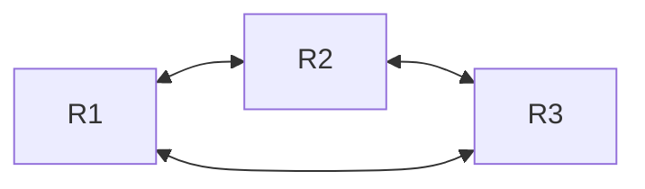
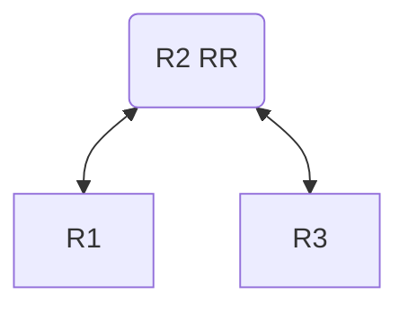

**eBGP** 会话的用途是在自治系统（AS）之间交换路由信息。通常，eBGP 会话建立在直连的物理或逻辑网络上（单跳链路），位于网络出口点；使用默认参数时，如果对端位于多跳之外，连接将失败。  
在 EVPN 环境中，运维人员通常在由 IGP 路由的环回地址上运行 eBGP 会话。这意味着连接不再位于直连网络上，除非配置 [`multihop`](/docs/cli-reference/routing/bgp/connection#multihop)`=yes`，否则连接将失败。

AS_PATH 属性用于防止路由环路。如果列表中包含自身 AS 号（ASN），则丢弃该路由；但在某些特定环境中，这不是期望的行为。例如，MPLS L3VPN 环境需要使用 [`input.allow-as`](/docs/cli-reference/routing/bgp/connection#input.allow-as) 参数覆盖默认的环路防护机制，以允许 CE 路由器接受来自多归属或互联站点且包含自身 ASN 的路由。

默认情况下，下一跳会出于显而易见的原因更改为自身，但在某些环境中同样不希望如此，例如 EVPN overlay。要覆盖默认行为，请将 [`nexthop-choice`](/docs/cli-reference/routing/bgp/connection#nexthop-choice) 参数设置为 `propagate`。

## 内部 BGP（iBGP）对等 {#internal-bgp-ibgp-peering}

与 **eBGP** 不同，**iBGP** 用于在自治系统内交换路由信息。它将从 eBGP 对等体学到的外部路由传播到内部网络中。

默认情况下，**iBGP** 会话被视为多跳，并运行在内部网关协议（IGP）之上，例如 [OSPF](/docs/user-guides/routing-and-networking-protocols/unicast/ospf/areas-and-virtual-links) 或 ISIS，由该协议提供环回地址之间的可达性。外部路由的下一跳会被传播，IGP 负责下一跳解析。在较小规模的环境中，为降低配置复杂度，可以将 [`nexthop-choice`](/docs/cli-reference/routing/bgp/connection#nexthop-choice) 参数设置为 `force-self`，并在直连网络上运行 iBGP 会话，从而在没有底层 IGP 的情况下使用 iBGP。

在 iBGP 对等体之间传播路由时，不会将自身 AS 号添加到 AS Path 列表中；而是使用水平分割进行环路防护，即规定从某个 iBGP 对等体学到的路由不会通告给另一个 iBGP 对等体。要克服水平分割的限制，每台 iBGP 路由器都必须与所有其他 iBGP 路由器建立连接，从而形成 **full mesh**。



full mesh 的问题在于可扩展性，连接总数为 `n*(n-1)/2`。为简化大规模 iBGP 网络，可使用 [路由反射器（RR）](#dynamic-sessions) 消除对 full mesh 的需求。它建立客户端—服务器关系，客户端仅与路由反射器建立对等关系，从而将连接数减少到 `n-1`。



引入 RR 会打破标准水平分割规则以实现路由反射，因此使用 **ORIGINATOR_ID** 和 **CLUSTER_LIST** 属性来防止路由环路。

## 会话配置 {#session-configuration}

[`/routing/bgp/connection`](/docs/cli-reference/routing/bgp/connection) 菜单定义 BGP 出站连接，同时也用作入站 BGP 连接的模板匹配器。

以下是一个非常基础的 BGP 配置示例。假设 Router1 的 IP 为 192.168.1.1，AS 为 65531；Router2 的 IP 为 192.168.1.2，AS 为 65532：

```ros
#Router1
/routing/bgp/instance
add name=myInstance as=65531

/routing/bgp/connection
add name=toR2 remote.address=192.168.1.2 instance=myInstance local.role=ebgp
```

```ros
#Router2
/routing/bgp/instance
add name=myInstance as=65532

/routing/bgp/connection
add name=toR1 remote.address=192.168.1.1 instance=myInstance local.role=ebgp
```

[`local.role`](/docs/cli-reference/routing/bgp/connection#local.role) 是必填参数，用于描述会话的性质：是 **eBGP** 会话（如本例）、[**iBGP**](#internal-bgp-ibgp-peering) 会话，还是充当 iBGP **route-reflector**。此外，还有用于 **route leak prevention and detection** 的其他模式，来自 [RFC 9234](https://datatracker.ietf.org/doc/rfc9234/)。

连接不需要指定远端 AS 号；RouterOS 会根据收到的第一条 **OPEN** 消息动态确定它。

与其他厂商和旧版 RouterOS 中的 `update-source` 对应的参数是 [`local.address`](/docs/cli-reference/routing/bgp/connection#local.address)。在大多数情况下，可以不配置该参数，路由器会自行确定地址。

未指定本地地址时，BGP 会根据当前配置尝试推测该地址：

- 如果对端是 iBGP
  - 如果有可用的 loopback
    - 选择最高的 loopback 地址
  - 如果没有可用的 loopback
    - 选择路由器上最高的 IP 地址
- 如果对端是 eBGP
  - 如果远端对端的 IP 不来自直连网络：
    - 如果未设置 multihop，BGP 会抛出错误
    - 如果启用了 multihop：
      - 如果有可用的 loopback
        - 选择最高的 loopback 地址
      - 如果没有可用的 loopback
        - 选择路由器上最高的 IP 地址
  - 如果远端对端的 IP 来自直连网络：
    - 如果未设置 multihop：
      - 从该直连网络中选择路由器的 IP 地址
    - 如果设置了 multihop：
      - 如果有可用的 loopback
        - 选择最高的 loopback 地址
      - 如果没有可用的 loopback
        - 选择路由器上最高的 IP 地址

此菜单还直接公开特定于模板的参数，在不需要模板的简单场景中可简化配置。

:::warning
不应在不安全的环境中启用监听子网；此类配置可能导致拒绝服务（DoS）。  
必须配置防火墙以保护路由器。  
详情请参阅 [`listen`](/docs/cli-reference/routing/bgp/connection#listen) 参数。
:::

### 活动会话列表 {#active-session-list}

检查 [`/routing/bgp/session`](/docs/cli-reference/routing/bgp/session) 菜单，查看会话是否已建立：

```ros
[admin@MikroTik] /routing/bgp/session> print 
Flags: E - established 
 0 E name="toR2" instance=myInstance 
     remote.address=192.168.1.2 .as=65532 .id=192.168.1.1 .refused-cap-opt=no 
     .capabilities=mp,rr,as4 .afi=ip,ipv6 .messages=43346 .bytes=3635916 .eor="" 
     local.address=192.168.1.1 .as=65531 .id=192.168.44.2 .capabilities=mp,rr,gr,as4 .messages=2 
     .bytes=71 .eor="" 
     output.procid=97 .keep-sent-attributes=no 
     .last-notification=ffffffffffffffffffffffffffffffff0015030601 
     input.procid=97 .limit-process-routes=500000 ebgp limit-exceeded 
     hold-time=3m keepalive-time=1m uptime=4s70ms
```

它显示只读的缓存 BGP 会话信息：当前状态、标志、上次收到的通知以及协商的会话参数。

即使 BGP 会话已不再处于活动状态，缓存仍可能保留一段时间。只有缓存过期时，才会移除从特定会话收到的路由；这可缓解 BGP 会话频繁振荡时的大量路由表重算。

如果 BGP 首次尝试建立会话，但 TCP 连接因 MD5 身份验证错误、防火墙阻止或任何其他阻止连接的因素而无法发起，则不会创建会话条目。

### 参数分组 {#parameter-grouping}

可以发现，大多数参数都按 `output`、`input`、`local` 和 `remote` 部分分组，使配置更易读，也更容易理解某个选项应用于 `input` 还是 `output`，以及它是影响路由器本地的值，还是尝试匹配远端对等体的参数。  
例如：

- 要指定输出选择链，请设置 [`output.filter-chain`](/docs/cli-reference/routing/bgp/connection#output.filter-chain)`=myBgpChain`。
- 会话列表中的 `local.bytes` 表示已发送的字节数。
- `remote.messages` 表示远端对等体已发送的数据包数量。
- 以此类推。

### BGP unnumbered

RouterOS 能够动态建立 BGP 会话，无需在接口上配置全局 IPv6 地址，也无需指定远端链路本地地址（BGP Unnumbered connection）。该机制依赖 IPv6 邻居发现（[RFC 4861](https://datatracker.ietf.org/doc/html/rfc4861)）获取邻居的链路本地地址，并使用 [RFC5549](https://datatracker.ietf.org/doc/html/rfc5549) 通过 IPv6 下一跳发布 IPv4 NLRI。

当 [`remote.address`](/docs/cli-reference/routing/bgp/connection#remote.address) 为空且 [`local.address`](/docs/cli-reference/routing/bgp/connection#local.address) 为接口时，将配置 unnumbered 连接。在此模式下，每个接口只接受一个连接。
这适用于包含大量点对点链路的场景，例如将 eBGP 用作 EVPN underlay。

对于未配置全局地址、需要发送 RA 回复的路由器，请应用以下 ND 配置：

```ros
/ipv6/nd/prefix/add prefix=none interface=sfp-sfpplus1
```

```ros
[admin@CCR2004_2XS_111] /ipv6/neighbor> print 
Flags: D - DYNAMIC; R - ROUTER
Columns: ADDRESS, MAC-ADDRESS, INTERFACE, VRF
#    ADDRESS                    MAC-ADDRESS        INTERFACE     VRF 
0 DR fe80::de2c:6eff:fec5:a7ff  DC:2C:6E:C5:A7:FF  sfp-sfpplus1  main
```

添加 unnumbered 连接配置：

```ros
/routing bgp connection
add instance=myInstance local.address=sfp-sfpplus1 .role=ibgp name=unnumbered_2
```

```ros
[admin@CCR2004_2XS_111] /routing/bgp/connection> print 
Flags: D - DYNAMIC, X - DISABLED, I - INACTIVE 
 0   name="unnumbered_2" instance=myInstance 
     local.address=sfp-sfpplus1 .default-address=fe80::de2c:6eff:fea4:b42f%sfp-sfpplus1 .role=ibgp 
     routing-table=main as=333 

[admin@CCR2004_2XS_111] /routing/bgp/session> print 
Flags: E - ESTABLISHED 
 0 E name="unnumbered_2-1" instance=v6_test 
     remote.address=fe80::de2c:6eff:fec5:a7ff%sfp-sfpplus1 .as=333 .id=203.0.113.2 .capabilities=mp,rr,enhe,gr,as4 .afi=ipv6 
     .messages=5181 .bytes=98439 .eor="" 
     local.role=ibgp .address=fe80::de2c:6eff:fea4:b42f%sfp-sfpplus1 .as=333 .id=203.0.113.1 .cluster-id=203.0.113.1 
     .capabilities=mp,rr,enhe,gr,as4 .afi=ipv6 .messages=5181 .bytes=98439 .eor="" 
     output.procid=20 
     input.procid=20 ibgp 
     multihop=yes hold-time=3m keepalive-time=1m uptime=3d14h20m55s640ms last-started=2026-02-12 18:26:59 prefix-count=0 
```

### 动态会话 {#dynamic-sessions}

BGP 对等体配置可能相当复杂且扩展性不佳，例如 hub-and-spoke 组网或 iBGP 路由反射器组网。

假设有一个包含路由反射器的组网，其中连接了两个对等体。为简化配置并提高扩展性，我们将使用 BGP 模板设置公共参数，并将连接配置为监听 loopback 地址范围，这样无需在路由反射器上进行任何配置即可添加更多对等体。


**Prerequisites**

- 接口上的 IP 连通性
- 已在接口上配置并运行 OSPF

**路由反射器**

在配置 BGP 之前，需要添加 loopback 地址并启用 OSPF 以发布 loopback 路由：

```routeros
/ip address
add address=203.0.255.1 interface=lo
/routing ospf interface-template add interfaces=lo area=backbone passive
```

接下来创建一个包含公共参数的 BGP 模板，并创建一个 BGP 会话以监听我们的 loopback（203.0.255.0/24）地址范围：

```routeros
/routing bgp instance
add as=65000 name=bgp_inst
/routing bgp template
set default afi=ip multihop=yes nexthop-choice=propagate hold-time=10s
/routing bgp connection
add instance=bgp_inst local.address=203.0.255.1 .role=ibgp-rr name=rr remote.address=\
    203.0.255.0/24 templates=default listen=yes
```

要添加新的 BGP 对等体，请在对等体和路由反射器之间创建 IP 连接，并将 BGP 配置为连接到反射器的 loopback 地址：

**Peer_1**

```routeros
/ip address
add address=203.0.255.11 interface=lo
/routing ospf interface-template add interfaces=lo area=backbone passive

/routing bgp instance
add as=65000 name=bgp_inst
/routing bgp connection
add instance=bgp_inst local.role=ibgp name=to_rr remote.address=203.0.255.1
```

**Peer_2**

```routeros
/ip address
add address=203.0.255.12 interface=lo
/routing ospf interface-template add interfaces=lo area=backbone passive

/routing bgp instance
add as=65000 name=bgp_inst
/routing bgp connection
add instance=bgp_inst local.role=ibgp name=to_rr remote.address=203.0.255.1
```

**Peer_N**

```routeros
/ip address
add address=203.0.255.1N interface=lo
/routing ospf interface-template add interfaces=lo area=backbone passive

/routing bgp instance
add as=65000 name=bgp_inst
/routing bgp connection
add instance=bgp_inst local.role=ibgp name=to_rr remote.address=203.0.255.1
```

更多用例请参阅 EVPN，其中该方法用于 [EVPN Overlay](/docs/user-guides/routing-and-networking-protocols/unicast/evpn#bgp-evpn-overlay) 配置。
