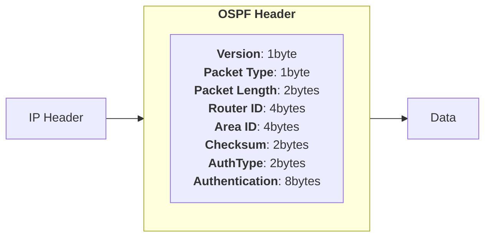
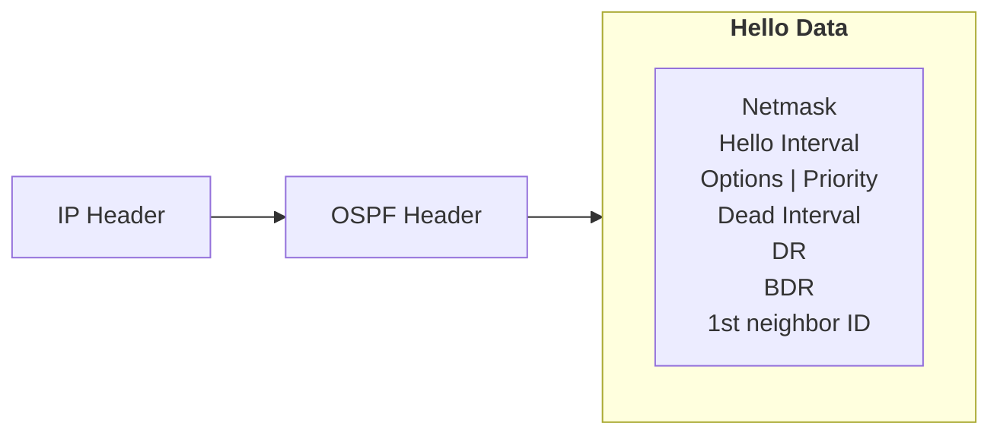

OSPF 是一种链路状态协议，它将路由器接口视为一条 OSPF 链路。每当 OSPF 启动时，它会把所有链路的状态加入本地**链路状态数据库**。

在 OSPF 网络完全可用之前，必须完成几个步骤：

- 邻居发现
- 数据库同步
- 路由计算

链路状态路由协议会分发并复制一个描述路由拓扑的数据库。链路状态协议的泛洪算法确保每台路由器都具有相同的链路状态数据库。路由表基于该数据库计算。

完成上述所有步骤后，每个邻居上的链路状态数据库都包含完整的路由域拓扑（网络中有多少台其他路由器、路由器有多少个接口、路由器之间的链路连接哪些网络、每条链路的开销，等等）。

## 基本配置示例 {#basic-configuration-example}

要启动 OSPF v2 和 v3 实例，请添加实例和骨干区域：

```ros
/routing/ospf/instance
add name=v2inst version=2 router-id=1.2.3.4
add name=v3inst version=3 router-id=1.2.3.4
/routing/ospf/area
add name=backbone_v2 area-id=0.0.0.0 instance=v2inst
add name=backbone_v3 area-id=0.0.0.0 instance=v3inst
```

该模板匹配 OSPF 应发现邻居的接口。可直接指定网络或接口。

```ros
/routing/ospf/interface-template
add networks=192.168.0.0/24 area=backbone_v2
add networks=2001:db8::/64 area=backbone_v3
add interfaces=ether1 area=backbone_v3
```

## OSPF 路由器之间的通信 {#communication-between-ospf-routers}

OSPF 在 IP 网络层上运行，协议号为 89。
目标 IP 地址被设置为邻居的 IP 地址，或设置为 OSPF 组播地址之一：AllSPFRouters（224.0.0.5）或 AllDRouters（224.0.0.6）。这些地址将在本文后面介绍。
每个 OSPF 数据包都以标准的 24 字节头部开始。

<center>

</center>

| 字段 | 描述 |
| :-- | :-- |
| **数据包类型** | 存在多种 OSPF 数据包类型：Hello 数据包、Database Description (DD) 数据包、Link-State Request 数据包、Link-State Update 数据包和 Link-State Acknowledgment 数据包。除 Hello 数据包外，所有这些数据包都用于链路状态数据库同步。 |
| **Router ID** | 默认使用路由器的一个 IP 地址，除非手动配置。 |
| **Area ID** | 允许 OSPF 路由器将数据包关联到正确的 OSPF 区域。 |
| **校验和** | 允许接收路由器判断数据包在传输过程中是否损坏。 |
| **认证字段** | 这些字段允许接收路由器验证数据包的内容未被修改，并且数据包来自数据包中出现的 Router ID 所对应的 OSPF 路由器。 |

五种 OSPF 数据包类型可确保 LSA 在 OSPF 网络中正确泛洪：

- **Hello 数据包** - 发现 OSPF 邻居并建立邻接关系。
- **Database Description (DD)** - 检查路由器之间的数据库同步情况。在邻接关系建立后交换。
- **Link-State Request (LSR)** - 请求邻居数据库中的最新部分。路由数据库中过时的部分在 DD 交换后确定。
- **Link-State Update (LSU)** - 携带一组被专门请求的链路状态记录。
- **Link-State Acknowledgment (LSack)** - 确认其他数据包类型，以确保可靠通信。

## 邻居发现 {#neighbor-discovery}

OSPF 通过从已配置的接口周期性发送 Hello 数据包来发现潜在的邻居。默认情况下，*Hello 数据包*每 10 秒发送一次。你可以通过在 OSPF 接口设置中设置 [`hello-interval`](../../../../cli-reference/routing/ospf/interface-template.md#hello-interval) 来更改此间隔。当路由器收到邻居返回的、参数匹配的 Hello 数据包时，它就会得知存在一个邻居路由器。

Hello 数据包的发送和接收还使路由器能够检测邻居的故障。如果在 [`dead-interval`](../../../../cli-reference/routing/ospf/interface-template.md#dead-interval)（默认为 40 秒）内未收到 Hello 数据包，路由器就会开始绕过该故障进行路由。"Hello" 协议确保相邻路由器在 Hello 间隔和 Dead 间隔参数上达成一致，从而防止因未及时收到 Hello 数据包而错误地将链路判定为 down 的情况。

<center>


</center>
| 字段 | 描述 |
| :-- | :-- |
| **网络掩码** | 发起路由器接口 IP 地址的 IP 掩码。 |
| **Hello 间隔** | Hello 数据包之间的时间间隔（默认 10 秒）。 |
| **选项** | 用于邻居信息的 OSPF 选项。 |
| **路由器优先级** | 一个 8 位值，用于辅助 DR 和 BDR 的选举（在点对点链路中不设置）。 |
| **路由器 Dead 间隔** | 在邻居被视为 down 之前的时间间隔（默认是 Hello 间隔的四倍）。 |
| **DR** | 当前 DR 的 Router ID。 |
| **BDR** | 当前 BDR 的 Router ID。 |
| **邻居 Router ID** | 发起路由器的所有邻居的 Router ID 列表。 |

在每种类型的网段上，Hello 协议的工作方式略有不同。在点对点网段上，只可能有一个邻居，不需要额外的操作。然而，如果该网段上可以有多个邻居，则会采取额外操作来提高 OSPF 的效率。

除非满足以下条件，否则两台路由器不会成为邻居：

- 路由器之间可以双向通信。这通过泛洪 Hello 数据包来确定。
- 接口应属于同一区域。
- 接口应属于同一子网并具有相同的网络掩码，除非其 network-type 配置为 **point-to-point**。
- 路由器应具有相同的认证选项，并交换相同的密码（如果有）。
- Hello 数据包中的 Hello 间隔和 Dead 间隔应相同。
- Hello 数据包中的外部路由和 NSSA 标志应相同。

:::info
**网络掩码、优先级、DR 和 BDR**字段仅在邻居通过广播或 **NBMA** 网段连接时使用。
:::

### 广播子网上的发现 {#discovery-on-broadcast-subnets}

连接到广播子网的节点可以发送单个数据包，而该数据包会被所有其他连接的节点接收。这允许自动配置和信息复制。广播子网中的另一个重要功能是组播。此功能允许发送单个数据包，而该数据包将被配置为接收组播数据包的节点接收。OSPF 利用此功能来发现 OSPF 邻居并检测双向连通性。

每个 OSPF 路由器都会加入 IP 组播组 **AllSPFRouters**（224.0.0.5）。然后，路由器会周期性将其 Hello 数据包组播到 IP 地址 224.0.0.5。加入同一组的所有其他路由器都将收到组播的 Hello 数据包。通过这种方式，OSPF 路由器只需发送单个数据包，而不是向该网段上的每个邻居分别发送数据包，就能维护与所有其他 OSPF 路由器的关系。

这种方法具有几个优点：

- 通过组播或广播 Hello 数据包自动发现邻居。
- 与其他子网类型相比，带宽占用更少。
- 在广播网段上存在 n\*(n-1)/2 个邻居关系，但只需发送 n 个 Hello 数据包即可维护这些关系。
- 如果广播具备组播能力，OSPF 可在不干扰广播网段上非 OSPF 节点的情况下运行。
- 如果不支持组播能力，所有路由器都将收到广播的 Hello 数据包，即使某个节点不是 OSPF 路由器。

### NBMA 子网上的发现 {#discovery-on-nbma-subnets}

非广播多路访问（NBMA）网段与广播网段类似。它们支持两台以上的路由器。唯一的区别是 NBMA 不支持数据链路广播能力。由于这一限制，OSPF 邻居必须最初通过配置来发现。在 RouterOS 上，静态邻居配置在 [`/routing/ospf/static-neighbor`](../../../../cli-reference/routing/ospf/static-neighbor.md) 菜单中设置。为减少 Hello 流量，连接到 NBMA 子网的大多数路由器应分配 Router Priority 为 0（RouterOS 中默认设置）。有资格成为指定路由器的路由器应具有非 0 的优先级值。这确保在 DR 和 BDR 选举期间，Hello 数据包只发送给有资格的路由器。

### PTMP 子网上的发现 {#discovery-on-ptmp-subnets}

Point-to-MultiPoint 将网络视为一组点对点链路。

按照设计，PTMP 网络不具备广播能力，因此 OSPF 邻居必须最初通过配置来发现，这与 NBMA 网络相同。所有通信都通过邻居之间直接发送单播数据包来进行。在 RouterOS 上，静态邻居配置在 [`/routing/ospf/static-neighbor`](../../../../cli-reference/routing/ospf/static-neighbor.md) 菜单中设置。点对多点子网上不会选举指定路由器和备份指定路由器。

对于支持广播的 PTMP 网络，可以使用名为 "ptmp-broadcast" 的混合类型。此网络类型使用组播 Hello 数据包自动发现邻居，并检测邻居之间的双向通信。在发现邻居后，"ptmp-broadcast" 会直接向已发现的邻居发送单播数据包。此模式与 RouterOS v6 的 "ptmp" 类型兼容。

## 主从关系 {#master-slave-relation}

在数据库同步开始之前，必须建立用于交换信息的层级顺序，以确定哪台路由器先发送 **Database Descriptor**（**DD**）数据包（**Master**）。主路由器是 Router ID 较高的那台路由器。这是一种基于路由器 [`priority`](../../../../cli-reference/routing/ospf/interface-template.md#priority) 的关系，用于安排邻居之间的数据交换，并且不影响 DR/BDR 选举（**DR** 并不总是必须是 **Master**）。

## 数据库同步 {#database-synchronization}

OSPF 路由器之间的链路状态数据库同步非常重要。未同步的数据库可能导致路由表计算错误，从而造成路由环路或黑洞。

OSPF 使用两种类型的数据库同步：

- 初始数据库同步。
- 可靠泛洪。

当两个邻居之间的连接首次建立时，会发生*初始数据库同步*。OSPF 在邻居连接首次建立时使用显式数据库下载。此过程称为 **Database exchange**。OSPF 路由器不是发送整个数据库，而是按顺序在一系列 OSPF **Database Description (DD)** 数据包中仅发送其 LSA 头部。路由器只有在前一个数据包被确认后才会发送下一个 DD 数据包。当收到完整的 DD 数据包序列后，路由器就知道自己缺少哪些 LSA，以及哪些 LSA 更新。然后，路由器发送 **Link-State Request (LSR)** 数据包请求所需的 LSA，邻居则通过在 **Link-State Update (LSU)** 数据包中泛洪 LSA 来响应。收到所有更新后，邻居就被称为**完全邻接**。

可靠泛洪是另一种数据库同步方法。此方法用于邻接关系已经建立，且 OSPF 路由器必须通知其他路由器 LSA 变化的情况。当 OSPF 路由器收到这样的 Link State Update 时，它会在链路状态数据库中安装新的 LSA，向发送方回送确认数据包，将 LSA 重新封装到新的 LSU 中，并将其发送到除接收接口之外的所有接口。

OSPF 通过比较序列号来判断 LSA 是否为最新。序列号从 0x80000001 开始。数字越大，LSA 越新。每次泛洪该记录时，序列号都会递增，而接收更新的邻居会重置 Maximum age 计时器。LSA 每 30 分钟刷新一次，但如果没有刷新，LSA 会在数据库中保留最长 60 分钟的最大老化时间。

数据库并非总是在所有 OSPF 邻居之间同步。OSPF 根据网段决定是否必须同步数据库。例如，在点对点链路上，路由器之间始终同步数据库。在以太网网络上，数据库只在某些邻居对之间同步。

### 广播子网上的同步 {#synchronization-on-broadcast-subnets}

在广播网段上存在 n\*(n-1)/2 个邻居关系。如果 OSPF 路由器尝试与该子网上的每台 OSPF 路由器同步，就会在子网上发送大量 Link State Update 和确认。


通过为每个广播子网选举一个**指定路由器**和一个**备份指定路由器**来解决此问题。所有其他路由器仅与这两台选举出的路由器同步并形成邻接关系。这种方法将邻接关系数量从 n\*(n-1)/2 减少到仅 2n-3。

右图展示了广播子网上的邻接关系形成。R1 是指定路由器，R2 是备份指定路由器。例如，如果 R3 要向 R1 和 R2 泛洪 Link State Update (LSU)，该路由器会将 LSU 发送到 IP 组播地址 **AllDRouters**（224.0.0.6），只有 DR 和 BDR 监听此组播地址。然后，指定路由器发送发往 AllSPFRouters 的 LSU，以更新其余路由器。

#### DR 选举 {#dr-election}

DR 和 BDR 路由器根据 Hello 数据包中收到的数据进行选举。子网上的第一台 OSPF 路由器始终被选举为指定路由器。当添加第二台路由器时，它将成为备份指定路由器。当现有 DR 或 BDR 发生故障时，将根据配置的路由器 [`priority`](../../../../cli-reference/routing/ospf/interface-template.md#priority) 选举新的 DR 或 BDR。优先级最高的路由器将成为新的 DR 或 BDR。

充当指定路由器或备份指定路由器会消耗额外资源。如果将 Router Priority 设置为 0，该路由器不会参与选举过程。当某些较慢的路由器不能成为 DR 或 BDR 时，这一点很重要。

### NBMA 子网上的同步 {#synchronization-on-nbma-subnets}

NBMA 网络上的数据库同步与广播网络上的同步类似。会选举 DR 和 BDR。数据库最初仅与 DR 和 BDR 路由器交换，泛洪始终通过 DR 进行。唯一的区别是 Link State Update 必须复制并分别发送到每个相邻路由器。
