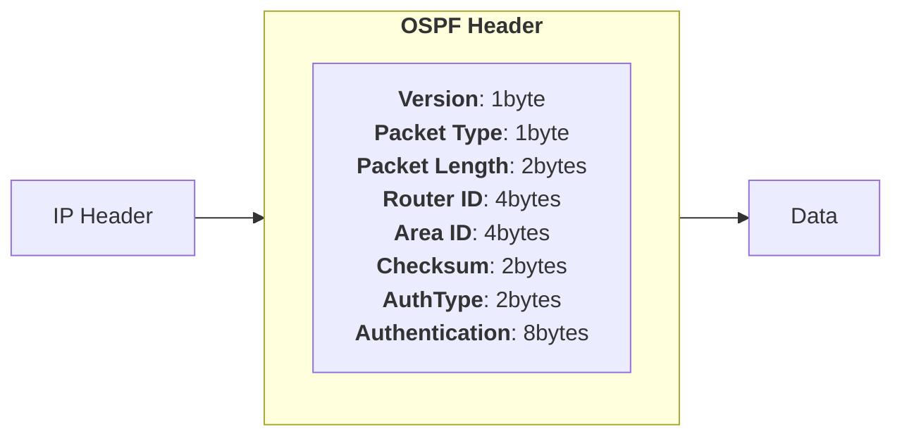
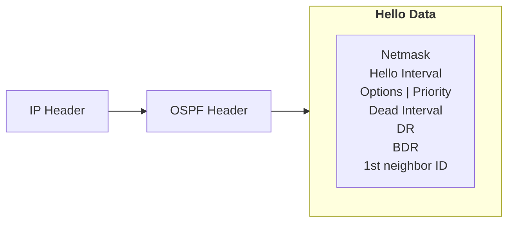

OSPF 是一种链路状态协议，它将路由器接口视为 OSPF 链路。每当 OSPF 启动时，它都会将所有链路的状态添加到本地 **链路状态数据库** 中。

OSPF 网络完全正常运行之前，必须完成以下几个步骤：

- 邻居发现
- 数据库同步
- 路由计算

链路状态路由协议会分发并复制一个描述路由拓扑的数据库。链路状态协议的泛洪算法确保每台路由器都拥有相同的链路状态数据库。路由表基于该数据库计算得出。

完成上述所有步骤后，每个邻居上的链路状态数据库都包含完整的路由域拓扑（网络中有多少台其他路由器、路由器有多少个接口、路由器之间的链路连接了哪些网络、每条链路的开销等）。

## 基本配置示例 {#basic-configuration-example}

要启动 OSPF v2 和 v3 实例，请添加实例和骨干区域：

```ros
/routing/ospf/instance
add name=v2inst version=2 router-id=1.2.3.4
add name=v3inst version=3 router-id=1.2.3.4
/routing/ospf/area
add name=backbone_v2 area-id=0.0.0.0 instance=v2inst
add name=backbone_v3 area-id=0.0.0.0 instance=v3inst
```

模板匹配 OSPF 应发现邻居的接口。请直接指定网络或接口。

```ros
/routing/ospf/interface-template
add networks=192.168.0.0/24 area=backbone_v2
add networks=2001:db8::/64 area=backbone_v3
add interfaces=ether1 area=backbone_v3
```

## OSPF 路由器之间的通信 {#communication-between-ospf-routers}

OSPF 运行在 IP 网络层之上，协议号为 89。
目的 IP 地址设置为邻居的 IP 地址，或设置为 OSPF 组播地址之一：AllSPFRouters（224.0.0.5）或 AllDRouters（224.0.0.6）。这些地址将在本篇文章后面介绍。
每个 OSPF 数据包都以一个标准的 24 字节头部开始。

<center>

</center>

| 字段 | 描述 |
| :-- | :-- |
| **数据包类型** | OSPF 数据包有多种类型：Hello packet、Database Description（DD）packet、Link-State Request packet、Link-State Update packet 和 Link-State Acknowledgment packet。除 Hello packet 外，所有这些数据包都用于链路状态数据库同步。 |
| **Router ID** | 默认使用路由器的某个 IP 地址，除非手动配置。 |
| **Area ID** | 使 OSPF 路由器能够将数据包与正确的 OSPF 区域关联。 |
| **Checksum** | 使接收路由器能够判断数据包在传输过程中是否损坏。 |
| **Authentication fields** | 这些字段使接收路由器能够验证数据包内容未被修改，并且数据包来自数据包中 Router ID 所示的 OSPF 路由器。 |

五种 OSPF 数据包类型确保 LSA 在 OSPF 网络中正确泛洪：

- **Hello packet** - 发现 OSPF 邻居并建立邻接关系。
- **Database Description (DD)** - 检查路由器之间的数据库同步情况。在建立邻接关系后交换。
- **Link-State Request (LSR)** - 请求邻居数据库中的最新部分。在 DD 交换后确定路由数据库中过时的部分。
- **Link-State Update (LSU)** - 承载一组特定请求的链路状态记录。
- **Link-State Acknowledgment (LSack)** - 确认其他数据包类型，以确保可靠通信。

## 邻居发现 {#neighbor-discovery}

OSPF 通过从已配置的接口定期发送 Hello 数据包来发现潜在邻居。默认情况下，*Hello 数据包*每 10 秒发送一次。可以通过在 OSPF 接口设置中配置 [`hello-interval`](/docs/cli-reference/routing/ospf/interface-template#hello-interval) 来更改该间隔。当路由器收到邻居返回的 Hello 数据包且参数匹配时，就会获知相邻路由器的存在。

Hello 数据包的发送和接收还使路由器能够检测邻居故障。如果在 [`dead-interval`](/docs/cli-reference/routing/ospf/interface-template#dead-interval)（默认为 40 秒）内未收到 Hello 数据包，路由器会开始绕开故障转发数据包。“Hello”协议确保相邻路由器就 Hello interval 和 Dead interval 参数达成一致，避免未及时收到 Hello 数据包而误判链路中断的情况。

<center>


</center>
| Field | Description |
| :-- | :-- |
| **Network mask** | The IP mask of the originating router's interface IP address. |
| **Hello interval** | The period between Hello packets (default 10s). |
| **Options** | OSPF options for neighbor information. |
| **Router priority** | An 8-bit value used to aid in the election of the DR and BDR (not set in point-to-point links). |
| **Router dead interval** | The time interval before the neighbor is considered down (by default, four times the Hello interval). |
| **DR** | The router ID of the current DR. |
| **BDR** | The router ID of the current BDR. |
| **Neighbor router IDs** | A list of router IDs for all the originating router's neighbors. |

在每种类型的网络段上，Hello 协议的工作方式略有不同。在点到点网络段上，只能有一个邻居，无需执行额外操作。但是，如果网络段上可能有多个邻居，则会执行额外操作以提高 OSPF 效率。

只有满足以下条件，两台路由器才会成为邻居：

- 路由器之间可以进行双向通信。这通过泛洪 Hello 数据包来确定。
- 接口应属于同一区域。
- 接口应属于同一子网并具有相同的网络掩码，除非 network-type 配置为 **point-to-point**。
- 路由器应具有相同的认证选项，并交换相同的密码（如果有）。
- Hello 数据包中的 Hello 和 Dead 间隔应相同。
- Hello 数据包中的 External routing 和 NSSA 标志应相同。

:::info
**Network mask、Priority、DR 和 BDR** 字段仅在邻居通过广播或 **NBMA** 网络段连接时使用。
:::

### 广播子网上的发现 {#discovery-on-broadcast-subnets}

连接到广播子网的节点可以发送单个数据包，该数据包会被所有其他连接的节点接收。这支持自动配置和复制信息。广播子网中的另一项重要能力是组播。该能力允许发送单个数据包，并由配置为接收组播数据包的节点接收。OSPF 使用此能力发现 OSPF 邻居并检测双向连通性。

每台 OSPF 路由器都会加入 IP 组播组 **AllSPFRouters**（224.0.0.5）。随后，路由器会定期将 Hello 数据包组播到 IP 地址 224.0.0.5。加入同一组的所有其他路由器都会收到组播的 Hello 数据包。通过这种方式，OSPF 路由器只需发送单个数据包，即可与网段上的所有其他 OSPF 路由器维持关系，而无需向每个邻居分别发送数据包。

这种方法具有以下优势：

- 通过组播或广播 Hello 数据包自动发现邻居。
- 与其他子网类型相比，带宽占用更少。
- 在广播网段上存在 n\*(n-1)/2 个邻居关系，但只需发送 n 个 Hello 即可维护这些关系。
- 如果广播网络具备组播能力，OSPF 不会影响广播网段上的非 OSPF 节点。
- 如果不支持组播能力，所有路由器都会收到广播的 Hello 数据包，即使某个节点不是 OSPF 路由器。

### 在 NBMA 子网上的发现 {#discovery-on-nbma-subnets}

非广播多路访问（NBMA）网段类似于广播网段。它们支持两台以上的路由器。唯一的区别是 NBMA 不支持数据链路层广播能力。由于这一限制，必须通过配置初始发现 OSPF 邻居。在 RouterOS 上，静态邻居配置在 [`/routing/ospf/static-neighbor`](/docs/cli-reference/routing/ospf/static-neighbor) 菜单中设置。为减少 Hello 流量，应将为 NBMA 子网连接的大多数路由器分配 Router Priority 0（RouterOS 中默认设置）。有资格成为 Designated Router 的路由器应具有非 0 的优先级值。这可确保在 DR 和 BDR 选举期间，Hello 仅发送给符合条件的路由器。

### 在 PTMP 子网上的发现 {#discovery-on-ptmp-subnets}

Point-to-MultiPoint 将网络视为一组点到点链路的集合。

按照设计，PTMP 网络不具备广播能力，因此必须通过配置初始发现 OSPF 邻居，这与 NBMA 网络相同。所有通信都通过在邻居之间直接发送单播数据包完成。在 RouterOS 上，静态邻居配置在 [`/routing/ospf/static-neighbor`](/docs/cli-reference/routing/ospf/static-neighbor) 菜单中设置。点到多点子网上不选举 Designated Router 和 Backup Designated Router。

对于支持广播的 PTMP 网络，可以使用名为“ptmp-broadcast”的混合类型。该网络类型使用组播 Hello 自动发现邻居，并检测邻居之间的双向通信。发现邻居后，“ptmp-broadcast”会直接向已发现的邻居发送单播数据包。该模式与 RouterOS v6 的“ptmp”类型兼容。

## 主从关系 {#master-slave-relation}

在开始数据库同步之前，必须建立用于交换信息的层级顺序，以确定哪台路由器先发送 **Database Descriptor**（**DD**）数据包（**Master**）。Master 路由器是 Router ID 较高的路由器。这是一种基于路由器 [`priority`](/docs/cli-reference/routing/ospf/interface-template#priority) 的关系，用于安排邻居之间的数据交换，不影响 DR/BDR 选举（**DR** 不一定必须是 **Master**）。

## 数据库同步 {#database-synchronization}

OSPF 路由器之间的链路状态数据库同步非常重要。未同步的数据库可能导致路由表计算错误，从而引发路由环路或黑洞。

OSPF 使用两种数据库同步类型：

- 初始数据库同步。
- 可靠泛洪。

当两个邻居之间的连接首次建立时，会发生*初始数据库同步*。当邻居连接首次建立时，OSPF 使用显式数据库下载。该过程称为 **Database exchange**。OSPF 路由器不会发送整个数据库，而是仅通过一系列 OSPF **Database Description (DD)** 数据包发送其 LSA 头部。只有当上一个数据包被确认后，路由器才会发送下一个 DD 数据包。当收到完整的 DD 数据包序列后，路由器会知道自身缺少哪些 LSA，以及哪些 LSA 更新。随后，路由器发送 **Link-State Request (LSR)** 数据包以请求所需的 LSA，邻居通过在 **Link-State Update (LSU)** 数据包中泛洪 LSA 进行响应。收到所有更新后，邻居被认为处于 **fully adjacent** 状态。

可靠泛洪是另一种数据库同步方法。该方法用于邻接关系已经建立，且 OSPF 路由器必须通知其他路由器 LSA 发生变化时。当 OSPF 路由器收到此类 Link State Update 时，它会在链路状态数据库中安装新的 LSA，向发送方回送确认数据包，将 LSA 重新封装到新的 LSU 中，并将其发送到除接收接口之外的所有接口。

OSPF 通过比较序列号来确定 LSA 是否为最新。序列号从 0x80000001 开始。数值越大，LSA 越新。每次泛洪记录时，序列号都会递增，收到更新的邻居会重置 Maximum age 计时器。LSA 每 30 分钟刷新一次，但如果没有刷新，LSA 会在数据库中保留 60 分钟的最大生存时间。

数据库并不总是在所有 OSPF 邻居之间同步。OSPF 根据网段决定数据库是否必须同步。例如，在点到点链路上，数据库始终在路由器之间同步。在以太网网络上，数据库仅在某些邻居对之间同步。

### 广播子网上的同步 {#synchronization-on-broadcast-subnets}

在广播网段上，存在 n\*(n-1)/2 个邻居关系。如果 OSPF 路由器尝试与子网上的每台 OSPF 路由器同步，则会在该子网上发送大量 Link State Update 和 Acknowledgment。


通过为每个广播子网选举一个 **Designated Router** 和一个 **Backup Designated Router** 可以解决此问题。所有其他路由器仅与这两个选举出的路由器同步并建立邻接关系。这种方法将邻接关系数量从 n\*(n-1)/2 减少到仅 2n-3。

右侧图片展示了广播子网上的邻接关系形成过程。R1 是 Designated Router，R2 是 Backup Designated Router。例如，如果 R3 要向 R1 和 R2 泛洪 Link State Update（LSU），该路由器会将 LSU 发送到 IP 组播地址 **AllDRouters**（224.0.0.6），并且只有 DR 和 BDR 监听该组播地址。然后，Designated Router 将发往 AllSPFRouters 的 LSU 发送出去，更新其余路由器。

#### DR 选举 {#dr-election}

DR 和 BDR 路由器根据 Hello 数据包中收到的数据选举。子网中的第一台 OSPF 路由器始终被选举为 Designated Router。添加第二台路由器时，它将成为 Backup Designated Router。当现有 DR 或 BDR 故障时，将根据配置的路由器 [`priority`](/docs/cli-reference/routing/ospf/interface-template#priority) 选举新的 DR 或 BDR。优先级最高的路由器将成为新的 DR 或 BDR。

作为 Designated Router 或 Backup Designated Router 会消耗额外资源。如果 Router Priority 设置为 0，则该路由器不参与选举过程。当某些较慢的路由器不能作为 DR 或 BDR 时，这一点很重要。

### NBMA 子网上的同步 {#synchronization-on-nbma-subnets}

NBMA 网络上的数据库同步类似于广播网络上的同步。选举 DR 和 BDR。数据库最初仅与 DR 和 BDR 路由器交换，泛洪始终通过 DR 进行。唯一的区别是必须复制 Link State Updates，并分别发送给每个相邻路由器。
