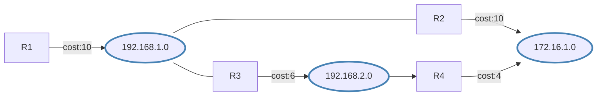
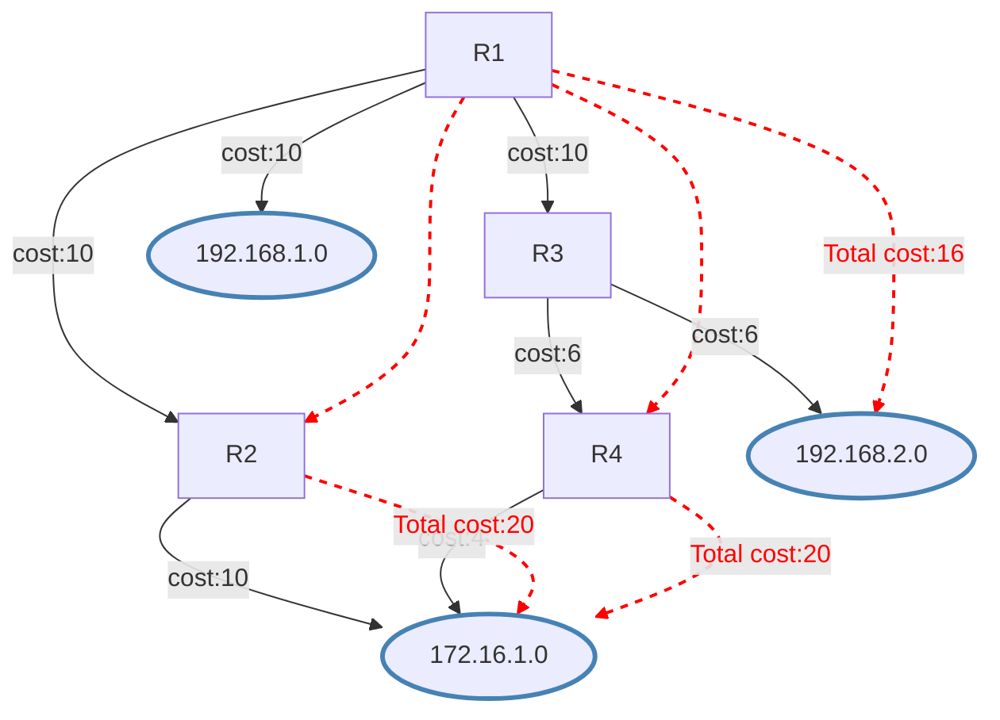

链路状态数据库描述了路由器以及互连这些路由器并适合用于转发的链路。它还包含每条链路的开销（度量值）。该度量值用于计算通往目标网络的最短路径。

每台路由器可以为其自身的链路方向通告不同的开销。这会形成非对称链路：发往目标的数据包沿一条路径传输，而响应则沿另一条路径传输。非对称路径会使故障排查变得复杂。
在 [`/routing/ospf/interface-template`](../../../../cli-reference/routing/ospf/interface-template.md) 菜单中更改开销值，或在 [`/routing/ospf/interface`](../../../../cli-reference/routing/ospf/interface.md) 菜单中创建静态 OSPF 接口。例如，要匹配 ether2 接口并将开销设置为 100：

```ros
/routing/ospf/interface-template
add interfaces=ether2 cost=100 area=backbone_v2
```

Cisco 路由器上接口的开销与该接口的带宽成反比。带宽越高表示开销越低。如果 RouterOS 上需要类似的开销，请使用公式 `Cost = 100000000/bw_in_bps`。

OSPF 路由器使用 Dijkstra 最短路径优先（SPF）算法来计算最短路径。该算法将路由器置于树的根节点，并根据到达目标所需的累积开销计算到每个目标的最短路径。即使所有路由器使用相同的链路状态数据库，每台路由器也会计算自己的树。

## SPT 计算 {#spt-calculation}

假设有以下网络。该网络由 4 台路由器组成。出接口的 OSPF 开销显示在表示链路的线附近。要为路由器 R1 构建最短路径树，请将 R1 作为根，并计算每个目标的最小开销。



已找到通往 172.16.1.0 网络的多条最短路径。这允许对发往目标的流量进行负载均衡。此类路由称为[等价多路径（ECMP）](../../routing-decision.md#multipath-ecmp-routes)。构建最短路径树后，路由器会相应地构建路由表。网络会根据树中计算出的开销来访问。



路由表计算看起来很简单；然而，当使用某些 OSPF 扩展或计算 OSPF 区域时，路由计算会变得更加复杂。

## 转发地址 {#forwarding-address}

OSPF 路由器可以将 **forwarding-address** 设置为自身以外的地址，表示可以使用备用下一跳。在大多数情况下，转发地址设置为 **0.0.0.0**，这表示只能通过通告路由器到达该路由。

如果满足以下条件，则会在 LSA 中设置转发地址：

- 必须在下一跳接口上启用 OSPF。
- 下一跳地址落在 OSPF networks 提供的网络中。

接收此类 LSA 的路由器，如果 OSPF 能够解析该转发地址，则可以使用该转发地址。如果无法直接解析转发地址，路由器会将 LSA 中该转发地址的下一跳设置为网关。如果完全无法解析转发地址，网关将是 originator-id。解析仅通过 OSPF 实例路由进行，而不是使用整个路由表。

考虑以下示例设置：


路由器 **R1** 有一条通往外部网络 _192.168.0.0/24_ 的静态路由。OSPF 在 R1、R2 和 R3 之间运行，并且该静态路由被分发到 OSPF 网络中。

这种设置中的问题显而易见。R2 无法直接到达外部网络。来自 **R2** 发往 LAN 网络的流量将通过路由器 **R1** 转发，但网络图显示 **R2** 可以直接到达连接到 LAN 网络的路由器。

了解转发地址的条件后，你可以让路由器 **R1** 设置转发地址。在路由器 **R1** 的配置中，将 10.1.101.0/24 网络添加到 OSPF networks 中：

```ros
/routing/ospf/interface-template add area=backbone_v2 networks=10.1.101.0/24
```

现在验证转发地址是否生效：

```ros
[admin@r2] /ip/route> print where dst-address=192.168.0.0/24
Flags: D - DYNAMIC; A - ACTIVE; o, y - COPY
Columns: DST-ADDRESS, GATEWAY, DISTANCE
    DST-ADDRESS       GATEWAY            DISTANCE
DAo 192.168.0.0/24    10.1.101.1%ether1       110

```

在所有 OSPF 路由器上，你将看到 LSA 中设置的转发地址不是 0.0.0.0。

```ros
[admin@r2] /routing/ospf/lsa> print where id=192.168.0.0
Flags: S - self-originated, F - flushing, W - wraparound; D - dynamic 

 1  D instance=default_ip4 type="external" originator=10.1.101.10 id=192.168.0.0 
      sequence=0x80000001 age=19 checksum=0xF336 body=
        options=E
        netmask=255.255.255.0
        forwarding-address=10.1.101.1
        metric=10 type-1
        route-tag=0
```

:::tip
10.1.101.0/24 网络中的路由器之间不需要建立 OSPF 邻接关系。
:::
