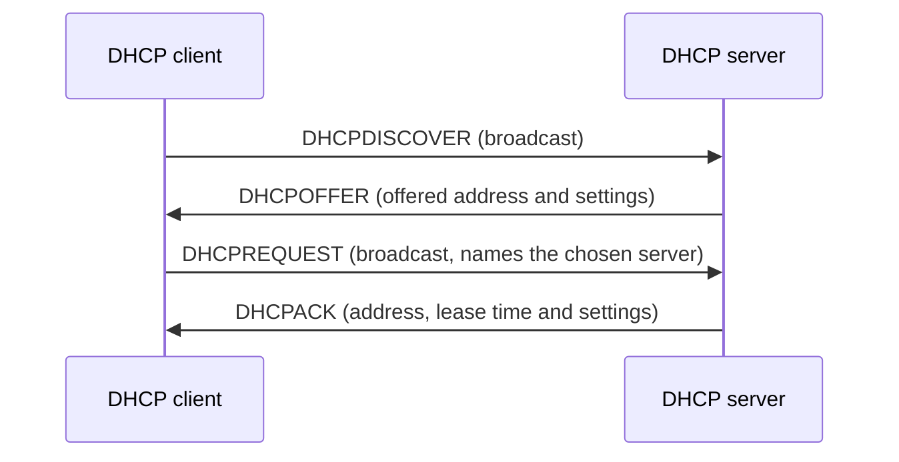

Dynamic Host Configuration Protocol（DHCP）会自动为主机分配 IP 地址和其他网络设置，因此无需手动配置。DHCP 服务器管理一个地址范围，并在有限时间内将地址租给客户端，同时提供子网掩码、默认网关和 DNS 服务器等设置。

RouterOS 根据 RFC 2131 实现 IPv4 的 DHCP，根据 RFC 8415 实现 DHCPv6，并为二者分别提供客户端、服务器和中继。

## RouterOS 组件 {#routeros-components}

| 组件 | 菜单 | 用途 |
| :-- | :-- | :-- |
| [DHCP 客户端](/docs/network-management/dhcp/client) | `/ip/dhcp-client` | 为接口获取 IPv4 地址和网络设置，例如从 ISP 获取。 |
| [DHCP 服务器](/docs/network-management/dhcp/server) | `/ip/dhcp-server` | 为本地网络中的主机分配 IPv4 地址和网络设置。 |
| [DHCP 中继](/docs/network-management/dhcp/relay) | `/ip/dhcp-relay`, `/ipv6/dhcp-relay` | 将客户端请求转发到另一网络中的 DHCP 或 DHCPv6 服务器。 |
| [DHCPv6 客户端](/docs/network-management/dhcp/dhcpv6-client) | `/ipv6/dhcp-client` | 获取 IPv6 地址或委派 IPv6 前缀，例如从 ISP 获取。 |
| [DHCPv6 服务器](/docs/network-management/dhcp/dhcpv6-server) | `/ipv6/dhcp-server` | 委派 IPv6 前缀或为客户端分配 IPv6 地址。 |

## 客户端如何获取地址 {#how-a-client-gets-an-address}

没有 IP 地址的主机无法发送或接收普通单播 IP 流量，因此最初的 DHCP 报文是广播。客户端从 UDP 端口 68 发送到端口 67，服务器在该端口监听。获取地址需要四个报文（RFC 2131，第 3.1 节）：

1. 客户端广播 DHCPDISCOVER 报文，以查找网络中的服务器。
2. 每个能够为该客户端提供服务的服务器都会回复 DHCPOFFER 报文，其中包含建议的 IP 地址和设置。
3. 客户端选择一个 offer，并广播 DHCPREQUEST 报文，标识所选服务器。其他服务器看到自己的 offer 未被接受，会将提供的地址返回到地址池。
4. 所选服务器通过 DHCPACK 报文确认，客户端配置该地址。如果该地址已不可用，服务器会改为回复 DHCPNAK，客户端将重新开始。

在客户端配置地址之前，服务器会广播其回复，或以单播方式发送到客户端的 MAC 地址和提供的 IP 地址。无法接收此类单播回复的客户端会在报文中设置广播标志，随后服务器会广播其回复（RFC 2131，第 4.1 节）。在 RouterOS 中，DHCP 客户端的 `use-broadcast` 属性控制该标志，DHCP 服务器的 `always-broadcast` 属性会使服务器无论标志如何都广播其回复。

### 地址冲突检查 {#address-conflict-checks}

双方都会在使用地址前检查该地址是否空闲（RFC 2131，第 2.2 节）：

- 服务器应在提供地址前探测该地址，例如使用 ICMP echo request。启用 `conflict-detection` 时（默认启用），RouterOS DHCP 服务器会在提供地址前发送针对该地址的 ARP request 和 ICMP echo request。如果另一台主机应答，服务器会记录警告，将该地址保留为 `conflict` 状态的租约，保留时间为租期，并从地址池中提供另一个空闲地址。当另一台主机不再应答时，`check-status` 租约命令会释放该地址。静态租约的地址不会被探测，即使另一台主机正在使用，也会分配出去。
- 客户端应在配置地址前检查所提供的地址，例如使用 ARP。如果另一台主机已使用该地址，客户端会发送 DHCPDECLINE 消息并重新开始。RouterOS DHCP 服务器会将客户端拒绝的租约显示为 `declined` 状态；正常运行时不会出现这种情况。

## 租约和续租 {#leases-and-renewal}

地址是租用的，并非永久分配。服务器会告知客户端租约持续时间，客户端必须在租约到期前续租才能继续使用该地址。RFC 2131（第 4.4.5 节）为此定义了两个计时器，服务器也可以显式设置：

- **T1**，默认为租期的 50%：客户端以单播方式向发放租约的服务器发送 DHCPREQUEST 消息（续租）。服务器确认后，租约会延长。
- **T2**，默认为租期的 87.5%：如果服务器尚未应答，客户端会广播 DHCPREQUEST 消息，以便任意服务器延长租约（重新绑定）。
- 当租约到期且未延长时，客户端会停止使用该地址，并通过 DHCPDISCOVER 消息重新开始。

例如，RouterOS DHCP 服务器的默认租期为 30 分钟，使用默认计时器的客户端会在 15 分钟后续租，并在 26 分钟 15 秒后开始重新绑定。RouterOS DHCP 客户端的 `status` 属性会显示客户端处于哪个阶段。

不再需要其地址的客户端可以通过 DHCPRELEASE 消息提前归还该地址。RouterOS DHCP 客户端的 `release` 命令会执行此操作。

## 客户端识别 {#client-identification}

当客户端续租或在重启后请求地址时，服务器需要再次识别该客户端。客户端发送客户端标识符选项（option 61）时，使用该选项识别客户端；否则使用其硬件（MAC）地址识别客户端（RFC 2131，第 4.2 节）。

RouterOS DHCP 服务器默认同时使用两者识别客户端（`dynamic-lease-identifiers`），静态租约可以绑定到 MAC 地址或客户端标识符。RouterOS DHCP 客户端默认发送基于其 MAC 地址的客户端标识符。它也可以改为发送基于路由器 DHCP 唯一标识符（DUID）的客户端标识符，如 RFC 4361 所述，该标识符与 DHCPv6 客户端使用的标识符相同。

## 选项 {#options}

除 IP 地址本身外，所有设置都通过选项承载，每个选项由一个编号标识（RFC 2132）。常见选项：

| Code | Option |
| --: | :-- |
| 1 | 子网掩码 |
| 3 | 路由器（默认网关） |
| 6 | DNS 服务器 |
| 12 | 主机名 |
| 15 | 域名 |
| 42 | NTP 服务器 |
| 43 | 厂商特定信息 |
| 51 | 租约时间 |
| 54 | 服务器标识符 |
| 55 | 参数请求列表 |
| 60 | 厂商类别标识符 |
| 61 | 客户端标识符 |
| 82 | 中继代理信息 |
| 121 | 无类别静态路由 |

客户端在参数请求列表（选项 55）中列出所需选项，服务器返回这些选项的值。当服务器发送无类别静态路由（选项 121）时，客户端会忽略路由器选项（选项 3），因此默认路由也必须包含在选项 121 中（RFC 3442）。RouterOS DHCP 客户端默认遵循此规则；使用 `add-default-route=special-classless` 时，它会同时安装无类别路由和来自选项 3 的默认路由。

RouterOS DHCP 服务器发送匹配网络的设置（`/ip/dhcp-server/network`），你也可以定义其他自定义选项，请参阅 [DHCP 选项](/docs/network-management/dhcp/server#dhcp-options)。

## DHCP 中继 {#dhcp-relay}

DHCP 广播不会跨越路由器，因此 DHCP 服务器只能听到与其直接相连网络上的客户端。要为其他网络提供服务，需要在客户端网络中的路由器上运行 DHCP 中继。中继接收客户端广播，并将其作为单播消息转发到一个或多个 DHCP 服务器（RFC 2131，第 4.1 节）。

中继会将其在客户端网络上的地址写入每条转发消息的网关地址字段（`giaddr`），服务器将回复发送到该地址。中继还可以添加中继代理信息选项（选项 82，RFC 3046），以告知服务器请求来自哪个端口或线路。

在 RouterOS 中，中继会将其 `local-address`，或在未设置 `local-address` 时将其接口地址写入 `giaddr`。当 DHCP 服务器的 `relay` 属性与该地址匹配，或设置为 `255.255.255.255` 以接受任意中继时，服务器会响应中继请求，并从其自身地址池分配地址。完整示例请参阅 [DHCP 中继](/docs/network-management/dhcp/relay)。

## DHCPv6

DHCPv6（RFC 8415）为 IPv6 提供相同用途，但在若干方面的工作方式不同：

- 客户端从其链路本地地址向 All_DHCP_Relay_Agents_and_Servers 组播地址 `ff02::1:2` 发送消息。客户端使用 UDP 端口 546，服务器使用端口 547。
- 客户端通过 Solicit、Advertise、Request 和 Reply 消息获取配置。使用 Rapid Commit 时，Solicit 和 Reply 即可完成配置。
- 每台设备都有一个 DHCP Unique Identifier（DUID），客户端的每个 identity association 都有一个 identity association identifier（IAID）。服务器通过 DUID 和 IAID 识别客户端绑定，而不是通过 MAC 地址。
- 客户端可以请求地址（IA_NA）和委派前缀（IA_PD）。使用前缀委派时，路由器从 ISP 接收整个前缀，例如 /56 或 /60，并用它为自己的网络编号。
- DHCPv6 不提供默认网关。主机通过路由器通告（RFC 4861）获知默认路由器。路由器通告中的 managed（M）和 other configuration（O）标志告诉主机是使用 DHCPv6 获取地址，还是仅获取其他设置。在 RouterOS 中，这些标志是 [`/ipv6/nd`](/docs/cli-reference/ipv6/nd) 的 `managed-address-configuration` 和 `other-configuration` 属性。RouterOS DHCPv6 客户端可以通过 `add-default-route` 选择添加一条指向服务器的默认路由。

有关不使用 DHCPv6 的地址自动配置，请参阅 [IPv6 Neighbor Discovery](/docs/getting-started/networking-fundamentals/ipv6-neighbor-discovery)。有关通过 PPPoE 进行前缀委派，请参阅 [IPv6 PD over PPP](/docs/virtual-private-networks/pppoe/ipv6-pd-over-ppp)。
