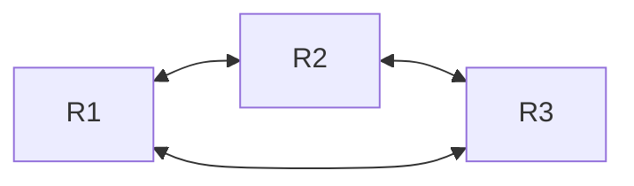
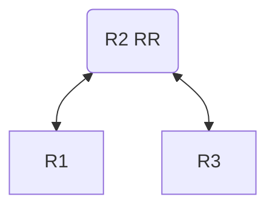

**eBGP** 会话的目的是在自治系统 (AS) 之间交换路由信息。通常，eBGP 会话建立在网络出口点处直连的物理或逻辑网络（单跳链路）上，并且在默认参数下，如果对等体位于多跳之外，它将无法建立连接。  
在 EVPN 部署中，运营商通常会在由 IGP 路由的环回地址上运行 eBGP 会话。这意味着连接不再位于直连网络上，除非配置了 [`multihop`](../../../../cli-reference/routing/bgp/connection.md#multihop)`=yes`，否则将失败。

AS_PATH 属性用于防止路由环路。如果列表包含自身的 AS 号 (ASN)，该路由将被丢弃；但在某些特定部署中，这并不是期望的行为。例如，MPLS L3VPN 部署需要使用 [`input.allow-as`](../../../../cli-reference/routing/bgp/connection.md#input.allow-as) 参数覆盖默认的环路预防机制，以允许 CE 路由器接受来自多归属或互连站点、且包含自身 ASN 的路由。

默认情况下，下一跳会因显而易见的原因改为自身，但同样，在某些部署中（例如 EVPN 叠加网络）这种行为并不可取。要覆盖默认行为，请将 [`nexthop-choice`](../../../../cli-reference/routing/bgp/connection.md#nexthop-choice) 参数设置为 `propagate`。

## 内部 BGP (iBGP) 对等 {#internal-bgp-ibgp-peering}

与 **eBGP** 相反，**iBGP** 用于在自治系统内部交换路由信息。它会将从 eBGP 对等体学习到的外部路由传播到内部网络。

默认情况下，**iBGP** 会话被视为多跳，并运行在内部网关协议 (IGP)（如 [OSPF](../ospf/areas-and-virtual-links.md) 或 ISIS）之上，该协议提供环回地址之间的可达性。外部路由的下一跳会被传播，而 IGP 负责下一跳解析。在较小的部署中，为了降低配置复杂性，可以通过将 [`nexthop-choice`](../../../../cli-reference/routing/bgp/connection.md#nexthop-choice) 参数设置为 `force-self` 并在直连网络上运行 iBGP 会话，来在不依赖底层 IGP 的情况下使用 iBGP。

当路由在 iBGP 对等体之间传播时，不会将自身的 AS 号添加到 AS Path 列表中；相反，会使用水平分割进行环路保护，这规定从某个 iBGP 对等体学习到的路由不会通告给另一个 iBGP 对等体。为了克服水平分割的限制，每台 iBGP 路由器都必须连接到其他所有 iBGP 路由器，从而形成**全互联**。



全互联的问题在于可扩展性，其连接总数为 `n*(n-1)/2`。为了简化大规模 iBGP 网络，可使用[路由反射器 (RR)](#dynamic-sessions) 来消除对全互联的需求。它建立客户端–服务器关系，其中客户端仅与路由反射器建立对等关系，从而将连接数减少到 `n-1`。



引入 RR 会打破标准的水平分割规则以启用路由反射，这就是使用 **ORIGINATOR_ID** 和 **CLUSTER_LIST** 属性来防止路由环路的原因。

## 会话配置 {#session-configuration}

[`/routing/bgp/connection`](../../../../cli-reference/routing/bgp/connection.md) 菜单定义 BGP 出站连接，同时也充当入站 BGP 连接的模板匹配器。

下面是一个非常基础的 BGP 配置示例。假设 Router1 的 IP 为 192.168.1.1，AS 为 65531；Router2 的 IP 为 192.168.1.2，AS 为 65532：

```ros
#Router1
/routing/bgp/instance
add name=myInstance as=65531

/routing/bgp/connection
add name=toR2 remote.address=192.168.1.2 instance=myInstance local.role=ebgp
```

```ros
#Router2
/routing/bgp/instance
add name=myInstance as=65532

/routing/bgp/connection
add name=toR1 remote.address=192.168.1.1 instance=myInstance local.role=ebgp
```

[`local.role`](../../../../cli-reference/routing/bgp/connection.md#local.role) 是必选参数，用于描述会话的性质：它是 **eBGP** 会话（如我们的示例）、[**iBGP**](#internal-bgp-ibgp-peering) 会话，还是将充当 iBGP **route-reflector**。此外，还有其他模式用于 [RFC 9234](https://datatracker.ietf.org/doc/rfc9234/) 中的**路由泄漏预防和检测**。

该连接不需要指定远端 AS 号；RouterOS 会从收到的第一条 **OPEN** 消息中动态确定它。

与其他厂商以及旧版 RouterOS 的 `update-source` 等效的参数是 [`local.address`](../../../../cli-reference/routing/bgp/connection.md#local.address)。在大多数情况下，可以不对其进行配置，路由器将自行确定地址。

当未指定本地地址时，BGP 将根据当前部署尝试猜测它：

- 如果对等体是 iBGP
  - 如果存在环回地址
    - 选择最高的环回地址
  - 如果不存在环回地址
    - 选择路由器上最高的 IP 地址
- 如果对等体是 eBGP
  - 如果远端对等体的 IP 不在直连网络中：
    - 如果未设置 multihop，BGP 会抛出错误
    - 如果启用了 multihop：
      - 如果存在环回地址
        - 选择最高的环回地址
      - 如果不存在环回地址
        - 选择路由器上最高的 IP 地址
  - 如果远端对等体的 IP 在直连网络中：
    - 如果未设置 multihop：
      - 从该直连网络中选择路由器的 IP 地址
    - 如果设置了 multihop：
      - 如果存在环回地址
        - 选择最高的环回地址
      - 如果不存在环回地址
        - 选择路由器上最高的 IP 地址

该菜单还直接提供模板特定的参数，这在不需要模板的简单场景中使配置更加容易。

:::warning
在不安全的环境中不应启用对子网的监听；此类配置可能导致拒绝服务 (DoS)。  
必须配置防火墙以保护路由器。  
有关更多详细信息，请参阅 [`listen`](../../../../cli-reference/routing/bgp/connection.md#listen) 参数。
:::

### 活动会话列表 {#active-session-list}

检查 [`/routing/bgp/session`](../../../../cli-reference/routing/bgp/session/index.md) 菜单以查看会话是否已建立：

```ros
[admin@MikroTik] /routing/bgp/session> print 
Flags: E - established 
 0 E name="toR2" instance=myInstance 
     remote.address=192.168.1.2 .as=65532 .id=192.168.1.1 .refused-cap-opt=no 
     .capabilities=mp,rr,as4 .afi=ip,ipv6 .messages=43346 .bytes=3635916 .eor="" 
     local.address=192.168.1.1 .as=65531 .id=192.168.44.2 .capabilities=mp,rr,gr,as4 .messages=2 
     .bytes=71 .eor="" 
     output.procid=97 .keep-sent-attributes=no 
     .last-notification=ffffffffffffffffffffffffffffffff0015030601 
     input.procid=97 .limit-process-routes=500000 ebgp limit-exceeded 
     hold-time=3m keepalive-time=1m uptime=4s70ms
```

它显示只读的缓存 BGP 会话信息：当前状态、标志、最后收到的通知以及协商的会话参数。

即使 BGP 会话不再活动，缓存仍可能保留一段时间。只有在缓存过期时，才会移除从特定会话接收到的路由，这有助于在 BGP 会话反复振荡时减轻大规模路由表重新计算。

如果 BGP 首次尝试建立会话，而 TCP 连接因 MD5 认证错误、防火墙阻止或任何其他阻止连接的原因而无法发起，则不会创建会话条目。

### 参数分组 {#parameter-grouping}

您可能已经注意到，大多数参数都分组在 `output`、`input`、`local` 和 `remote` 部分中，这使配置更具可读性，也更容易理解该选项是应用于 `input` 还是 `output`，或者它影响路由器本地的值，还是尝试匹配远端对等体的参数。  
例如：

- 要指定输出选择链，请设置 [`output.filter-chain`](../../../../cli-reference/routing/bgp/connection.md#output.filter-chain)`=myBgpChain`。
- 会话列表中的 `local.bytes` 表示已发送多少字节。
- `remote.messages` 表示远端对等体已发送多少数据包。
- 依此类推。

### BGP 未编号 {#bgp-unnumbered}

RouterOS 能够动态建立 BGP 会话，而无需在接口上配置全局 IPv6 地址，也无需指定远端链路本地地址（BGP 未编号连接）。该机制依赖 IPv6 邻居发现 ([RFC 4861](https://datatracker.ietf.org/doc/html/rfc4861)) 来获取邻居的链路本地地址，并依赖 [RFC5549](https://datatracker.ietf.org/doc/html/rfc5549) 来通告带有 IPv6 下一跳的 IPv4 NLRI。

如果 [`remote.address`](../../../../cli-reference/routing/bgp/connection.md#remote.address) 为空且 [`local.address`](../../../../cli-reference/routing/bgp/connection.md#local.address) 是接口，则配置为未编号连接。在此模式下，每个接口只接受一个连接。
它在包含大量点对点链路的部署中很有用，例如，当 eBGP 用作 EVPN 底层时。

对于未配置全局地址、无法发送 RA 回复的路由器，请应用以下 ND 配置：

```ros
/ipv6/nd/prefix/add prefix=none interface=sfp-sfpplus1
```

```ros
[admin@CCR2004_2XS_111] /ipv6/neighbor> print 
Flags: D - DYNAMIC; R - ROUTER
Columns: ADDRESS, MAC-ADDRESS, INTERFACE, VRF
#    ADDRESS                    MAC-ADDRESS        INTERFACE     VRF 
0 DR fe80::de2c:6eff:fec5:a7ff  DC:2C:6E:C5:A7:FF  sfp-sfpplus1  main
```

添加未编号连接配置：

```ros
/routing bgp connection
add instance=myInstance local.address=sfp-sfpplus1 .role=ibgp name=unnumbered_2
```

```ros
[admin@CCR2004_2XS_111] /routing/bgp/connection> print 
Flags: D - DYNAMIC, X - DISABLED, I - INACTIVE 
 0   name="unnumbered_2" instance=myInstance 
     local.address=sfp-sfpplus1 .default-address=fe80::de2c:6eff:fea4:b42f%sfp-sfpplus1 .role=ibgp 
     routing-table=main as=333 

[admin@CCR2004_2XS_111] /routing/bgp/session> print 
Flags: E - ESTABLISHED 
 0 E name="unnumbered_2-1" instance=v6_test 
     remote.address=fe80::de2c:6eff:fec5:a7ff%sfp-sfpplus1 .as=333 .id=203.0.113.2 .capabilities=mp,rr,enhe,gr,as4 .afi=ipv6 
     .messages=5181 .bytes=98439 .eor="" 
     local.role=ibgp .address=fe80::de2c:6eff:fea4:b42f%sfp-sfpplus1 .as=333 .id=203.0.113.1 .cluster-id=203.0.113.1 
     .capabilities=mp,rr,enhe,gr,as4 .afi=ipv6 .messages=5181 .bytes=98439 .eor="" 
     output.procid=20 
     input.procid=20 ibgp 
     multihop=yes hold-time=3m keepalive-time=1m uptime=3d14h20m55s640ms last-started=2026-02-12 18:26:59 prefix-count=0 
```

### 动态会话 {#dynamic-sessions}

BGP 对等体配置可能相当复杂且可扩展性不强；例如，中心辐射型部署或 iBGP 路由反射器部署。

假设我们有一个连接了两个对等体的路由反射器部署。为了简化配置并使其可扩展，我们将利用 BGP 模板来设置公共参数，并配置连接监听环回地址范围，这样我们就可以在路由反射器上不做任何配置的情况下添加更多对等体。


**先决条件**

- 接口上的 IP 连通性
- 在接口上配置并运行 OSPF

**路由反射器**

在配置 BGP 之前，我们需要添加环回地址并启用 OSPF 来分发环回路由：

```routeros
/ip address
add address=203.0.255.1 interface=lo
/routing ospf interface-template add interfaces=lo area=backbone passive
```

接下来创建一个包含公共参数的 BGP 模板，以及一个监听环回地址范围 (203.0.255.0/24) 的 BGP 会话：

```routeros
/routing bgp instance
add as=65000 name=bgp_inst
/routing bgp template
set default afi=ip multihop=yes nexthop-choice=propagate hold-time=10s
/routing bgp connection
add instance=bgp_inst local.address=203.0.255.1 .role=ibgp-rr name=rr remote.address=\
    203.0.255.0/24 templates=default listen=yes
```

要添加新的 BGP 对等体，请在对等体与路由反射器之间创建 IP 连接，并配置 BGP 连接到反射器的环回地址：

**Peer_1**

```routeros
/ip address
add address=203.0.255.11 interface=lo
/routing ospf interface-template add interfaces=lo area=backbone passive

/routing bgp instance
add as=65000 name=bgp_inst
/routing bgp connection
add instance=bgp_inst local.role=ibgp name=to_rr remote.address=203.0.255.1
```

**Peer_2**

```routeros
/ip address
add address=203.0.255.12 interface=lo
/routing ospf interface-template add interfaces=lo area=backbone passive

/routing bgp instance
add as=65000 name=bgp_inst
/routing bgp connection
add instance=bgp_inst local.role=ibgp name=to_rr remote.address=203.0.255.1
```

**Peer_N**

```routeros
/ip address
add address=203.0.255.1N interface=lo
/routing ospf interface-template add interfaces=lo area=backbone passive

/routing bgp instance
add as=65000 name=bgp_inst
/routing bgp connection
add instance=bgp_inst local.role=ibgp name=to_rr remote.address=203.0.255.1
```

有关更多用例，请参阅 EVPN，其中此方法用于 [EVPN 叠加网络](../evpn.md#bgp-evpn-overlay) 部署。
