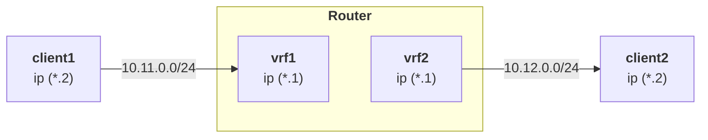
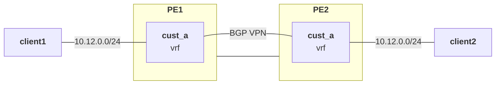

## 描述 {#description}

RouterOS 允许在单台路由器上创建多个 Virtual Routing and Forwarding（**VRF**）实例。这对于基于 BGP 的 MPLS VPN 很有价值。与 OSI 二层技术的 BGP VPLS 不同，BGP VRF VPN 工作在三层，并在路由器之间交换 IP 前缀。VRF 解决了 IP 前缀重叠的问题，并通过为不同 VPN 分别路由来提供所需的私密性。

你可以设置 VRF-Lite 配置，或使用带 VPNv4 地址族的多协议 BGP，将 VRF 路由表中的路由分发到其他路由器，或分发到同一路由器上的不同路由表。

## 配置 {#configuration}

VRF 表在 [**`/ip/vrf`**](../../cli-reference/ip/vrf.md) 菜单中创建。创建 VRF 配置后，会添加路由表映射（创建一个同名的动态表）。每个活动 VRF 始终会有一个映射的路由表。

```ros
[admin@arm-bgp] /ip/vrf> print
Flags: X - disabled; * - builtin
 0  * name="main" interfaces=all

[admin@arm-bgp] /routing/table> print
Flags: D - dynamic; X - disabled, I - invalid; U - used
 0 D   name="main" fib

```

添加 VRF 的顺序很重要。为了正确匹配接口属于哪个 VRF，请按正确顺序放置 VRF（匹配从顶部条目开始，类似防火墙规则）。

:::info
由于每个 VRF 都有一个映射的路由表，唯一 VRF 的最大数量限制为 1024。
:::

考虑以下示例：

```ros
[admin@arm-bgp] /ip/vrf> print
Flags: X - disabled; * - builtin
 0  * name="main" interfaces=all
 1    name="myVrf" interfaces=lo_vrf
```

由于第一个条目匹配所有接口，第二个 VRF 没有添加任何接口。要解决此问题，必须更改条目的顺序。

```ros
[admin@arm-bgp] /ip/vrf> move 1 0
[admin@arm-bgp] /ip/vrf> print
Flags: X - disabled; * - builtin
 0    name="myVrf" interfaces=lo_vrf
 1  * name="main" interfaces=all
```

分配给 VRF 的接口的直连路由会自动安装到相应的路由表中。

:::info
当接口被分配给 VRF 时，直连路由会被添加到 VRF 路由表中。然而，RouterOS 服务不会仅仅因为在配置中指定 IP 地址就自动知道要使用哪个 VRF。每个服务都需要 VRF 支持和显式配置。有关某个服务是否支持 VRF 以及 VRF 配置选项的信息，请参阅相应服务的文档。
:::

例如，配置 SSH 服务监听属于该 VRF 的接口上的连接：

```ros
[admin@arm-bgp] /ip/service> set ssh vrf=myVrf
[admin@arm-bgp] /ip/service> print
Flags: X, I - INVALID
Columns: NAME, PORT, CERTIFICATE, VRF
#   NAME     PORT  CERTIFICATE  VRF
0   telnet     23               main
1   ftp        21
2   www        80               main
3   ssh        22               myVrf
4 X www-ssl   443  none         main
5   api      8728               main
6   winbox   8291               main
7   api-ssl  8729  none         main
```

在 [**`/ip/route`**](../../cli-reference/ip/route/index.md) 菜单中添加路由时，通过指定 routing-table 参数来向 VRF 添加路由，并通过在网关 IP 后追加 @name 来指示在哪个路由表中解析网关：

```ros
/ip/route/add dst-address=192.168.1.0/24 gateway=172.16.1.1@myVrf routing-table=myVrf
```

当显式将网关设置为在另一个 VRF 中解析时，VRF 之间就可能发生流量泄漏，例如：

```ros
# 在 myVrf 中添加路由，但在主表中解析网关
/ip/route/add dst-address=192.168.1.0/24 gateway=172.16.1.1@main routing-table=myVrf

# 在主表中添加路由，但在 myVrf 中解析网关
/ip/route/add dst-address=192.168.1.0/24 gateway=172.16.1.1@myVrf
```

:::info
如果网关配置没有显式配置要在其中解析的表，则网关会在 "main" 表中解析。
:::

## 支持的服务 {#supported-services}

可以将不同服务放入特定的 VRF，服务在该 VRF 中监听传入连接或创建传出连接。默认情况下，所有服务都使用 `main` 表，但你可以通过单独的 `vrf` 参数，或在 IP 地址末尾使用 "@" 分隔并指定 VRF 名称来更改这一点。

下面是支持的服务列表。

| 服务 | 支持 | 备注 |
|---|---|---|
| **[BGP](./unicast/bgp/understanding-bgp.md)** | + | <code>/routing/bgp/template add name=bgp-template1 vrf=vrf1</code><br/><code>/routing/bgp/vpls add name=bgp-vpls1 site-id=10 vrf=vrf1</code><br/><code>/routing/bgp/vpn add label-allocation-policy=per-vrf vrf=vrf1</code> |
| **[电子邮件](../../system-information-and-utilities/e-mail.md)** | + | `/tool/e-mail set address=192.168.88.1 vrf=vrf1` |
| **[IP 服务](../../system-information-and-utilities/services.md)** | + | VRF 支持 <code>telnet</code>、<code>www</code>、<code>ssh</code>、<code>www-ssl</code>、<code>api</code>、<code>winbox</code>、<code>api-ssl</code> 服务。<code>ftp</code> 服务不支持更改 VRF。<br/><code>/ip/service/set telnet vrf=vrf1</code> |
| **[L2TP 客户端](../../virtual-private-networks/l2tp/index.md)** | + | `/interface/l2tp-client add connect-to=192.168.88.1@vrf1 name=l2tp-out1 user=l2tp-client` |
| **[MPLS](./mpls/index.md)** | + | `/mpls/ldp/add vrf=vrf1` |
| **[网络监控](../../diagnostics-monitoring-and-troubleshooting/netwatch.md)** | + | `/tool/netwatch/add host=192.168.88.1@vrf1` |
| **[NTP](../../system-information-and-utilities/ntp.md)** | + | <code>/system/ntp/client/set vrf=vrf1</code><br/><code>/system/ntp/server/set vrf=vrf1</code> |
| **[OSPF](./unicast/ospf/index.md)** | + | `/routing/ospf/instance add disabled=no name=ospf-instance-1 vrf=vrf1` |
| **[ping](../../diagnostics-monitoring-and-troubleshooting/ping.md)** | + | `/ping 192.168.88.1 vrf=vrf1` |
| **[RADIUS](../../authentication-authorization-accounting/radius.md)** | + | <code>/radius/add address=192.168.88.1@vrf1</code><br/><code>/radius/incoming/set vrf=vrf1</code> |
| **[RIP](./unicast/rip.md)** | + | `/routing/rip/instance/add name=rip-instance-1 vrf=vrf1` |
| **[RPKI](./unicast/rpki.md)** | + | `/routing/rpki/add vrf=vrf1` |
| **[SNMP](../../diagnostics-monitoring-and-troubleshooting/snmp.md)** | + | `/snmp/set vrf=vrf1` |
| **[EoIP](../../virtual-private-networks/eoip.md)** | + | `/interface/eoip add remote-address=192.168.1.1@vrf1` |
| **[IPIP](../../virtual-private-networks/ipip.md)** | + | `/interface/ipip/add remote-address=192.168.1.1@vrf1` |
| **[GRE](../../virtual-private-networks/gre.md)** | + | `/interface/gre/add remote-address=192.168.1.1@vrf1` |
| **[SSTP-client](../../virtual-private-networks/sstp.md#sstp-client)** | + | `/interface/sstp-client/add connect-to=192.168.1.1@vrf1` |
| **[OVPN 服务器和客户端](../../virtual-private-networks/openvpn.md)** | + | `/interface/ovpn-client/add connect-to=192.168.1.1@vrf1` |
| **[L2TP-ether](../../virtual-private-networks/l2tp/index.md#l2tp-ether)** | + | `/interface/l2tp-ether/add connect-to=192.168.2.2@vrf` |
| **[VXLAN](../../bridging-and-switching/vxlan.md)** | + | `/interface/vxlan/add vni=10 vtep-vrf=vrf1` |
| **[获取](../../system-information-and-utilities/fetch.md)** | + | `/tool/fetch address=10.155.28.236@vrf1 mode=ftp src-path=my_file.pcap user=admin password=""` |
| **[DNS](../../network-management/dns.md)** | + <br/> 从 RouterOS v7.21 开始 | 指定路由器在哪个 VRF 中监听 DNS 查询。<br/><code>/ip/dns/set vrf=vrf1</code><br/>指定用于联系上游服务器的 VRF。<br/><code>/ip/dns/set servers=8.8.8.8@vrf1</code> |
| **[DHCP 中继](../../network-management/dhcp/relay.md)** | + <br/> 从 RouterOS v7.15 开始 | <code>/ip/dhcp-relay/set dhcp-server-vrf=vrf1</code><br/><em>如果 DHCP 客户端位于同一 VRF 中，则不需要在 "ip dhcp-relay" 配置中设置特殊参数。</em> |
| **[远程日志](../../diagnostics-monitoring-and-troubleshooting/log/index.md)** | + <br/> 从 RouterOS v7.19 开始 | `/system/logging/action add name=remote1 remote=192.168.1.1 target=remote vrf=vrf1` |

## 防火墙中的 VRF 接口 {#vrf-interfaces-in-firewall}

:::warning
在 RouterOS v7.14 之前，带有 in/out-interface 属性的防火墙过滤规则会应用于 VRF 实例内的接口。从 RouterOS v7.14 开始，这些规则不再针对 VRF 内的单个接口，而是针对整个 VRF 接口。
:::

从 RouterOS v7.14 开始，当接口被添加到 VRF 时，会自动创建一个虚拟 VRF 接口。要匹配属于某个 VRF 接口的流量，请在防火墙过滤规则中使用该 VRF 虚拟接口，例如：

```ros
/ip/vrf/add interfaces=ether5 name=vrf5
/ip/firewall/filter/add chain=input in-interface=vrf5 action=accept
```

如果多个接口属于同一个 VRF，但你只需要匹配其中一个接口，请使用连接标记。例如：

```ros
/ip/vrf/add interfaces=ether15,ether16 name=vrf1516
/ip/firewall/mangle
add action=mark-connection chain=prerouting connection-state=new in-interface=ether15 new-connection-mark=input_allow passthrough=yes
/ip/firewall/filter
add action=accept chain=input connection-mark=input_allow
```

## 示例 {#examples}

### 简单的 VRF-Lite 设置 {#simple-vrf-lite-setup}

考虑这样一个设置：两个客户 VRF 需要访问互联网：

```ros
/ip/address
add address=172.16.1.2/24 interface=public
add address=192.168.1.1/24 interface=ether1
add address=192.168.2.1/24 interface=ether2

/ip/route
add gateway=172.16.1.1

# 添加 VRF 配置
/ip/vrf
add name=cust_a interface=ether1 place-before 0
add name=cust_b interface=ether2 place-before 0

# 添加 vrf 路由
/ip/route
add gateway=172.16.1.1@main routing-table=cust_a
add gateway=172.16.1.1@main routing-table=cust_b

# 对本地源进行伪装
/ip/firewall/nat/add chain=srcnat out-interface=public action=masquerade
```

可能需要确保到达 "public" 接口的数据包进入正确的 VRF。
这可以通过标记源自 VRF 客户的新连接，并根据 "public" 接口上传入数据包的路由标记来引导流量来解决。

```ros
# 标记新的客户连接
/ip/firewall/mangle
add action=mark-connection chain=prerouting connection-state=new new-connection-mark=\
    cust_a_conn src-address=192.168.1.0/24 passthrough=no
add action=mark-connection chain=prerouting connection-state=new new-connection-mark=\
    cust_b_conn src-address=192.168.2.0/24 passthrough=no

# 标记路由
/ip/firewall/mangle
add action=mark-routing chain=prerouting connection-mark=cust_a_conn \
    in-interface=public new-routing-mark=cust_a
add action=mark-routing chain=prerouting connection-mark=cust_b_conn \
    in-interface=public new-routing-mark=cust_b
```

### 静态跨 VRF 路由 {#static-inter-vrf-routes}

通常，应使用 [BGP](./unicast/bgp/understanding-bgp.md) 本地导入和导出功能在 VRF 之间交换所有路由。如果这还不够，可以使用静态路由来实现所谓的路由泄漏。

可以通过两种方式安装一条路由，使其网关位于与该路由本身不同的路由表中。

第一种方式是在添加路由时，在 gateway 字段中显式指定路由表。只有在将路由和网关从 "main" 路由表泄漏到不同路由表（VRF）时才可能这样做。例如：

```ros
# 在 'vrf1' 路由表中添加通往 5.5.5.0/24 的路由，网关位于主路由表中
add dst-address=5.5.5.0/24 gateway=10.3.0.1@main routing-table=vrf1
```

第二种方式是在 gateway 字段中显式指定接口。指定的接口可以属于某个 VRF 实例。例如：

```ros
# 在主路由表中添加通往 5.5.5.0/24 的路由，网关为 'ether2' VRF 接口
add dst-address=5.5.5.0/24 gateway=10.3.0.1%ether2 routing-table=main
# 在主路由表中添加通往 5.5.5.0/24 的路由，以 'ptp-link-1' VRF 接口作为网关
add dst-address=5.5.5.0/24 gateway=ptp-link-1 routing-table=main
```

可以看出，有两种变体——将网关指定为 *ip\_address%interface*，或仅指定 *interface*。在大多数情况下，对于广播接口使用第一种方式。对于点对点接口使用第二种方式；如果该路由在某个 VRF 中是直连路由，则对于广播接口也使用第二种方式。例如，如果接口 *ether2* 上有一个放入 VRF 的地址 `1.2.3.4/24`，那么该 VRF 的路由表中会存在一条通往 `1.2.3.0/24` 的直连路由。即使 *ether2* 是广播接口，也可以在不同路由表中添加一条仅以接口作为网关的静态路由 `1.2.3.0/24`：

```ros
add dst-address=1.2.3.0/24 gateway=ether2 routing-table=main

```

### 静态 VRF-Lite 直连路由泄漏 {#static-vrf-lite-connected-route-leaking}

有时需要从另一个 VRF 访问直连资源。在此示例中，两个直连网络各自位于自己的 VRF 中，并且你希望允许 client1 访问 client2。



```ros
/ip/address
add address=10.11.0.1/24 interface=sfp-sfpplus1
add address=10.12.0.1/24 interface=sfp-sfpplus2

# 添加 VRF 配置
/ip/vrf
add name=vrfTest1 interface=sfp-sfpplus1 place-before 0
add name=vrfTest2 interface=sfp-sfpplus2 place-before 0

```

通过将网关设置为 "interface@vrf"，可以在特定 VRF 上访问直连网络。

```ros
# 添加 vrf 路由
/ip/route
add dst-address=10.11.0.0/24 gateway="sfp-sfpplus1@vrfTest1" routing-table=vrfTest2
add dst-address=10.12.0.0/24 gateway="sfp-sfpplus2@vrfTest2" routing-table=vrfTest1

```

**验证路由和可达性**

```text
[admin@CCR2004_2XS] /ip/route> print detail
Flags: D - dynamic; X - disabled, I - inactive, A - active;
c - connect, s - static, r - rip, b - bgp, o - ospf, i - is-is, d - dhcp, v - vpn, m - modem, y - bgp-mpls-vpn; H - hw-offloaded; + - ecmp

    DAc   dst-address=10.11.0.0/24 routing-table=vrfTest1 gateway=sfp-sfpplus1@vrfTest1 immediate-gw=sfp-sfpplus1 distance=0 scope=10 suppress-hw-offload=no
          local-address=10.11.0.1%sfp-sfpplus1@vrfTest1

 1  As   dst-address=10.12.0.0/24 routing-table=vrfTest1 pref-src="" gateway=vrfTest2 immediate-gw=vrfTest2 distance=1 scope=30 target-scope=10
          suppress-hw-offload=no

 2  As   dst-address=10.11.0.0/24 routing-table=vrfTest2 pref-src="" gateway=vrfTest1 immediate-gw=vrfTest1 distance=1 scope=30 target-scope=10
          suppress-hw-offload=no

    DAc   dst-address=10.12.0.0/24 routing-table=vrfTest2 gateway=sfp-sfpplus2@vrfTest2 immediate-gw=sfp-sfpplus2 distance=0 scope=10 suppress-hw-offload=no
          local-address=10.12.0.1%sfp-sfpplus2@vrfTest2

```

```text
[admin@cl2] > /ping 10.11.0.2 src-address=10.12.0.2
  SEQ HOST                                     SIZE TTL TIME       STATUS
    0 10.11.0.2                                 56  64 67us
    1 10.11.0.2                                 56  64 61us
    sent=2 received=2 packet-loss=0% min-rtt=61us avg-rtt=64u

```

:::warning
尝试泄漏重叠网络是行不通的。
:::

**在另一个 VRF 中访问路由器的本地地址**

```text
[admin@cl2] > /ping 10.11.0.1 src-address=10.12.0.2
  SEQ HOST                                     SIZE TTL TIME       STATUS
    0 10.11.0.1                                                   timeout
    1 10.11.0.1                                                   timeout
    sent=2 received=0 packet-loss=100%

```

使用 "interface@vrf" 网关的方法仅在路由器转发数据包时有效。要访问本地 VRF 地址，需要路由到 VRF 接口。

```ros
# 添加 vrf 路由
/ip/route
add dst-address=10.11.0.0/24 gateway=vrfTest1@vrfTest1 routing-table=vrfTest2
add dst-address=10.12.0.0/24 gateway=vrfTest2@vrfTest2 routing-table=vrfTest1

```

```text
[admin@cl2] > /ping 10.11.0.1 src-address=10.12.0.2
  SEQ HOST                                     SIZE TTL TIME       STATUS
    0 10.11.0.1                                 56  64 67us
    1 10.11.0.1                                 56  64 61us
    sent=2 received=2 packet-loss=0% min-rtt=61us avg-rtt=64u

```

### 动态 VRF-Lite 路由泄漏 {#dynamic-vrf-lite-route-leaking}

在足够大的设置中，静态路由泄漏并不够用。考虑与静态路由泄漏示例相同的设置，只是额外加入 IPv6 地址，仅用于演示。

```ros
/ip/address
add address=10.11.0.1/24 interface=sfp-sfpplus1
add address=10.12.0.1/24 interface=sfp-sfpplus2

# 添加 VRF 配置
/ip/vrf
add name=vrfTest1 interface=sfp-sfpplus1 place-before 0
add name=vrfTest2 interface=sfp-sfpplus2 place-before 0

/ipv6/address
add address=2001:1::1 advertise=no interface=sfp-sfpplus1
add address=2001:2::1 advertise=no interface=sfp-sfpplus2

```

你可以使用 [BGP VPN](../../cli-reference/routing/bgp/vpn.md) 泄漏本地路由，而无需实际建立 BGP 会话。

```ros
/routing/bgp/vpn
add export.redistribute=connected .route-targets=1:1 import.route-targets=1:2 label-allocation-policy=per-vrf name=bgp-mpls-vpn-1 \
    route-distinguisher=1.2.3.4:1 vrf=vrfTest1
add export.redistribute=connected .route-targets=1:2 import.route-targets=1:1 label-allocation-policy=per-vrf name=bgp-mpls-vpn-2 \
    route-distinguisher=1.2.3.4:1 vrf=vrfTest2
```

:::warning
请小心处理导入/导出 route target。如果设置不当，来自同一 VRF 的本地 VRF 路由会被导入。
:::

现在，VRF 之间的直连路由已交换。

```text
[admin@CCR2004_2XS] > /routing/route/print where dst-address in 111.0.0.0/8 && afi=ip4
...
 Ac   afi=ip4 contribution=active dst-address=111.11.0.0/24 routing-table=vrfTest1 gateway=sfp-sfpplus1@vrfTest1 immediate-gw=sfp-sfpplus1 distance=0 scope=10
       belongs-to="connected" local-address=111.11.0.1%sfp-sfpplus1@vrfTest1
       debug.fwp-ptr=0x202421E0
 Ay   afi=ip4 contribution=best-candidate dst-address=111.12.0.0/24 routing-table=vrfTest1 label=17 gateway=vrfTest2@vrfTest2 immediate-gw=sfp-sfpplus2
       distance=200 scope=40 target-scope=10 belongs-to="bgp-mpls-vpn-1-bgp-mpls-vpn-2-connected-export-import"
       bgp.ext-communities=rt:1:2 .atomic-aggregate=no .origin=incomplete
       debug.fwp-ptr=0x202425A0
 Ay   afi=ip4 contribution=best-candidate dst-address=111.11.0.0/24 routing-table=vrfTest2 label=16 gateway=vrfTest1@vrfTest1 immediate-gw=sfp-sfpplus1
       distance=200 scope=40 target-scope=10 belongs-to="bgp-mpls-vpn-2-bgp-mpls-vpn-1-connected-export-import"
       bgp.ext-communities=rt:1:1 .atomic-aggregate=no .origin=incomplete
       debug.fwp-ptr=0x202424E0
 Ac   afi=ip4 contribution=active dst-address=111.12.0.0/24 routing-table=vrfTest2 gateway=sfp-sfpplus2@vrfTest2 immediate-gw=sfp-sfpplus2 distance=0 scope=10
       belongs-to="connected" local-address=111.12.0.1%sfp-sfpplus2@vrfTest2
       debug.fwp-ptr=0x20242240

```

IPv6 也是如此：

```text
[admin@CCR2004_2XS] /routing/route> print detail where dst-address in 2001::/8 && afi=ip6
...
 Ac   afi=ip6 contribution=active dst-address=2001:1::/64 routing-table=vrfTest1 gateway=sfp-sfpplus1@vrfTest1 immediate-gw=sfp-sfpplus1 distance=0 scope=10
       belongs-to="connected" local-address=2001:1::1%sfp-sfpplus1@vrfTest1
       debug.fwp-ptr=0x20242300
 Ay   afi=ip6 contribution=active dst-address=2001:2::/64 routing-table=vrfTest1 label=17 gateway=vrfTest2@vrfTest2 immediate-gw=sfp-sfpplus2 distance=200
       scope=40 target-scope=10 belongs-to="bgp-mpls-vpn-1-bgp-mpls-vpn-2-connected-export-import"
       bgp.ext-communities=rt:1:2 .atomic-aggregate=no .origin=incomplete
       debug.fwp-ptr=0x202425A0
 Ay   afi=ip6 contribution=active dst-address=2001:1::/64 routing-table=vrfTest2 label=16 gateway=vrfTest1@vrfTest1 immediate-gw=sfp-sfpplus1 distance=200
       scope=40 target-scope=10 belongs-to="bgp-mpls-vpn-2-bgp-mpls-vpn-1-connected-export-import"
       bgp.ext-communities=rt:1:1 .atomic-aggregate=no .origin=incomplete
       debug.fwp-ptr=0x202424E0
 Ac   afi=ip6 contribution=active dst-address=2001:2::/64 routing-table=vrfTest2 gateway=sfp-sfpplus2@vrfTest2 immediate-gw=sfp-sfpplus2 distance=0 scope=10
       belongs-to="connected" local-address=2001:2::1%sfp-sfpplus2@vrfTest2
       debug.fwp-ptr=0x20242360

```

### 动态 VRF-Lite 路由泄漏（旧变通方法） {#dynamic-vrf-lite-route-leaking-old-workaround}

在 RouterOS v7.14 之前，不存在在同一路由器上将路由从一个 VRF 实例泄漏到另一个 VRF 实例的机制。

作为一种变通方法，可以在两个本地配置的环回地址之间创建隧道，并将每个隧道端点分配到各自的 VRF。随后，动态路由协议或静态路由可以在两个 VRF 之间泄漏路由。

这种方法的缺点是，必须在每一对需要泄漏路由的 VRF 之间创建隧道（形成全互联），即使只有少量 VRF，也会显著增加配置复杂性，更不用说更复杂的设置了。

例如，在 5 个 VRF 之间泄漏路由需要 n × (n − 1) / 2 个连接，这会在一台路由器上产生 20 个隧道端点和 20 个 [OSPF](./unicast/ospf/index.md) 实例。

两个 VRF 的示例配置：

```ros
/interface/bridge
add name=dummy_custC
add name=dummy_custB
add name=lo1
add name=lo2

/ip/address
add address=111.255.255.1 interface=lo1 network=111.255.255.1
add address=111.255.255.2 interface=lo2 network=111.255.255.2
add address=172.16.1.0/24 interface=dummy_custC network=172.16.1.0
add address=172.16.2.0/24 interface=dummy_custB network=172.16.2.0

/interface/ipip
add local-address=111.255.255.1 name=ipip-tunnel1 remote-address=111.255.255.2
add local-address=111.255.255.2 name=ipip-tunnel2 remote-address=111.255.255.1

/ip/address
add address=192.168.1.1/24 interface=ipip-tunnel1 network=192.168.1.0
add address=192.168.1.2/24 interface=ipip-tunnel2 network=192.168.1.0

/ip/vrf
add interfaces=ipip-tunnel1,dummy_custC name=custC
add interfaces=ipip-tunnel2,dummy_custB name=custB

/routing/ospf/instance
add disabled=no name=i2_custB redistribute=connected,static,copy router-id=192.168.1.1 routing-table=custB vrf=custB
add disabled=no name=i2_custC redistribute=connected router-id=192.168.1.2 routing-table=custC vrf=custC
/routing/ospf/area
add disabled=no instance=i2_custB name=custB_bb
add disabled=no instance=i2_custC name=custC_bb
/routing/ospf/interface-template
add area=custB_bb disabled=no networks=192.168.1.0/24
add area=custC_bb disabled=no networks=192.168.1.0/24

```

**结果**

```ros
[admin@rack1_b36_CCR1009] /routing/ospf/neighbor> print
Flags: V - virtual; D - dynamic
 0  D instance=i2_custB area=custB_bb address=192.168.1.1 priority=128 router-id=192.168.1.2 dr=192.168.1.1 bdr=192.168.1.2
      state="Full" state-changes=6 adjacency=41m28s timeout=33s

 1  D instance=i2_custC area=custC_bb address=192.168.1.2 priority=128 router-id=192.168.1.1 dr=192.168.1.1 bdr=192.168.1.2
      state="Full" state-changes=6 adjacency=41m28s timeout=33s

[admin@rack1_b36_CCR1009] /ip/route> print where routing-table=custB
Flags: D - DYNAMIC; A - ACTIVE; c, s, o, y - COPY
Columns: DST-ADDRESS, GATEWAY, DISTANCE
     DST-ADDRESS       GATEWAY                         DISTANCE
  DAo 172.16.1.0/24     192.168.1.1%ipip-tunnel2@custB       110
  DAc 172.16.2.0/24     dummy_custB@custB                      0
  DAc 192.168.1.0/24    ipip-tunnel2@custB                     0

[admin@rack1_b36_CCR1009] > /ip/route/print where routing-table=custC
Flags: D - DYNAMIC; A - ACTIVE; c, o, y - COPY
Columns: DST-ADDRESS, GATEWAY, DISTANCE
    DST-ADDRESS       GATEWAY                         DISTANCE
  DAc 172.16.1.0/24     dummy_custC@custC                      0
  DAo 172.16.2.0/24     192.168.1.2%ipip-tunnel1@custC       110
  DAc 192.168.1.0/24    ipip-tunnel1@custC                     0

```

### 最简单的 MPLS VPN 设置 {#the-simplest-mpls-vpn-setup}


在此示例中，创建了一个基本的 [MPLS](./mpls/index.md) 骨干网络（由两台提供商边缘（PE）路由器 PE1 和 PE2 组成），并配置为在属于 *cust-one* VPN 的客户边缘（CE）路由器 CE1 和 CE2 之间转发流量。

**CE1 路由器**

```ros
/ip/address/add address=10.1.1.1/24 interface=ether1
# 使用静态路由
/ip/route/add dst-address=10.3.3.0/24 gateway=10.1.1.2
```

**CE2 路由器**

```ros
/ip/address/add address=10.3.3.4/24 interface=ether1
/ip/route/add dst-address=10.1.1.0/24 gateway=10.3.3.3
```

**PE1 路由器**

```ros
/interface/bridge/add name=lobridge
/ip/address/add address=10.1.1.2/24 interface=ether1
/ip/address/add address=10.2.2.2/24 interface=ether2
/ip/address/add address=10.5.5.2/32 interface=lobridge
/ip/vrf/add name=cust-one interfaces=ether1
/mpls/ldp/add enabled=yes transport-address=10.5.5.2 lsr-id=10.5.5.2
/mpls/ldp/interface/add interface=ether2
/routing/bgp/template/set default as=65000

/routing/bgp/vpn
add vrf=cust-one \
  route-distinguisher=1.1.1.1:111 \
  import.route-targets=1.1.1.1:111 \
  import.router-id=cust-one \
  export.redistribute=connected \
  export.route-targets=1.1.1.1:111 \
  label-allocation-policy=per-vrf
/routing/bgp/connection
add template=default remote.address=10.5.5.3 address-families=vpnv4 local.address=10.5.5.2

# 添加通往远程 BGP 对等体 loopback 地址的路由
/ip/route/add dst-address=10.5.5.3/32 gateway=10.2.2.3
```

**PE2 路由器（Cisco）**

```
ip vrf cust-one
rd 1.1.1.1:111
route-target export 1.1.1.1:111
route-target import 1.1.1.1:111
exit

interface Loopback0
ip address 10.5.5.3 255.255.255.255

mpls ldp router-id Loopback0 force
mpls label protocol ldp

interface FastEthernet0/0
ip address 10.2.2.3 255.255.255.0
mpls ip

interface FastEthernet1/0
ip vrf forwarding cust-one
ip address 10.3.3.3 255.255.255.0

router bgp 65000
neighbor 10.5.5.2 remote-as 65000
neighbor 10.5.5.2 update-source Loopback0
address-family vpnv4
neighbor 10.5.5.2 activate
neighbor 10.5.5.2 send-community both
exit-address-family
address-family ipv4 vrf cust-one
redistribute connected
exit-address-family

ip route 10.5.5.2 255.255.255.255 10.2.2.2

```

**结果**

检查 VPNv4 路由重分发是否正常工作：

```ros
[admin@PE1] /routing/route> print detail where afi="vpn4"
Flags: X - disabled, F - filtered, U - unreachable, A - active;
c - connect, s - static, r - rip, b - bgp, o - ospf, d - dhcp, v - vpn, m - modem, a - ldp-address, l - l
dp-mapping, g - slaac, y - bgp-mpls-vpn;
H - hw-offloaded; + - ecmp, B - blackhole
 Ab   afi=vpn4 contribution=active dst-address=111.16.0.0/24&1.1.1.1:111 routing-table=main label=16
       gateway=111.111.111.4 immediate-gw=111.13.0.2%ether9 distance=200 scope=40 target-scope=30
       belongs-to="bgp-VPN4-111.111.111.4"
       bgp.peer-cache-id=*2C00011 .as-path="65511" .ext-communities=rt:1.1.1.1:111 .local-pref=100
       .atomic-aggregate=yes .origin=igp
       debug.fwp-ptr=0x202427E0

[admin@PE1] /routing/bgp/advertisements> print
 0 peer=to-pe2-1 dst=10.1.1.0/24 local-pref=100 origin=2 ext-communities=rt:1.1.1.1:111 atomic-aggregate=yes

```

检查 10.3.3.0 是否已安装到 cust-one 路由表的 IP 路由中：

```ros
[admin@PE1] > /ip/route/print where routing-table="cust-one"
Flags: D - DYNAMIC; A - ACTIVE; c, b, y - BGP-MPLS-VPN
Columns: DST-ADDRESS, GATEWAY, DISTANCE
# DST-ADDRESS     GATEWAY         DISTANCE
0 ADC 10.1.1.0/24 ether1@cust-one        0
1 ADb 10.3.3.0/24 10.5.5.3              20
```

进一步查看 cust-one VRF 中的 IP 路由可以看出，10.1.1.0/24 IP 前缀是某个配置为属于 cust-one VRF 的接口上的直连路由。10.3.3.0/24 IP 前缀由 PE2 通过 BGP 作为 VPNv4 路由通告，并被导入到此 VRF 路由表中，因为配置的 `import.route-targets` 与该路由通告时携带的 BGP 扩展社区属性匹配。

```ros
[admin@PE1] /routing/route> print detail where routing-table="cust-one"
Flags: X - disabled, F - filtered, U - unreachable, A - active;
c - connect, s - static, r - rip, b - bgp, o - ospf, d - dhcp, v - vpn, m - modem, a - ldp-address, l - l
dp-mapping, g - slaac, y - bgp-mpls-vpn;
H - hw-offloaded; + - ecmp, B - blackhole
  Ay   afi=ip4 contribution=active dst-address=10.1.1.0/24 routing-table=cust-one
        gateway=ether1@cust-one immediate-gw=ether1 distance=0 scope=10 belongs-to="connected"
        local-address=10.1.1.2%ether1@cust-one
        debug.fwp-ptr=0x202420C0

 Ay   afi=ip4 contribution=active dst-address=10.3.3.0/24 routing-table=cust-one label=16
        gateway=10.5.5.3 immediate-gw=10.2.2.3%ether2 distance=20 scope=40 target-scope=30
        belongs-to="bgp-mpls-vpn-1-bgp-VPN4-10.5.5.3-import"
        bgp.peer-cache-id=*2C00011 .ext-communities=rt:1.1.1.1:111 .local-pref=100
        .atomic-aggregate=yes .origin=igp
        debug.fwp-ptr=0x20242840

[admin@PE1] /routing/route> print detail where afi="vpn4"
Flags: X - disabled, F - filtered, U - unreachable, A - active;
c - connect, s - static, r - rip, b - bgp, o - ospf, d - dhcp, v - vpn, m - modem, a - ldp-address, l - l
dp-mapping, g - slaac, y - bgp-mpls-vpn;
H - hw-offloaded; + - ecmp, B - blackhole
 Ay   afi=vpn4 contribution=active dst-address=10.1.1.0/24&1.1.1.1:111 routing-table=main label=19
        gateway=ether1@cust-one immediate-gw=ether1 distance=200 scope=40 target-scope=10
        belongs-to="bgp-mpls-vpn-1-connected-export"
        bgp.ext-communities=rt:1.1.1.1:111 .atomic-aggregate=no .origin=incomplete
        debug.fwp-ptr=0x202426C0

 Ab   afi=vpn4 contribution=active dst-address=10.3.3.0/24&1.1.1.1:111 routing-table=main label=16
        gateway=10.5.5.3 immediate-gw=10.2.2.3%ether2 distance=200 scope=40 target-scope=30
        belongs-to="bgp-VPN4-10.5.5.3"
        bgp.peer-cache-id=*2C00011 .ext-communities=rt:1.1.1.1:111 .local-pref=100
        .atomic-aggregate=yes .origin=igp
        debug.fwp-ptr=0x202427E0

```

Cisco 的对应结果：

```
PE2#show ip bgp vpnv4 all
BGP table version is 5, local router ID is 10.5.5.3
Status codes: s suppressed, d damped, h history, * valid, > best, i - internal,
r RIB-failure, S Stale
Origin codes: i - IGP, e - EGP, ? - incomplete
Network Next Hop Metric LocPrf Weight Path
Route Distinguisher: 1.1.1.1:111 (default for vrf cust-one)
*>i10.1.1.0/24 10.5.5.2 100 0 ?
*> 10.3.3.0/24 0.0.0.0 0 32768 ?

PE2#show ip route vrf cust-one
Routing Table: cust-one
Codes: C - connected, S - static, R - RIP, M - mobile, B - BGP
D - EIGRP, EX - EIGRP external, O - OSPF, IA - OSPF inter area
N1 - OSPF NSSA external type 1, N2 - OSPF NSSA external type 2
E1 - OSPF external type 1, E2 - OSPF external type 2
i - IS-IS, su - IS-IS summary, L1 - IS-IS level-1, L2 - IS-IS level-2
ia - IS-IS inter area, * - candidate default, U - per-user static route
o - ODR, P - periodic downloaded static route

Gateway of last resort is not set
10.0.0.0/24 is subnetted, 1 subnets
B 10.1.1.0 [200/0] via 10.5.5.2, 00:05:33
10.0.0.0/24 is subnetted, 1 subnets
C 10.3.3.0 is directly connected, FastEthernet1/0
```

现在你应该能够从 CE1 ping 到 CE2，反之亦然。

```ros
[admin@CE1] > /ping 10.3.3.4
10.3.3.4 64 byte ping: ttl=62 time=18 ms
10.3.3.4 64 byte ping: ttl=62 time=13 ms
10.3.3.4 64 byte ping: ttl=62 time=13 ms
10.3.3.4 64 byte ping: ttl=62 time=14 ms
4 packets transmitted, 4 packets received, 0% packet loss
round-trip min/avg/max = 13/14.5/18 ms
```

### 更复杂的设置（仅变更部分） {#a-more-complicated-setup-changes-only}


与最简单的设置不同，此示例有两个客户：cust-one 和 cust-two。

为它们配置了两个 VPN——cust-one 和 cust-two——并且它们之间交换所有路由（这也称为 "route leaking"）。

这不是最典型的设置，因为不同客户之间通常不会交换路由。默认情况下，禁止从一个 VRF 站点访问另一个 VPN 中的不同 VRF 站点（这就是 VPN 的 "Private" 方面）。单独路由提供了私密性，也是解决 IP 网络前缀重叠问题所必需的。路由交换与这两项要求直接冲突，但有时可能是需要的（例如，当两个客户迁移到单一网络基础设施时作为临时解决方案）。

**CE1 路由器，*cust-one***

```ros
/ip/route/add dst-address=10.4.4.0/24 gateway=10.1.1.2
```

**CE2 路由器，*cust-one***

```ros
/ip/route/add dst-address=10.4.4.0/24 gateway=10.3.3.3

```

**CE1 路由器，*cust-two***

```ros
/ip/address/add address=10.4.4.5 interface=ether1
/ip/route/add dst-address=10.1.1.0/24 gateway=10.3.3.3
/ip/route/add dst-address=10.3.3.0/24 gateway=10.3.3.3
```

**PE1 路由器**

```ros
# 用以下内容替换旧的 BGP VPN：
/routing/bgp/vpn
add vrf=cust-one \
  export.redistribute=connected \
  route-distinguisher=1.1.1.1:111 \
  import.route-targets=1.1.1.1:111,2.2.2.2:222  \
  export.route-targets=1.1.1.1:111

```

**PE2 路由器（Cisco）**

```
ip vrf cust-one
rd 1.1.1.1:111
route-target export 1.1.1.1:111
route-target import 1.1.1.1:111
route-target import 2.2.2.2:222
exit

ip vrf cust-two
rd 2.2.2.2:222
route-target export 2.2.2.2:222
route-target import 1.1.1.1:111
route-target import 2.2.2.2:222
exit

interface FastEthernet2/0
ip vrf forwarding cust-two
ip address 10.4.4.3 255.255.255.0

router bgp 65000
address-family ipv4 vrf cust-two
redistribute connected
exit-address-family
```

### 变体：用另一台 MikroTik 替换 Cisco {#variation-replace-the-cisco-with-another-mikrotik}

**PE2 MikroTik 配置**

```ros
/interface/bridge/add name=lobridge
/ip/address
add address=10.2.2.3/24 interface=ether1
add address=10.3.3.3/24 interface=ether2
add address=10.4.4.3/24 interface=ether3
add address=10.5.5.3/32 interface=lobridge
/ip/vrf
add name=cust-one interfaces=ether2
add name=cust-two interfaces=ether3
/mpls/ldp/add enabled=yes transport-address=10.5.5.3
/mpls/ldp/interface/add interface=ether1

/routing/bgp/template/set default as=65000
/routing/bgp/vpn
add vrf=cust-one \
  export.redistribute=connected \
  route-distinguisher=1.1.1.1:111 \
  import.route-targets=1.1.1.1:111,2.2.2.2:222 \
  export.route-targets=1.1.1.1:111 \
add vrf=cust-two \
  export.redistribute=connected \
  route-distinguisher=2.2.2.2:222 \
  import.route-targets=1.1.1.1:111,2.2.2.2:222 \
  export.route-targets=2.2.2.2:222 \

/routing/bgp/connection
add template=default remote.address=10.5.5.2 address-families=vpnv4 local.address=10.5.5.3

# 添加通往远程 BGP 对等体 loopback 地址的路由
/ip/route/add dst-address=10.5.5.2/32 gateway=10.2.2.2

```

**结果**

`/ip/route/print` 的输出很有意思，值得详细观察。

```ros
[admin@PE2] /ip/route> print
Flags: X - disabled, A - active, D - dynamic,
C - connect, S - static, r - rip, b - bgp, o - ospf, m - mme,
B - blackhole, U - unreachable, P - prohibit
# DST-ADDRESS PREF-SRC GATEWAY DISTANCE
0 ADb 10.1.1.0/24 10.5.5.2 recurs... 20
1 ADC 10.3.3.0/24 10.3.3.3 ether2 0
2 ADb 10.4.4.0/24 20
3 ADb 10.1.1.0/24 10.5.5.2 recurs... 20
4 ADb 10.3.3.0/24 20
5 ADC 10.4.4.0/24 10.4.4.3 ether3 0
6 ADC 10.2.2.0/24 10.2.2.3 ether1 0
7 A S 10.5.5.2/32 10.2.2.2 reacha... 1
8 ADC 10.5.5.3/32 10.5.5.3 lobridge 0
```

10.1.1.0/24 路由是从远程 BGP 对等体接收的，并已安装到两个 VRF 路由表中。

10.3.3.0/24 和 10.4.4.0/24 路由也已安装到两个 VRF 路由表中。每条路由在一个表中是直连路由，在另一个表中是 BGP 路由。这与它们通过 BGP 通告无关。它们只是被 "通告" 到本地 VPNv4 路由表，随后在本地重新导入。导入和导出 **route-targets** 决定它们最终会进入哪些表。

这一点从其属性可以明显看出——它们没有通常的 BGP 属性（路由 10.4.4.0/24）。

```ros
[admin@PE2] /routing/route> print detail where routing-table=cust-one
...

```

### 每站点唯一 RD 与每客户唯一 RD 对比 {#unique-rd-per-site-vs-unique-rd-per-customer}

考虑一个 BGP VPN 设置，其中两个 CUST_A 站点通告相同的网络（111.12.0.0/24）。



处理此类设置有两种方式：

- 每客户（路由器 1 上的 CUST_A VPN 与路由器 2 上的 CUST_A VPN 具有相同的[路由区分符](./route-distinguisher-and-route-target.md)（假设 RD=1:1））。
- 每站点（每个 CUST_A 站点具有唯一的路由区分符）。

在第一种情况下，Router1 上的 CUST_A 站点已导出 VPNv4 路由，并将其通告给远程 PE。

```routeros
 Ay   afi=vpnv4 contribution=active dst-address=111.12.0.0/24&1:1 routing-table=main label=16 gateway=vrf-dummy@vrfTest
       immediate-gw=vrf-dummy distance=200 scope=40 target-scope=10 belongs-to="bgp-mpls-vpn-1-connected-export"
       bgp.ext-communities=rt:1:1 .origin=incomplete
       debug.fwp-ptr=0x20302600
```

Router2 上的 CUST_A 站点也导出了一条 VPNv4 路由，并且还从另一个站点接收了一条 VPNv4 路由：

```routeros
 Ab + afi=vpnv4 contribution=active dst-address=111.12.0.0/24&1:1 routing-table=main label=16 gateway=111.11.0.2
       immediate-gw=111.11.0.2%sfp-sfpplus1 distance=200 scope=40 target-scope=30 belongs-to="bgp-VPNv4-111.11.0.2"
       bgp.session=to-tested-1 .ext-communities=rt:1:1 .local-pref=100 .origin=igp
       debug.fwp-ptr=0x203421E0

 Ay + afi=vpnv4 contribution=active dst-address=111.12.0.0/24&1:1 routing-table=main label=32 gateway=vrf-dummy@vrfTest
       immediate-gw=vrf-dummy distance=200 scope=40 target-scope=10 belongs-to="bgp-mpls-vpn-1-connected-export"
       bgp.ext-communities=rt:1:1 .origin=incomplete
       debug.fwp-ptr=0x20342540
```

RouterOS 只通告一条最佳路由。在 ECMP 情况下，默认情况下它会选择列表中的第一条，而这恰好是从远程站点接收的 BGP VPNv4 路由，远程站点将不会获得第二条路由。这会导致一种情况：一个站点在 VRF 中有两条冗余路由，而另一个站点没有。在 VRF 未安装该 VPN 路由且本地路由变为非活动的站点上，BGP 需要发送撤销、重新计算 main 表、从远程站点接收更新，并将新的最佳路由导入 CUST_A VRF，从而导致收敛变慢。

可以通过[路由选择过滤器](./route-selection-and-filtering.md)更改此行为，但这超出了本示例的范围。

如果导出到 VPNv4 的路由同时也是从客户 CE-PE 会话接收的 BGP 路由，则会出现类似情况，只不过这里不是 ECMP，而是对 VPNv4 路由应用 BGP 最佳路径选择过程，并且只选择一条最佳路由。

如果为每个站点分配唯一的路由区分符（例如，第一个站点为 1.1.1.1:1，第二个站点为 1.1.1.2:1），则 VPNv4 路由不再需要进行选择，因为它们现在被视为唯一目的地，并且两者都会被导入 VRF。

**Router1 上的 CUST_A**

```routeros
[admin@CCR2004_2XS_111] /routing/route> print detail
...
 Ay   afi=vpnv4 contribution=active dst-address=111.12.0.0/24&1.1.1.1:1 routing-table=main label=17 gateway=vrf-dummy@vrfTest
       immediate-gw=vrf-dummy distance=200 scope=40 target-scope=10 belongs-to="bgp-mpls-vpn-1-connected-export"
       bgp.ext-communities=rt:1:1 .origin=incomplete
       debug.fwp-ptr=0x20302240

 Ab   afi=vpnv4 contribution=active dst-address=111.12.0.0/24&1.1.1.2:1 routing-table=main label=33 gateway=111.11.0.1
       immediate-gw=111.11.0.1%sfp-sfpplus1 distance=200 scope=40 target-scope=30 belongs-to="bgp-VPNv4-111.11.0.1"
       bgp.session=to-tester-1 .ext-communities=rt:1:1 .local-pref=100 .origin=igp
       debug.fwp-ptr=0x20302480

[admin@CCR2004_2XS_111] /ip/route> print
...
  DAc  111.12.0.0/24       vrf-dummy@vrfTest  vrfTest               0
  D y  111.12.0.0/24       111.11.0.1         vrfTest             200
```

**Router2 上的 CUST_A**

```routeros
[admin@CCR2004_2XS_111] /routing/route> print detail
...
 Ab   afi=vpnv4 contribution=active dst-address=111.12.0.0/24&1.1.1.1:1 routing-table=main label=17 gateway=111.11.0.2
       immediate-gw=111.11.0.2%sfp-sfpplus1 distance=200 scope=40 target-scope=30 belongs-to="bgp-VPNv4-111.11.0.2"
       bgp.session=to-tested-1 .ext-communities=rt:1:1 .local-pref=100 .origin=igp
       debug.fwp-ptr=0x203421E0

 Ay   afi=vpnv4 contribution=active dst-address=111.12.0.0/24&1.1.1.2:1 routing-table=main label=33 gateway=vrf-dummy@vrfTest
       immediate-gw=vrf-dummy distance=200 scope=40 target-scope=10 belongs-to="bgp-mpls-vpn-1-connected-export"
       bgp.ext-communities=rt:1:1 .origin=incomplete
       debug.fwp-ptr=0x20342240

[admin@CCR2004_2XS_111] /ip/route> print
...
 DAc 111.12.0.0/24       vrf-dummy@vrfTest  vrfTest               0
 D y 111.12.0.0/24       111.11.0.2         vrfTest             200
```

在这种情况下，与之前的设置相比，当任一站点中的本地路由变为非活动状态时，会立即切换到备用路由。

## 参考资料 {#references}

[RFC 4364：BGP/MPLS IP 虚拟专用网络（VPN）](http://www.ietf.org/rfc/rfc4364.txt)

《MPLS Fundamentals》，第 7 章，*Luc De Ghein*，Cisco Press 2006
